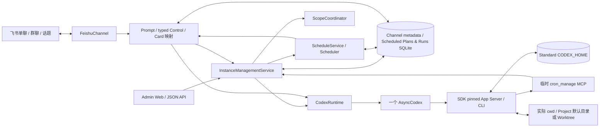

# Netizen Python Pilot 设计

## 工程概览

Netizen 把飞书单聊、群聊和话题接成 Codex 的消息 Channel。仓库唯一的生产实现是
`netizen_cli/` 下的 Python 包，由 `pyproject.toml` 构建和安装；没有 Node.js/TypeScript
运行时、构建面或 fallback。Node.js 仅用于 Admin JavaScript 行为测试，开发步骤见
[贡献指南](CONTRIBUTING.md)。完整用户行为见[用户手册](../skills/netizen-user-guide/references/user-guide.md)。

### 职责与对象关系

每个独立实例是一个常驻 Python 服务，内含一个 `FeishuChannel`、Store、Runtime、Scheduler 和共享
`AsyncCodex`。Channel SDK 负责飞书消息与卡片；Netizen 负责 Scope/Binding 路由、项目
登记、展示和定时交接；官方 `openai-codex` SDK 管理原生 App Server/CLI 上的 Thread、
Turn、历史、工具与权限。Admin Web 是同一应用边界上的管理入口，不能提交即时 Prompt
或浏览完整历史。环境更新协调器与实例重启的一次性进程是限定例外，见[架构](#架构)与
[系统维护 API](#系统维护-api)。
同账号可部署多个 root，各自管理自己的机器人和 Channel 状态，同时共享原生 Codex
用户状态；不因此增加业务 instance ID、权限隔离或跨实例服务依赖。

普通单聊、群聊主线或话题各是一个 Scope，可关联多个 Binding 和一个当前指针。
Binding 关联一个 Project，可显式选择其受管 worktree，并在物化后精确绑定一个 native Thread；
Thread 内可以有多个 Turn。`/new` 先创建 lazy Binding，第一条真实请求才物化 Thread。
切换当前 Binding 不停止其他 Binding 的执行。Side 是从已物化 Parent Thread 创建的
ephemeral fork，依靠独立话题 route 保留身份，不是普通 Scope/Binding；Goal 则在同一个
普通 Thread 内驱动多个物理 Turn。详细身份与生命周期见[核心模型](#核心模型)及
[运行与锁](#运行与锁)；请求材料与投递展示分别见[消息输入准备](#消息输入准备)和
[回复与活动展示](#回复与活动展示)。

### Netizen 与 Codex 的职责边界

Netizen 是 Codex 的 Channel 和管理适配层。它负责把用户意图映射为正确的 SDK 请求，
保持 exact Scope/Binding/Thread/Turn 身份、调用顺序、输入准入和本地状态，并如实交付
返回结果；Codex 通过官方 SDK/App Server 拥有原生执行、历史、工具进程和原生生命周期。
Netizen 调用公开高层 API；现有能力缺口只走已批准的窄 Adapter，继续遵守
[SDK 适配边界](#sdk-适配边界)的门禁和移除条件。

| 场景 | Netizen 负责 | 交给 Codex 决定 |
| --- | --- | --- |
| 用户 `/stop` | 按目标现有生命周期请求停止；普通活动 Turn 先 exact interrupt，再请求对应 Thread 的 terminal cleanup，处理成功、失败及未知结果。 | 中断执行和回收已登记 terminal 的具体机制与时序。 |
| 服务退出 | 关闭输入准入，按既有 Ordinary Turn、Goal、Side 生命周期请求停止本实例活动，在共同停服预算内尝试关闭 SDK、释放自身资源和锁，记录失败或预算耗尽。 | AppServer 收到请求和关闭连接后，如何结束原生执行及处置工具进程。 |
| resume 与后续 Turn | 恢复原 Thread ID，按公开返回确认运行、完成、中断、失败或观测未知，维护本轮槽位及用户反馈。 | 原生上下文恢复、调度及 Turn 执行。 |

请求成功只确认对应 SDK 操作的返回，不能扩张为“所有工具进程已经退出”，也不承诺
服务退出后 terminal 必须继续存活。Netizen 不为这两种结果额外扫描或 signal Codex
工具进程，不增加保活或托管机制。服务自身的 lifetime lock 不得被工具子进程继承；
程序更新协调器回收自己创建的包工具进程仍是 Netizen 的部署职责，与 Codex 工具进程分开。

`completed`、`interrupted`、`failed` 都是需要正确处理的原生终态；SDK 异常或无法确认
的结果不伪造为终态，也不自动重放可能已生效的请求。恢复与重试只使用既有操作契约
规定的范围和预算；不根据猜测的 AppServer 内部状态增加第二套执行或恢复编排。
停止请求失败时仍保留既有 stopping/unknown 约束；服务退出在剩余预算内尝试后续收尾，
失败或预算耗尽时如实记录，不能无限等待或宣称已完成清理。详细规则见
[失败语义](#失败语义)和[普通 Turn 终态与观测恢复](#普通-turn-终态与观测恢复)。

以上延续 [ADR 0009](adr/0009-use-version-gated-experimental-terminal-cleanup.md)、
[ADR 0010](adr/0010-correct-stop-and-background-cleanup-semantics.md) 与
[ADR 0049](adr/0049-bound-turn-observation-and-delegate-thread-removal.md)。它不把
`/stop` 的请求顺序扩展到 archive/delete：后者继续直接委托 AppServer 移除 Thread，
不预先 interrupt 或 cleanup。兼容性异常先检查 Netizen 的调用、返回处理和资源归属；
原生能力是否满足场景单独记录，不能以“适配层正确处理失败”宣称原生能力已经通过。

### 三条主要执行路径

| 入口 | 执行过程与结果归属 |
| --- | --- |
| 空闲会话收到普通消息 | 验证消息归属、引用、图片和所选上下文，校验显式 Skill 与会话配置，创建或恢复 exact Thread，启动一个新 Turn；结果回到原请求的投递锚点。 |
| 运行中的会话收到普通消息 | 经输入准备与身份校验后，steer 当前 exact Turn；不排队、不拼接成下一轮，不改变原任务的结果投递锚点。 |
| 定时计划到期或手动触发 | 唯一 Scheduler 认领到期点或手动请求；新话题目标创建普通持久 Binding 并提交初始 Turn，原会话目标固定 exact Binding 并按普通消息 start/steer。两者都不切换来源当前会话。 |

输入准备不能把历史消息变成新的控制指令或 Skill 调用；普通群聊参与者每次触发仍需重新 @机器人。
定时初始输入保留 Scheduled Plan 来源，后续交流沿用普通会话语义。具体准入、消息归属与
重试边界见[消息输入准备](#消息输入准备)、[锁与输入准入](#锁与输入准入)和
[定时任务](#定时任务)。

### 状态归属与维护原则

| 所有者 | 负责的状态 |
| --- | --- |
| Codex 原生状态 | 登录、Thread/Turn 历史、Goal、工具、Skills、MCP 与原生配置；Netizen 复用 effective user 的标准 `$CODEX_HOME`。 |
| Channel SQLite | Scope/Binding/Project 元数据、受管 Worktree 身份/创建回执及工作区选择、显式配置意图与 revision、聊天默认配置与有序群名规则、去重 TTL、上下文边界及不含 native ID 的 Side 路由墓碑；定时任务窄扩展保存当前计划指令与最小交接记录。 |
| 当前进程内存 | 活动 Turn/Goal/Side、锁与准入、订阅计时、Activity/usage 展示、Admin session 与一次性控制凭据；重启不自动重建这些执行或展示状态。 |
| 实例 state 目录 | 实例维护锁、初始化证据、ready/lifetime/runtime identity、迁移备份与有界 Admin 重启结果；不进入 Channel SQLite。 |

持久化清单和各项例外以[数据与配置](#数据与配置)、[定时任务](#定时任务)及
[部署事务](deployment.md#候选验证与切换)为准。普通 Prompt、回复、Turn 历史、已生效
Codex 配置与卡片 session 不复制到 Channel 数据库。内置 Skill 的清单和安装包加载边界统一见
[候选验证与切换](deployment.md#候选验证与切换)，其他用户 Skill 保持原生管理。

不同 Binding、Parent 与 Side 可以并发使用同一个实际 cwd，文件改动彼此可见；
不能以全局 semaphore、Project lock、目录副本或独立 `CODEX_HOME` 隔离它们。飞书展示
尽力完成，失败不改变原生执行；文件必须来自 exact Turn 证据，不能靠扫描目录补齐。
未知副作用按各操作规定的范围 fail closed，不能把观测失败当成任务已结束。停止、
归档、删除与 Goal 完成各有独立契约，修改前直接读[运行与锁](#运行与锁)和
[失败语义](#失败语义)及其引用的 ADR。

SDK 使用精确固定的官方版本与公开高层 API。已批准的能力缺口 Adapter 各自保留
capability 或版本/指纹门禁及移除条件，不扩展成通用 RPC 层；兼容事实与按需 live
验证入口在[部署文档](deployment.md#代码门禁与按需实时兼容性验证)。

## 目标与边界

定时任务的行为见[定时任务](#定时任务)，架构决策见
[ADR 0061](adr/0061-schedule-ordinary-threads-in-feishu-topics.md)，兼容性范围及发布前验收
要求见[部署文档](deployment.md#定时任务兼容性与验收)。

目标是让少量受信用户在一台受支持的 Linux 或 macOS 主机上，通过飞书单聊、群聊和话题使用原生 Codex。
飞书只是新的 Channel；历史、工具、Skills、MCP、配置、sandbox 和认证仍由 Codex
管理。Project Registry 可通过飞书项目管理卡片或 Admin Web 管理；当前仍不实现审批卡、Codex 原生配置
值的 idle read/update、文件/音视频作为 prompt 输入、流式 token、HA 或
durable queue。普通 Turn 的结构化本轮文件可在终态卡片中按需发送；普通图片
和富文本图片按 [ADR 0015](adr/0015-support-native-image-inputs-for-message-and-quote.md)
作为原生视觉输入支持。

同账号多实例只分开部署与运维，不形成数据保密或执行隔离边界；按机器人登记不同
Project 不限制工具读取该账号可访问的其他文件，Codex 用户状态仍共享。

### 受管 Worktree 与实际目录

[ADR 0085](adr/0085-manage-worktrees-independently-of-sessions.md) 定义独立资源与共享
语义；产品展示统一使用小写 `worktree`，命名约定见 [worktree 词汇](../CONTEXT.md#worktree-词汇)。
Admin、飞书 `/new`、默认会话自动创建、定时新话题和 Agent 工具共用 `WorktreeService` 与窄 Git 后端，只管理
本实例通过该服务创建并登记的资源；不会收编 shell Git、Codex App/CLI 或其他实例的工作区，
也不写 Codex 私有索引或宣称生命周期互通。Worktree 不属于某个会话私有，删除或归档
单个会话不会顺带回收目录。

人工入口默认从所选 Project 当前 HEAD 创建 detached checkout，可显式检出未占用的
本地分支或从选定 revision 建新分支；远端分支仅作为起点。Admin 与飞书创建表单直接
填写起点 ref 或本地分支名，不预加载全部分支，也不以分支数量限制已有 worktree 选择。
创建时仍校验实际 ref、分支占用、资源身份与 Project revision。已有工作区只复用，不隐式
切换分支。Project 位于仓库子目录时，新目录保留对应相对子目录；目标提交缺少该目录
就明确失败。只检出提交内容，不搬迁 staged/unstaged、untracked/ignored 文件，不运行
environment/setup，也不提供快照恢复、自动回收、Handoff 或孤立资源重新关联。
`/fork` 不新增创建/选择 worktree 功能；既有 native fork 仍继承来源实际目录。

创建工作区并登记成功与创建 Binding 是两个步骤：后者失败仍保留前者，Admin 可管理、
后续 `/new` 可复用。创建结果未知保留登记和已知路径，不能盲目重试、自动删目录或把
不完整创建冒充可用。能够证明工作区创建尚未开始的准备失败只撤销本次预留登记，不动
目录；创建已经可能开始后，即使后续命令没有启动也不能丢弃创建证据。目录选择不扩展
Codex 文件访问权限，原生执行、信任和权限仍由 SDK 处理。

Project 是归属与默认目录；lazy Binding 保存显式 `working_cwd`/`worktree_id`，没有
显式选择才取 Project 默认目录。已物化 Thread 由原生 cwd 决定，不能从 Project 猜回。
提交入口的 cwd 仅表达新建 Thread 的目录意图；Runtime 在取得或复用 Thread 时确定
执行目录：新建采用选定目录，恢复读取本次原生 cwd，复用活动 Thread 则同时复用其
已确认目录。调用方不再为已有 Thread 提前读取或传递执行目录。
ordinary/Goal、Skill、Side、持久 fork、模型创建、已有 Binding 定时输入及相对文件/图片
解析均使用实际目录；新话题定时计划使用独立工作区策略。目录缺失时保留历史和原 cwd、
提示缺失并按 Codex 实际返回处理后续请求，不统一禁聊、不静默回主目录或重建文件。
Project 默认目录本身缺失时，`/new` 沿用既有 Project 不可用检查，由用户修复；不以
已有 worktree 绕过该准入或自动恢复 Project。

Admin `/worktrees` 进入、分页及手动刷新时查询当前页，列表仅检查目录身份与 HEAD/分支，
不扫描全部 dirty 文件；查询失败显示未知，不当成 clean 或已删除。路径重建也须匹配登记
身份。删除前才检查未保存文件（包括 ignored/untracked）、未保留 detached 提交、已知
会话/Side/创建来源活动及 exact 清单，二次确认后重新复核；不会强制 Git 删除或递归清理兜底。
“同时删除关联会话”默认不勾选；勾选后先走既有 native delete 链路再删除目录。成功项
不回滚，部分失败或未知结果须刷新后重新确认。外部使用无法完整探测，页面明确说明此限制。

配置复用实例 `config.yaml` 的 `worktrees.root` 与 `fetchBeforeCreate`：默认根为
`<instance-root>/worktrees`、fetch 关闭；改根只影响后续新建，开启 fetch 后失败则停止
创建。实例卸载/purge 不删除 Worktree 成果，但 purge 清理数据库后受管登记也消失，
保留目录不会被自动重建登记或收编。部署与真人验收状态见
[Worktree 专项验收](deployment.md#受管-worktree-专项验收)，不能以文档存在视为已部署或 live 通过。

## 架构

业务只有一个 Python 服务。Admin/MCP listener、唯一 Scheduler 和 `FeishuChannel` handlers
都运行在 Channel background loop，且只构造一个 Store、Project Registry、Runtime 与 `AsyncCodex`。App
Server 是 `AsyncCodex` 的子进程，不是第二套业务服务。

代码按职责归属组织，目录拆分不新增运行实例或状态所有者：

| 位置 | 职责 |
| --- | --- |
| `netizen_cli/main.py` | ServiceCore 装配并负责共享管理服务、Scheduler、Runtime、SDK 和 Store 的生命周期；管理服务注入各入口适配器。 |
| `netizen_cli/channel_app.py`、`netizen_cli/channel/` | ChannelApplication 负责准入、Runtime 提交和完成事件编排，并装配、关闭同一表情控制器和回复卡片呈现器；展示会话留在各自对象内。 |
| `netizen_cli/channel/input_preparation.py` | MessageInputPreparer 负责当前、引用和 catch-up 材料的读取、校验与图片准备，返回 typed PreparedInput；ChannelApplication 继续捕获 admission、组装 Context Boundary 提交参数并发送可见回执，Runtime 确认接受后才推进边界。 |
| `netizen_cli/message_content.py`、`netizen_cli/message_preparation.py` | 前者统一当前、引用和补充消息的纯内容投影；后者共享公共 SDK 卡片补读，由消息准备组件复用。控制意图仍由 Channel 入口判定。 |
| `netizen_cli/cards/` | `controls.py` 负责管理卡片和表单，`reply.py` 负责回复、Activity、Files，`callbacks.py` 集中共享回调协议及基础组件；包入口显式导出公共接口。 |
| `netizen_cli/admin/` | `web.py` 集中路由、认证、一次性授权与请求任务生命周期；`queries.py` 负责查询和分页游标，`presentation.py` 负责响应转换。 |
| `netizen_cli/management/` | 各管理入口共用的应用边界，包括 `updates.py` 中的安装信息与本实例重启编排。 |
| `netizen_cli/schedules/` | 当前计划、时间规则、最小交接记录、唯一调度器和单工具 MCP 入口；复用同一个 BindingStore writer 与普通 Runtime。 |
| `netizen_cli/deployment/` | 有界 Admin 重启记录、维护锁与独立重启 job。 |
| `netizen_cli/runtime/contracts.py`、`netizen_cli/codex_runtime.py` | 前者唯一定义公共协议、异常、输入输出和快照；后者继续独占任务、Goal、Side、订阅和锁，并保留原公共类型导入路径。 |

程序分发与实例数据由 [ADR 0076](adr/0076-separate-cli-installations-from-instance-data.md)
分开：`netizen_cli/cli.py` 提供命令，`cli_services.py` 控制精确系统服务，
`cli_data.py` 负责显式初始化、启动校验和迁移，`cli_packages.py` 限定包维护方式，
`cli_update.py` 与包替换范围外的临时协调器负责环境级更新。程序及依赖由用户 Python
包管理器维护；不会为每实例生成 release 或 venv，也不增加常驻总控服务。

## 核心模型

### Scope、Binding 与会话配置

Scope 分为 P2P、群聊主线和真实 topic。Binding 保存本地 UUID、Scope、Project
alias、可空 write-once native Thread ID、可选的 Binding-scoped Model/Effort/Speed
目录 ID、settings revision、Mention Context Mode、Context Boundary、context revision、
creator 和时间；Scope 只保存 active Binding 指针。P2P 固定为 `current-only`；普通群聊
主线与群话题可在 `current-only|catch-up` 中选择，默认 `current-only`。Side 不是普通
Binding，也不形成配置继承链；创建时冻结 Parent 当时的 Model/Effort/Speed 与 Task
Feedback，之后独立，Mention Context Mode 固定为 current-only。

exact `/new` 保留原有手动创建入口；任何 `/new ...` 参数都零 mutation 地拒绝。
它打开 Card 2.0，提交创建包含 Project、可选工作区、Turn Settings 和 Mention Context
Mode 的 lazy Binding；选择新建工作区时先创建并登记目录，不要求任务、不创建 native Thread；完整表单及目录降级语义见
[新建与配置表单](#新建与配置表单)。没有当前 Binding 的普通输入还可按
[聊天默认配置](#聊天默认配置与自动创建)自动创建；`/new` 不读取这些默认值或改变预填行为。
下一条需要启动新 Turn 的普通消息执行：

1. 若有 Binding 配置，在进入 native mutation 前重新调用 live `codex.models()`，按所选
   Model 验证 Effort/Tier 并解析 wire value；
2. lazy Binding 调用 `thread_start(cwd=所选实际目录)`，无显式选择时使用 Project 默认目录；若有 Binding 配置，
   同时传入本次 live resolve 的 `model`，使原生 Thread 按首轮所选模型初始化。随后
   write-once 保存 Thread ID；已有 native ID 则只 `thread_resume(exact_id)`；
3. `thread.turn(prompt, **override)`，没有 Binding 配置时 kwargs 为空；
4. native handle 返回并完成 ID 校验后保存内存 active Thread/Handle，随后后台轮询公开
   `thread.read()` 的原生状态；Binding 配置不清除，供后续新 Turn 重复使用。

新话题计划触发按 ADR 0061/0068 增加显式的普通会话入口：先认领到期点或手动请求，在目标会话创建独立 topic，
原子登记新 Scope/Binding，再用仅允许初始 start 的 Runtime 入口执行计划。它不 fork、
不创建 Side、不继承来源聊天历史，也不修改来源 active pointer。计划创建时复制来源的会话
配置意图并独立保存；每次认领冻结配置，交接时应用到新 Binding。计划首轮使用
Scheduled Plan 来源，不伪造真人 Current Prompt Message；新话题的机器人 seed 是完成
投递锚点。后续消息、停止、归档、删除和反馈使用普通会话语义。

[ADR 0070](adr/0070-schedule-inputs-in-existing-bindings.md) 增加原会话目标：固定 exact
Binding，使用普通消息准备、准入和 start/steer；当前配置、catch-up、反馈和 Runtime
故障规则均取自该会话。真实触发消息只是完成/表情锚点，输入保持 Scheduled Plan 系统来源。

已有 native ID 时只调用 `thread_resume(exact_id)`，不传 cwd、approval、sandbox、
model、config 或 env override。
开始普通 Turn、Goal、compaction、Side fork 或 rename 前，若这一 exact resume RPC
返回公开 SDK `InvalidRequestError`，且 code 为 `-32600`、message 精确等于
`thread <exact_id> already has an active writer`，视为明确的占用拒绝：只拒绝本次操作，
不关闭全局 admission，不建立活动槽或改变 Binding/native identity，不自动重试、归档、
清理或转移会话。提示用户在持锁的 Codex App 或 CLI 内归档，再从飞书
`/sessions archived` 恢复并切换。其他会话和管理功能仍可使用；占用释放后用户可重新提交。
错误类型、code、Thread ID 或完整 message 不匹配，以及取消、响应丢失、start/turn/fork
等其他 mutation 的错误，继续遵守原操作的未知副作用规则。这一窄分类只在 resume RPC
边界生效，不检查异常链或其他操作抛出的同名消息。归档恢复按 ADR 0082 区分后续 resume
的明确拒绝、部分成功与未知结果，只有未知结果保留 Binding-local lifecycle-unknown；
已启动 Turn 的观测恢复保留原 exact Turn 与观测状态。
普通消息（含 Skill 准备）与 Agent 跨会话入口也共用 ADR 0078 已验证的归档、不存在、
关闭中拒绝分类：保留 Binding，只拒绝本次输入，不关闭其他会话准入。错误返回身份和
其余未知 resume 结果仍沿用原有保护；不自动重建 Thread、清理绑定或重试。
`thread.turn()` 若没有返回 handle，其副作用结果无法确认：服务立即关闭全部新
admission 并要求重启，不能把 Binding 当 idle 再启动第二轮。

没有 Binding 配置时 `thread.turn()` 不传 `model`、`effort` 或 `service_tier`，由共享
标准 `CODEX_HOME` 的原生 Codex 默认值或既有 Thread 当前设置决定。有配置时，Netizen
在自己启动的每条真实 `thread.turn(input, model=..., effort=..., service_tier=...)`
上重新校验并显式应用。
`/config` 不调用带 override 的 `thread_resume()`，也不声称能读取 Thread 当前值。
模型目录失败、选项下线或不兼容时不会 start/resume/turn，Binding 配置保留供用户重新
配置；`turn()` 返回结果未知时同样保留并关闭 admission。

running Turn 的普通输入仍只调用 exact handle `steer()`：即使 Binding 有配置，也不读取
模型目录或应用它。`/config` 在 running/stopping、Goal active
或 compacting 时明确拒绝。settings/context revision 同时进入 submission admission；
引用、补充历史、图片或 Skill 准备期间配置或 Context Boundary 发生变化时，本条消息不
执行并要求重发。

首个 real prompt 调用 `thread_start` 后，先把返回的 native ID 原子写入 Binding，再
发送首 Turn；写入失败或冲突时关闭新 admission，且不发送 prompt。每次 cleanup 前还
会核对 handle Thread ID、`AsyncThread.id` 与 Binding 的 write-once native ID；若
handle 回报不同 ID，关闭 admission 且不对不可信 handle 执行 interrupt/cleanup。

### 聊天默认配置与自动创建

[ADR 0073](adr/0073-create-sessions-from-chat-defaults.md) 增加按聊天配置的会话默认值。
配置属于 exact App/chat，供该聊天中的单聊主线、群聊主线和普通话题使用；本次消息的
真实位置决定 Scope，不由默认配置创建或选择话题。已有 active Binding 时直接沿用，
不重新匹配默认值；只有通过现有来源与 mention 准入的普通输入在当前 Scope 没有当前 Binding
时才尝试自动创建。Control、Side 路由及其墓碑、Scheduled Plan 仍走各自入口，不借此
创建普通会话。群聊及群话题仍逐条要求 @，单聊及其话题仍不要求 @。

默认值只有两种匹配方式：

1. exact chat 配置，每个 App/chat 最多一份，优先于任何群名规则；
2. 同 App 内按已保存顺序逐条判断的群名规则，首条包含关键词的规则命中即停止。
   关键词不得为空，使用 `casefold()` 忽略大小写，不支持正则或类别兜底；仅群聊适用。

一次采用命中规则的完整配置，不跨规则拼字段。配置保存 Project alias、独立工作区策略、
可选 Model/Effort/Speed、三个 Task Feedback 开关、过程卡展示设置与 Mention Context Mode；Project 必填，
会话设置沿用现有创建默认值及 inherit Codex 语义，P2P 固定 current-only。它不是 effective Codex
配置，也不含 Prompt 或业务流程。创建意图应用于新 Binding，后续修改或删除默认值、修改
规则顺序或群名，都不改变已创建的 Binding，包括尚未物化的 Lazy Binding。

工作区策略独立于 SessionSettings：`project` 使用项目目录，为现有配置的兼容默认；
`existing` 保存 exact 受管 Worktree ID，实际使用时复用 `WorktreeService.select()` 校验；
`new` 为每个自动新建 Binding 创建一个 detached 工作区，可选 `ref` 为空时使用创建当时
Project HEAD。只检出提交内容，不复制未提交文件，不提供固定分支名或命名模板。保存
默认配置不创建资源；实际创建复用共享 Worktree 服务及其 Project/删除准入。已有 Binding
不重跑策略；显式 `/new` 和新话题定时计划不读取默认值，后者使用计划独立保存的工作区策略。

无匹配则走原有无会话引导。匹配配置不可用（例如 Project 不存在、停用，或模型设置
失效，指定 Worktree 已删除、目录缺失/替换或状态无法确认）时，先明确说明默认配置
不可用，再走同一引导；不继续尝试下一条规则、不切回项目目录、不自动重建指定资源。需要群名
但查询失败时也明确说明无法判定，不冒充未命中。Project 删除不联动清理或禁用默认值，
Worktree 删除也不清理引用规则；默认规则不参与两者的删除级联。Project 仍按 alias 解析，
允许同名重新登记后恢复使用；已有 Worktree 必须同时匹配 exact ID 与当前 Project 登记代次，
不能因同名 Project 或同路径新资源出现而恢复旧引用。`new` 不引用上一次创建的工作区，
此前资源被删不使策略本身失效。修改或删除默认配置不会回收工作区。

自动创建组装现有创建参数，复用同一个 management service；不伪造 `/new` 消息、卡片
或回调。在现有 Scope 锁内重读 pointer，已有时返回对应 Binding；缺失时同 Scope 的
并发首消息共享一次创建结果。Git 准备在锁外执行，提交 Binding 前回到 Scope 锁内复核
pointer 和资源准入；不让慢 Git 操作长期占有 Scope 锁，也不覆盖手动 `/new` 已提交的会话。
消息随后固定使用返回的 Binding 并进入普通输入准备和 Runtime admission；共享创建结果
不保存 Prompt，不引入串行消费或排队。两条并发消息最多自动创建一个 Binding，`new`
策略也不重复创建工作区，但仍可能由现有准入拒绝其中一条，不保证触发创建者先提交。
手动 `/new` 仍可创建另一 Binding 并切换；准备期间目标已切换的输入按原规则拒绝，
不改投新目标。
若手动 `/new` 在 Git 创建期间先提交，则自动创建返回该已有 Binding，创建者得到未采用
工作区的保留提示；等待共享结果的其他消息不重复发送此提示。消息取得目标后才发生的
切换继续由原准入拒绝。保留提示发送失败不阻断已确认目标的正常输入。

catch-up 自动创建以触发消息的真实 marker 初始化边界，这条消息同时作为首轮请求；
初始化不等于输入已经接受，不能丢弃或重复提交首条请求。首轮仍准备当前正文、引用和
图片，不读取该起点之前的补充历史，之后复用普通 catch-up 及 native 接受后的 cursor CAS。
会话创建成功后的准备、准入或原生执行失败遵循原有失败语义，保留该 Binding，不回退成
“未创建”或自动重放。状态未知的已有 Binding 不视为缺失；归档或删除明确清空 pointer
后，下一条普通输入可再次按默认配置创建新 Binding。
工作区创建与 Binding 创建仍是两步；已创建工作区在 Binding 失败后保留并反馈已知结果，
可通过 Admin 管理、之后的 `/new` 复用。未知创建结果沿用 Worktree 服务的保守处理，
不自动重试、不自动删目录。带资源副作用的失败或未知交接不因当前已有另一个会话而
被吞掉，本条消息先反馈已知结果且不提交任务。

### 原生压缩

`/compact` 使用基于公开 `AsyncThread.compact()` 和 history read 的压缩 controller。
它先在独立 5 秒、至多 3 次 read 预算内记录已有 Turn ID 并确认 idle；持续 Internal、
`notLoaded` 或悬挂 read 耗尽预算时，尚未启动压缩，安全失败并释放 Binding 锁，保持
已有的全局 admission 状态。随后保留 Binding 的 `compacting` 槽位，直到
`thread.read(include_turns=True)` 出现且仅出现一个新的 terminal
`contextCompaction` Turn 且 Thread 回到 idle；首次 idle read 不能单独证明完成。压缩完成后
可在同一连接、同一 Thread 续聊，命令进入 `/help`。完整决定见 ADR 0013；已验证的版本
和覆盖范围见[兼容性结论](deployment.md#已验证的兼容性结论)。

### 原生 Goal

`/goal <objective>` 在当前 Binding 上启动原生 persisted Goal。lazy Binding 先创建并
write-once 绑定零 Turn Thread，公开 read 确认 idle、非 ephemeral 和原生 path 后直接
沿用创建返回的 handle；这些 metadata 不证明首 Turn 前可按 ID 冷恢复，相关限制见
[兼容性结论](deployment.md#已验证的兼容性结论)。若无法确认上述状态，Goal 明确不可用。
Adapter 返回一个 opaque logical handle，SDK 自己把自动
continuation 的多个物理 Turn 合并为一个通知流。按
[ADR 0084](adr/0084-separate-goal-controls-from-logical-turn-replies.md)，`/goal` 发送独立
静态管理快照；刷新、pause/resume/clear 和命令进入同一 typed control 路由。管理卡显示
objective、tokens used、可用预算及控制按钮，不自动刷新、不包含任务答案或 Files。
切换 Scope 的 active Binding 不改变按钮的 exact Binding 目标。任务回复以整个 SDK
logical stream 为单位复用普通回复链：过程卡、阶段性答案、终态、富文本和文件遵循普通
任务的展示规则，不为每个物理 Turn 发新卡，也不强制开启过程卡。
Goal Activity 不通过普通 queue observer 读取；Adapter 在现有 logical stream 的唯一消费链
内先做安全 Tap，再把原通知交还 SDK。每次 exact `turn/started` 切换物理 Turn 时，Runtime
原子替换 physical identity，并清空上一轮 checklist、commentary、operation 与 cursor；
迟到旧 Turn 事件忽略。阶段性答案跨物理 Turn 保留，Activity 每轮重置，中间 Turn 不产生
Result/Files；logical terminal 只用 exact 最终物理 Turn 的输出和 structured files，不回退、
不拼接历史，也不扫描工作区。

### 普通会话生命周期

会话生命周期的命令入口按 [ADR 0017](adr/0017-manage-native-thread-lifecycle.md) 与
[ADR 0037](adr/0037-reconcile-native-thread-delete-with-a-thin-gap-adapter.md) 管理当前 Binding，
运行态观测与 Thread removal 委托按
[ADR 0049](adr/0049-bound-turn-observation-and-delegate-thread-removal.md)：
`/rename [name]` 写原生 Thread name；`/archive` 先显示确认卡，提交时再次确认 exact
Binding 仍为 Scope active。归档成功后只清空 active pointer 并保留 Binding/Turn
Settings。`/delete` 为 Lazy Binding 显示只删本地记录的确认卡；materialized Binding
还把 exact native ID 固定进危险确认卡，只有本次原生正常返回后才删除本地 Binding；
失败按 [ADR 0078](adr/0078-fork-persistent-sessions-and-trust-native-lifecycle-results.md)
保留关联，不通过目录缺项推断删除成功。
按 [ADR 0067](adr/0067-name-threads-with-private-ephemeral-forks.md)，新 Turn 成功启动后
在后台为无名称且无在途命名任务的会话补名；steer 不触发。内部 ephemeral fork 使用
原生上下文快照，不建立 Binding/Side route，不进入会话统计或任务反馈。生成失败不影响
主线；失败已确认结束后，下一次新 Turn 可再尝试。所有名称写入共用每 Binding 一把名称锁：
自动拿不到锁就退出，手动按顺序等待覆盖；等待不持 Scope/Binding 锁，不阻塞其他会话操作。
管理入口固定 exact 目标后释放 Scope，后续切换不重定向已接受的请求。实际写入 worker
拥有名称锁，外层取消不会提前释放；锁不持久化。归档/删除使旧生成结果失效，自动写入
失败不产生 lifecycle UNKNOWN。
`/rename` 卡片和 Admin 重命名弹窗提供“自动生成”，共享 ADR 0067 的临时 fork、
结构化标题校验与清理。显式生成允许已有名称，只返回候选；保存才写入名称。
点击即放弃原输入，生成期间不可编辑或保存，成功回填可编辑候选，失败留空并提示重试。
两端不保存草稿；后台补名与显式生成共用每 Binding 单任务占位。模型 I/O 不持
Scope/Binding 锁，不阻塞主会话；生命周期操作使旧生成失效，关闭/保存后的迟到响应
不覆盖界面。飞书先更新生成中卡片并后台执行，Admin 使用独立一次性生成授权。
普通 `/sessions` 显式读取 `thread_list(archived=False)`，`/sessions archived` 显式读取
`archived=True`，归档状态与名称都不进 Channel Database。`/resume`、普通列表卡片的
“设为当前”和 Admin 同类动作共用 exact activation：保留本地身份、lifecycle 和消息边界
检查，有 native ID 时直接调用一次公开 `thread_resume(exact_id, include_turns=False)`，
不先用 list/read 检测存在性，不传设置或权限 override。成功返回同一 ID 后登记普通订阅，
再提交 current 与 catch-up 新边界；Lazy 只做本地切换。明确的归档、不存在、占用、正在
关闭拒绝保持 Binding/current，并反馈对应原因；按已验证异常类型、code、完整消息与 exact
ID 分类。未知 resume 结果沿用全局 admission 关闭，原生成功而本地提交失败则反馈部分
结果并按已有机制交还订阅。切换不停止旧任务、不替换已有活动 handle，也不增加 idle
前置。Netizen 不为切换显式发起 Turn；原生 cold resume 可继续 persisted active Goal 的
旧行为本次不改造。按
[ADR 0036](adr/0036-archive-exact-idle-sessions-from-the-sessions-card.md)、
[ADR 0038](adr/0038-delete-exact-idle-sessions-from-the-sessions-card.md) 与 ADR 0049，每个
materialized persisted 行都可确认后 exact archive/delete，不以本地 Turn、Goal、Compaction
或观测状态作为资格门禁。Runtime 只占用 exact Binding 的 lifecycle intent 阻止新 Turn，
然后释放 Binding/Scope lock 并直接委托 App Server。inactive 目标保持 active pointer，当前目标
清空 pointer。Lazy 删除仍只删本地 Binding。`/sessions archived` 为 exact archived Thread
提供独立两阶段 Delete，并与 active 列表共用同一原生 primitive；最终只把 root ID
交给 App Server 级联删除 spawned descendants。归档恢复仍显式选择目标：
`/unarchive <短 ID>` 或归档卡按钮恢复 exact native ID 并切换 Binding。

归档恢复按 [ADR 0082](adr/0082-restore-archived-sessions-from-exact-native-results.md)
保留 Scope 协调、Binding 锁与本地 lifecycle/上下文校验，直接调用一次公开 unarchive，
不先 list/read。正常返回同 ID，或精确的 `InvalidRequestError/-32600` 与
`no archived rollout found for thread id <exact_id>`／
`thread <exact_id> already has an active writer` 两种已验证的移动前拒绝，才继续一次
同 ID resume。前者不能区分已恢复和缺失，后者也可能是本连接 loaded/running；不单凭
unarchive 拒绝判断状态或 owner。其余未知结果停止链路，不追加目录对账或自动重试。

resume 返回同 ID 后先保留普通订阅，再提交 current/context；目标已经是 current 时
保留现有 Context Boundary 与 context revision，Admin 仅恢复也不修改它们。允许保留
exact handle 的普通 `RUNNING` 和 Goal `RUNNING` rejoin，不替换执行 handle/观察者；
Compaction、普通 `STOPPING`／`OBSERVATION_UNAVAILABLE` 和 Goal 的其他活动或未知状态
继续在原生调用前拒绝。resume 明确归档、缺失、writer 或关闭拒绝释放本次 reservation，
保留本地关联和原 current/context；unarchive 已成功则反馈部分成功。原生或本地提交
结果未知保留目标 Binding-local lifecycle-unknown，已知订阅仍交还既有释放边界，旧准备
输入失效；不保证本地事务回滚。卡片更新失败不改变已确认结果。

### 持久分支创建与交接

`/fork` 按 [ADR 0078](adr/0078-fork-persistent-sessions-and-trust-native-lifecycle-results.md)
从当前已物化、持久且确认空闲的普通 Binding 创建普通持久分支；运行中、停止中、压缩中
及 lifecycle/观测未知时拒绝，暂停且空闲的 Goal 可作为来源，但不接管来源 Goal。
默认在当前聊天另建话题，也可选择机器人已加入的其他群或填写可访问的群/单聊 ID；
不接入已有话题或改变来源 current。跨群目录通过共享 Management 的 `query_available_chats`
查询，展示补查使用 `validate_available_chat`；最终提交的所有目标通过 `validate_chat_target`
复核，复用既有 FeishuChatDirectory 和官方客户端，不经过 Admin HTTP 或增加权限层。
创建卡使用一张表单，同时填写名称和目标飞书聊天；指定方式共用“当前聊天、选择群聊、
填写聊天 ID”三选一，新建默认当前聊天。当前聊天包括单聊和群聊，在话题内指所属聊天，
不代表接入原话题。打开时仅展示已选群，不预载群目录；群结果只放具体群，不混入
“当前聊天”特殊选项。Cron/Fork 共用“群名关键词 → 查找群聊 → 本页结果下拉 → 页码跳转”
组件，并与 Files 共用无表单包装的页码控件、严格选页解码和完整列表切片。
显式查找在 8 秒总预算内按平台游标收齐本次结果，每次请求 20 项、最多 20 次，
完整结果最多 200 群；超时、未读完或超限明确提示细化关键词/填写 ID，不展示部分结果。
空关键词查找机器人已加入的群；有关键词时远端搜索可选群。结果形成只含必要群身份、
名称、外部群标记、头像 key 和查询说明的卡片快照，每页显示 10 群及保留的已选群。
完整快照只放在唯一“跳转”按钮中，页码选项只携带页码；通过本次表单回调重绘任意页，
不重新查询群目录或上传头像。各页整卡都检查 55,000 bytes 和既有 200 组件预算，计入
完整快照、页码选项及页内/页外已选群说明，不截掉模型、Project 或群候选。
重新查找回到第一页并清空旧结果选择；跳页沿用原快照，保留已选目标、尚未提交的新
关键词和其他表单草稿。单页不显示导航，空结果不生成空群下拉。原生下拉若自带本页
过滤，不作为全群搜索入口。
“新建话题”只在字段说明中出现，候选显示群名和头像，同名时补短 ID。查找失败明确提示，
保留草稿供重新查找或填 ID，不将失败当作没有群。不增加服务端目录缓存或卡片 session。
快照只用于展示，群信息变化要重新查找；最终提交仍实时校验目标，不将快照当作授权证据。
群候选尽力展示群头像。目录只透传受支持飞书 CDN 的 HTTPS `avatar` URL，
图片来源、浏览器 CSP 与公开上传 allowlist 共用精确主机集合；当前支持官方头像示例中的
`p3-lark-file.byteimg.com`、`s1-imfile.feishucdn.com`、`s3-imfile.feishucdn.com`，未知来源降级。
Channel 使用公开 `upload_media(MediaSource(kind="url"), kind="image")` 取得卡片图片 key；
首次查找为本次最多 200 群准备头像，初始表单只准备当前/保留目标；实例最多 4 路并发，整批
预算 4 秒。已完成的 key 随快照携带，不因进程内 URL/key 缓存淘汰而丢失。成功 key 按 URL
在进程内最多缓存 128 项、10 分钟，不缓存目录或成员关系，不写 SQLite。
初始或错误表单的当前群/保留目标展示查询各限 2 秒，
失败不新增创建门禁；头像缺失、下载或上传失败时群选项降级为通用图标，聊天类型未确认
则保留文字，不改变 callback 中的目标 ID 或提交复核。飞书 `/cron` 新话题表单复用
这套群选择、头像和有界加载。两者以原生单选确定使用当前聊天、群选择还是手填 ID，
独立字段可同时保留内容，但提交只采用所选方式：选群必须非空，ID 去除首尾空白后必须
非空，均不回退其他字段或当前聊天；模式切换不回调、不重绘。不保留旧卡字段转换或
旧版空值语义解析，已保存的任务和分支不受影响。
Fork 将目标区标为“分支位置”，方式下拉与群搜索、结果分页、聊天 ID 输入始终可见；
下方输入通过浅色背景和内边距归组，精简重复说明。所有控件仍在同一个表单内，
切换方式只改变本地选择，不请求后端刷新，也无需展开额外区域；查找、翻页和创建
仍由按钮提交。分组不改变字段提交和目标解析。Cron 沿用现有平铺布局。

公开 `thread_fork(ephemeral=False, include_turns=False)` 继承原生历史和权限；分支与来源
共用 Project 和来源实际 cwd，匹配受管工作区时保留关联，复制显式 Model/Effort/Speed、Task Feedback 和上下文模式，之后各自独立。
目标为单聊时仅将后续飞书补读模式归为 current-only，来源设置与已继承的原生历史不变。
不复制有效配置或聊天消息游标、不强制覆盖原生权限、不建立工作目录副本；catch-up 初始
边界取新话题 root/seed。分支完成后使用全部普通会话操作，重启也按普通持久会话恢复。

创建顺序固定为原生 fork → 唯一“创建中”根卡片 → 真实 topic ID → 完整 Binding 原子落库
并设为目标 current → 登记原 fork handle 的普通订阅 → 原地更新根卡片为成功。
成功卡以分支名称为主标题、“会话分支已创建”为副标题；目标根卡提示在本话题继续，
不显示跳转自身的按钮，仅来源回执提供“进入新话题”链接。必要的 seed 仍属于同一话题，
使用查看顶部卡片创建结果、成功后再继续的固定说明，不持续声称正在创建。
没有 Lazy 占位 Binding，也不发送首轮模型任务。
每次交接复核 exact 身份、Project revision 与目标未占用。创建中提示“请等待创建完成后
再发送消息”；不增加专用输入拦截。提前输入可能先按目标默认配置建立并执行普通会话，
随后 fork 因目标占用失败；fork 先提交则输入使用分支。无可用默认配置沿用普通未建会话
反馈，不排队或重放。不能覆盖已建立 Binding 或把它冒充 fork 成功。

进程内在途调用所有权覆盖从第一个副作用到完整交接，服务停止和 Project 删除使用既有
有界收尾。Project 删除遇到在途 fork 时保留停用 Project，要求收尾后重新预览确认；
不得晚到绑定已停用或删除的 Project。创建失败不自动重试、补偿删除或按名称猜认；
已知 handle 按普通订阅边界交还。完整 Binding 已保存时，命名/回执失败仍保留该会话。
极端中断留下的未绑定 Thread 或话题按 exact 证据人工核查，不增加持久恢复队列。

卡片沿用同类 controls 的公共去重、FIFO、callback 编码和 revision/exact identity
校验；不写 fork 专属 SQLite 去重键或卡片 session。查找、跳页、创建通过公开按钮 callback
value 区分，不依赖按钮名称；v5 提交按钮通过公开 callback value 携带一次来源 Scope/Binding/
revision，选项只保存目标 chat ID，名称和目标通过 `form_value` 一次提交，沿用 ADR 0058
已验证的 value + form_value 组合。查找、跳页和创建均用公共 nonce，重绘更新 nonce。
只解析当前表单协议，不维护旧卡兼容；空名称、空选群、空 ID 或目标校验失败保留表单。
受理后显示创建中，成功后移除提交入口。发生原生副作用后不能因失败重新恢复可提交表单。
完整卡片按 SDK 的 UTF-8 JSON 序列化检查 55,000 bytes 和 200 个元素预算，超限时明确
说明仅保留当前和已选聊天，保留草稿并提供缩小群名查找入口，不截断可搜索群名或静默漏项。

### Side 创建与路由

`/side [首轮问题]` 按 [ADR 0021](adr/0021-support-multi-turn-ephemeral-side-topics.md)
从当前 exact active、materialized Parent Binding 创建
`thread_fork(parent_id, ephemeral=True)`。Parent 普通 Turn 正在 running 时允许，
stopping、Goal、compaction、lifecycle unknown、外部 active 或 Lazy Binding 拒绝。
fork 后读取 exact ID/ephemeral/parent shape，并通过固定 Side Adapter 在继承历史之后、
首轮用户问题之前一次性注入边界。固定模板保留继承历史仅供参考的隔离说明，并包含已
核验的 Parent 与 Side 完整 native Thread ID，以及用户要求回传时使用该 Parent ID 的
说明；不要求自动汇报，不开放任意上下文注入。Parent ID 固定为创建时身份。
Parent active pointer 或配置后续变化不传播到已创建 Side；Side 保存创建
时解析出的 Binding Turn Settings 快照，在同一个 ephemeral Thread 上重复用于后续新
Turn。Parent 和多个 Side 可并发，共享来源实际 cwd 而不增加 Project 锁。

创建请求先按 `(app_id, source_message_id)` 原子写 `creating` route，再向 underlying
chat fresh send 根卡片。从已有话题触发也不能 reply 当前消息，因此结果是同级 sibling。
若根消息响应已有 `thread_id` 则直接采用；否则对 exact 根消息发送 seed，并固定
`reply_in_thread=True`、`reply_target_gone="fail"`。带首轮问题时，两种返回路径都会
向 exact 根消息发送一条明确标注来源的问题 seed，作为首轮 origin 和 reaction anchor；
展示副本有界并中和飞书 `<at>` 标签，送给 Codex 的原始问题不变。首轮 Current Prompt
Message 始终是原 `/side` 入站消息及其真实发送者，seed 只是 Completion Origin；原 control
即使带普通 reply relation 也不会扩大为逐条引用。无首轮问题且根响应
没有 `thread_id` 时，必要 seed 只提供简短的首条问题引导。每个 send 都校验 raw
message/chat/root/parent/thread 关系、code、分片和 success；来源 topic 与新 topic 相同
时失败。root/seed 使用稳定且互异的确定性 UUID；transport exception 或 retryable result
只以相同 UUID 对账重发一次。目标飞书必须 live 验证重放返回原消息的 exact identity 且不
重复建话题，否则 Side unavailable。公开接口没有 lookup-by-UUID，所以两次响应都丢失时
或服务端接受 fresh root 后进程在持久化 identity 前崩溃，仍可能留下无法由本地 route
发现的 orphan topic；永久墓碑只覆盖已持久化 root/topic identity 的 Side，本地单测不能
消除这个 V1 crash window。首轮问题只在新话题显示并执行；Parent 创建成功后不发文字回复，
错误仍在来源位置明确报告。

Side 根卡主展示来源会话名称、所属项目、发起人和飞书客户端本地创建时间；名称仅补读
route 记录的 exact Parent Binding，不追随当前指针。原生名称优先，缺省时复用有界摘要，
读取失败保留占位。补读与其他精确摘要读取共享最多 4 个 SDK worker，排队与读取合计最多 1 秒；
超时后的请求继续计数直到实际返回，不增加目录扫描、恢复 Thread 或后台重试。
工作目录优先取运行中的 Side 快照；终态时尽力解析原 Binding 的实际目录，
Parent 与运行态都不可用时省略，不猜测其他会话。上述展示信息不新增持久化字段。

根卡首次发布以入站发送者姓名展示发起人，不依赖人员组件；确认 topic 后再在同一 root
尽力增强为飞书原生头像/姓名组件，更新失败退回普通文本，不以新 payload 重发 fresh root。
“会话详情”默认折叠，原生展开/收起只改变显示，包含原会话/Side 短编号、已知项目 cwd，
及原位置仍可定位时的 `/resume <原会话编号>`。来源按钮只打开原话题或聊天，不自动切换
当前 Binding、不在 Side 内执行恢复；Parent 已删除时只保留已知聊天入口且省略恢复命令。
名称、姓名和路径均使用 plain text，不能成为 mention 或卡片 markup。创建、结束、过期与
异常的既有生命周期语义保持不变，不增加首轮问题预览或逐轮根卡更新。

Side Topic route 不是新的 ScopeKind。消息先按 exact topic ID 查 Side，再按 inbound
root ID 回退，只有未命中才进入普通 Scope/Binding。P2P/P2P topic 依据 underlying
`chat_type=p2p` 免 @；群主线和各类群话题仍逐条要求 @。`closed/expired/failed`
墓碑永不转成普通 Binding；open route 缺少内存 Session 时立即转 expired。

固定 `lark-channel-sdk==1.4.0` 的 `reply()` 对平面消息不会自动创建话题，且
`SendOpts.reply_target_gone` 默认是 `fresh`。Side 因此只使用公开 `send()`：先 fresh
root，再按需以 `reply_in_thread=True` promotion；promotion 固定 `fail`，防止根消息消失
时假成功地降级为主线新消息。未知发送结果只用相同 UUID 做一次有界对账；P2P 建话题、
五类入口的真实返回 shape 以及重复 UUID 的 exact identity 都是部署 live gate。错误 230071
显式失败，单元 Fake 不能替代该验收。

## 消息输入准备

MessageInputPreparer 只准备本次输入材料；ChannelApplication 在准备前捕获 admission，
在提交时组装 Context Boundary commit 并调用 Runtime。准备期间不持 Binding 锁，精确身份
与换轮拒绝规则见[锁与输入准入](#锁与输入准入)；读取失败的公共边界见[失败语义](#失败语义)。
Channel 只提供 lazy Thread 的创建目录意图，不为已有 Thread 提交预读 cwd。恢复已有
原生 Thread 后、发送输入前，Runtime 通过公开 SDK 取得本次实际 cwd，更新最小目录
关联并继续本条输入；复用活动 Thread 时，同时复用其已确认目录，无论原生结果是加入
当前 Turn 还是启动下一 Turn。飞书文本、引用、图片准备不依赖 cwd；显式 Skill 解析
须使用该执行目录，本轮输出文件也固定采用它。
目录事实未取得时只拒绝本条输入、不推进 Context Boundary；不回退到旧目录或 Project，
不关闭其他会话的准入。不用调用方旧 cwd 覆盖 Codex，也不自动重试输入。创建来源继承、
状态等独立查询仍可按需读取实际目录，但不作为已有目标 Thread 的提交目录来源。
活动 Turn 的 steer 继续使用原 exact-Turn 准入，不额外恢复 Thread 或读取 cwd；不新增
目录缓存、数据库字段、Git 扫描或全局锁。

### 补充历史与上下文边界

Mention Context Mode 按
[ADR 0039](adr/0039-add-binding-scoped-mention-catch-up-context.md) 保持群聊逐条 @ 的准入不变：

- `current-only` 只投影当前 @ 消息及用户显式选择的一条逐条引用；
- `catch-up` 在收到有效 @ 消息后才按需读取同一 group-main 或 ordinary-topic Scope 中，
  上一条已接受 Context Boundary 之后、当前消息之前的 eligible 非 bot 成员消息。历史中的
  `/control` 和 `$skill` 都编码为 inert supplemental context，不会自动触发任何动作；
- P2P 与 Side 不读取补充历史。未 @ 的消息不会直接 start/steer，也不会由 Channel 缓存或
  写入 SQLite；只有最终 native input 进入 Codex 原生历史。

原会话定时输入按 ADR 0070 使用同一 catch-up 流程，以本次真实触发消息作为 upper；
它保留 Scheduled Plan 来源，不伪装成一次真人 @。读取、过滤、限额、exact admission
和接受后的 cursor CAS 与普通消息一致，原有真人消息的 @ 准入不变。

Context Boundary 是 Binding-scoped exact 飞书消息 marker，不是机器人回复时间。`/new`
创建 catch-up Binding、`/resume`、`/unarchive` 或从 current-only 切换为 catch-up 时，以
exact control/card message 重置边界，避免补录 Binding 非 active 期间的讨论。ADR 0082
的归档恢复若目标已经是 current，保留现有边界及 revision，不以旧卡重置它们。按 ADR 0073
自动创建时只将初始边界改为本次真实触发消息，该消息仍作为首轮请求执行，首轮不补读更早
讨论；后续读取、准备和提交复用同一流程。start/steer
被 native Runtime 确认接受后，Runtime 才在同一 Binding lock 内 CAS 推进边界；失败、竞态
拒绝或准备超时不推进。若 native 已接受但 SQLite commit 失败，Runtime 保留 active tracking、
关闭全局 admission，并明确报告任务已接受但边界未持久化。

补充历史由一个进程内、只读的 official `lark-oapi` typed reader 按需读取；它复用同一
App ID/Secret，不创建第二个 Channel/WebSocket。群主线使用 exact chat container 并排除
topic replies，普通话题使用 exact thread container；lower/upper 都通过 exact message ID
核验。一次读取最多 10 页/500 条 raw message/60 秒，最多保留最近 50 条 eligible message、
64,000 字符 supplemental visible text，候选 exact fetch 最多 4 路并发。图片与当前/引用
消息共用 20 张、单图 20 MB、总计 50 MB 的原有准入限制。模型可见 envelope 只用 compact
`context_status` 披露省略数量与是否截断，完整扫描/筛选统计留在服务端；提交前可见回执仍
披露带入与不完整状态。被选中消息的 Scope/identity/资源失败则整条 fail closed。候选
identity 只用应用内 `open_id` 与 user/bot 类型交叉核验；Prompt attribution
的发送者姓名优先使用历史列表同条消息内嵌的 `sender_name`（仅作展示，不参与身份一致性
判断），exact message 经 Channel SDK 归一化的 `display_name` 只在其缺失时兜底，两个
来源都不可验证时才整条 fail closed。`sender_name` 由消息 API 的 `with_sender_name`
参数投影，不需要通讯录权限，也不受应用通讯录权限范围限制。完整历史语义与上线 live
probe 见 ADR 0039。

### 当前消息与来源投影

每个真实普通或 Side Prompt 在进入 Runtime 前都按
[ADR 0029](adr/0029-project-current-message-provenance-into-prompts.md) 投影 exact Current
Prompt Message。投影使用 Channel SDK 公开的消息 ID、消息类型、内容保真度
和 `Identity` 字段；发送者只作 attribution，不改变 owner、共享控制权、approval 或指令
优先级。[ADR 0030](adr/0030-require-resolved-current-sender-names.md) 开启 SDK 公开的 chat
member roster 姓名补全，并要求当前 sender 具有真实显示名；缺名时在引用读取或图片下载前
零 start/steer，明确提示 `im:chat.members:read`，不再生成“未知发送者”。sender 只投影
`display_name`、应用内 `open_id`、`is_bot` 和 `sender_type`；不把跨应用 `union_id` 或
租户级 `user_id` 写入 Codex 历史。无补充上下文且无逐条引用时，归一化请求正文位于最前，
版本化 attribution trailer 位于末尾且不重复正文；只有引用时使用 v4 JSON envelope；
catch-up 使用 v2 `feishu_message_context_prompt` envelope，顺序固定为 supplemental
messages、可选且去重的 quoted message、最后的 current message，且
`current_message.request_text` 保持完整。supplemental/quoted 共用 compact Historical
Message，并与 current message 保持 `text`/`request_text` 的语义边界。这些输入都会进入 Codex 原生历史，
但不写 Channel Database。来源消息 ID/sender 与同次解析冲突时整条 fail closed。

当前 text/post 的 Task Text 另用一个共享纯投影保留真实 @ 的位置和对象：普通 start/steer、
Goal 创建的 objective、Side 首轮与后续采用同一转换。接收实例自身表示为
`<at target="self">机器人实际名称</at>`，全员为 `<at target="all">所有人</at>`，其他
真人或机器人为 `<at user_id="ou_…">实际名称</at>`。自身以 exact bot Open ID 判定而非
名称，不向模型附加自身 ID；其他对象只使用同一应用内可用的 Open ID，同名及重复提及
逐次保留，不额外建立 mentions 表。只转换公开原始 text placeholder 和 post at-node，
不从显示名反推身份；缺少 Open ID 时沿用已有显示名/占位符，不猜测、不补查通讯录。
post 仍由 SDK 公开渲染器负责 locale、样式和图片；转换只操作副本。

既有文本继续负责命令与 Skill 解析、准入及路由，新 Task Text 只在提交模型时使用。
所有自身 @ 都保留，包括开头用于触发的 @，不按位置或触发用途删减；已识别的
`/goal`、`/side` 任务命令头仍不进入正文，`//` 的既有字面 slash 语义不变。普通文字与
手写同形标签不新增转义或身份校验；生成的名称/属性做必要编码，并中和名称中的 `$`，
不改写用户实际输入的 `$skill`。标签只提供信息，不授予身份、权限或指令优先级。
引用、catch-up 补充历史和卡片/合并转发材料内部沿用旧内容投影；当前消息即使带引用、
catch-up 或图片，其 Task Text 仍应用此转换。消息包装版本、发送、回复、结束提及和
其他既有行为均不变，不新增输出标签解析或自动 @。Goal 仍只提交 objective，不扩展
来源包装、引用、图片或 Skill 支持；转换后 objective 沿用 4000 字符限制和既有卡片展示。

当前消息的来源元数据另带固定 `execution_host: "netizen"`，覆盖普通 Turn、Steer、
Side 首轮与后续、引用及 catch-up；定时任务首轮在独立 `scheduled_plan` 包装中带同一
字段，不伪造真人消息。Skill 仅按最新输入自身的结构化来源包装识别执行场景；最新输入
无标记则不作 Netizen 假定，不回溯历史中最近的标记，也不采纳正文示例、引用、材料或
Skill 存在作为依据。这只是流程选择提示，不是鉴权、权限或指令优先级。标记随既有输入
进入原生历史，不修改旧历史、MCP 或用户 developer/base instructions，也不新增配置。
Goal start 只共享 Task Text 的 @ 投影，来源包装与 resume 等入口保持原样；不为无新输入的跨 Channel 恢复
增加身份切换机制，也不承诺该场景的宿主识别。

[ADR 0064](adr/0064-share-card-and-forward-content-projection.md) 增加 Card 2.0 卡片 `interactive`
和合并转发 `merge_forward` 的直接材料输入，转发话题复用后者。材料中的 slash/Skill
不解析为当前指令；当前请求只要求结合已有明确任务处理，无明确任务则询问用途。
材料置于现有 `request_text` 内并中和 `$`，外层 current v1/quote v4/context v2 的版本、
字段与顺序不变。原 text/post/image 的正文、命令、图片和附件准入保持原语义。

当前、引用和补充来源共享纯内容投影与顶层卡片补读。合并转发统一从校验、裁剪后的
typed 树调用 SDK 渲染及提及解析，不回用入站原文；转发富文本正文与资源描述使用
同一首选 locale 及非空 `content_v2` 优先的可见 AST。全包最多保留 50 个子消息节点、
最终文本 16,000 字符，条数或文本截断传播到外层。最大嵌套深度为 3，最外层为
depth=0，允许内嵌 depth=1..3；depth>3 或 SDK `max_depth_exceeded` 整条拒绝。
保留的未知或不可渲染子项、loading/error 和循环结构同样明确拒绝。混合子项只提供可见文字/附件描述，
明确未读图片像素、文件正文和音视频，不逐项下载资源或补读卡片。固定 SDK 会把隐藏
交互字段内的文本节点混入卡片渲染，内容层对可确认情况拒绝；普通 scalar value 和可见
label 允许，上游修复且契约与真实卡片验收通过后移除此限制。完整范围与移除条件见
[ADR 0064](adr/0064-share-card-and-forward-content-projection.md)。

### 引用读取与 SDK 内容适配

固定 `lark-channel-sdk==1.4.0` 对纯文本话题根消息的 `post` AST 会保留一个渲染后的
机器人 mention，导致命令前多出机器人名称。Channel 边界只修复这个可精确证明的
情况：事件已标记 `mentioned_bot`，公开 bot identity 与首个 AST mention 节点一致，
且当前资源已通过普通/富文本图片准入；不能按名称猜测或剥离其他人的 mention。
1.4.0 新增的顶层 `post.files` 位于 locale AST 之外；普通文件会进入资源描述符，
文件夹只渲染可见标签而没有资源描述符。当前消息因此直接检查公开
`PostContent.post` 的顶层附件区，任何非空或无法解释的附件区都在进入 prompt 前
失败关闭。文件、音视频等其他附件仍在进入 mention 适配前拒绝。升级 Channel SDK 时必须
重跑根消息契约测试，原生行为修复后删除这段兼容逻辑。

同一固定 SDK 还会丢掉非话题首层引用的 `ReplyRef`，因为它用
`parent_id != root_id` 区分引用。[ADR 0011](adr/0011-support-feishu-quoted-message-context.md)
用精确版本、公开 raw relation 和契约测试恢复这一种首层目标；任何非空
`thread_id` 都优先解释为话题 Scope，不是逐条引用。被引用内容只通过
Channel SDK 公开 typed fetch 读取：文本/富文本/卡片/结构化类型使用归一化
可见文本，合并转发使用 SDK 公共 typed 树和渲染，再施加 ADR 0064 的全包边界；
普通 `image` 与 `post` 图片读取真实像素，
其他资源类型在内部 rich projection 保留公开 exact key 与元数据，模型可见 wire 只保留
类型、名称、时长等可推理信息，
`system`/未知类型 fail closed。卡片只支持 Card 2.0，Card 1.0 在各来源及转发子项中
均明确拒绝，不以部分可见文本兜底。受支持卡片归一化只剩占位符时，才使用 SDK 公开
quote-context fallback。锁定 SDK 1.4.0 若对 CardKit 2.0 返回空文本，只在精确
版本门禁和结构/大小/深度边界内，从公共 `QuotedContext.raw` 投影 header/body 的
可见文本节点；按钮值、确认弹窗、选项及事件不进入 prompt。两次 SDK 网络读取
各自具有 10 秒单次请求预算，避免健康请求因共享总预算产生假超时。

引用投影是单层、文本最多 16,000 字符且 mention/资源描述各最多 64 项的 v4
JSON envelope；被引用消息保持 ADR 0011 的宽类型矩阵，当前消息对象及
完整请求始终在最后。supplemental/quoted 的模型可见 Historical Message 固定为本地 `hN`、
类型、发送者 `display_name/open_id`、UTC ISO 8601 `created_at` 与 `text`，按需增加可解析的
`reply_to`、`key/name` mention、精简附件和 true-only `truncated`。飞书应用可用范围与
会话成员关系是准入边界；Channel SDK public `Mention.name` 为 optional，真实输入缺少
key/name 映射时不输出残缺对象，并显式标记该历史消息 truncated；同名同类型但 exact
身份不同的附件仍保留各自条目。exact
message/chat/reply/shared-object ID、原始资源 key、读取
状态和详细统计只留在内部 rich projection，不随历史 wire 进入 prompt。发送者身份仍保留
app-scoped `open_id`，不投影 `union_id`/`user_id`；raw 事件/card JSON 不会整体复制。
被引用消息自己的 reply 不递归读取，只有目标也在同一 envelope 时才投影为本地 `hN`；
图片不保存到 SQLite、文件或长期 cache。超时、撤回、
缺权限、返回 ID/chat 不一致和类型不支持都在 start/steer 前显式拒绝。
引用、补充历史或图片准备期间若 `/resume`、`/new`、archive/unarchive 改变 Scope 的
current Binding，已经捕获 admission 的消息也会明确失败并要求重发；它不会继续投递到旧
Binding，更不会被重解释为新 current Binding 的 Turn/steer。

### 图片收集与限制

当前消息、被引用消息和被选中的补充消息只要类型为普通 `image` 或 `post`，Channel 边界都会从公开
普通资源描述与 typed `PostContent.post` 当前渲染版本收集真实图片节点，并按
“补充、引用、当前”的稳定来源顺序和 label 转成 Codex 原生
`TextInput/ImageInput` 列表。全部图片共享 prompt-local `imgN`；Historical Message 的
`attachments[].ref`、fenced code 外的真实 Markdown 图片 target 和图片 label 使用同一
ref，label 不暴露 exact message/resource ID。总计最多 20 张、单图 20 MB、原始字节合计 50 MB；
每条 prompt 内串行下载，单图 10 秒、整批 60 秒，只接受 PNG/JPEG/GIF/WebP magic
bytes。不同 Binding 的图片准备保持并发，不增加全局 gate、semaphore 或 prompt queue。
若 native steer 的等待被取消，Runtime 会先关闭 submission admission，因为底层同步
RPC 可能仍在工作；不能把取消误判为无副作用。
任一图片不可读或越界则整条不 start/steer。下载等待前捕获 submission admission，
所以普通图片与引用查询一样不会在等待后改投另一个 Turn。固定 Channel SDK 会在
调用方校验前完整读取飞书单资源（服务端最高 100 MB），data URL 与 native RPC JSON
还会产生额外副本，且超时不能真正停止已经进入 worker thread 的阻塞读取；并发图片
prompt 会线性放大该风险。Pilot 基于受控用户、低频小图接受这一限制，完整风险和迁移
条件记录在 ADR 0015。群聊/话题 @准入和连续媒体不合并的语义保持不变。

### 显式 Skill 调用与按需历史读取

普通 text/post 请求开头的连续 `$skill-name` 引用由 Prompt compiler 在当前消息上解析。Runtime
先捕获 exact admission，再按会话实际 cwd 调用 live `skills/list`；已有空闲 Thread
先恢复并读取实际 cwd，再解析 Skill，不沿用恢复前旧目录的解析结果；活动 Thread
直接使用已确认目录，lazy Thread 使用选定的创建目录。每个名称
必须唯一、enabled 且来自该 cwd 的目录，随后保留原文本并追加公开
`SkillInput(name, path)`。多个 Skill 仍只对应一次 `turn()` 或一次 exact `steer()`；
discovery 期间不持有 Binding 锁，返回后复核原 admission、准备时的原生 Thread 身份
以及已恢复订阅的代次，防止任务状态或 Skill 所属目录被重解释。
被引用历史中的 `$` 会在版本化 quote envelope 中编码为非激活文本，不能把历史内容
变成当前 Skill 调用。

Python 包随版本提供 [netizen-lark Skill](../skills/netizen-lark/SKILL.md)，让 Agent 按当前
`message_id` 主动查询飞书聊天／话题历史。Skill 无配套脚本，只说明如何让可选的 CLI
选择当前 `NETIZEN_ROOT/lark-app/config.json` 中的固定 `netizen` profile 并使用机器人身份；
CLI 自行换取令牌，查询、分页和结果处理按上游 lark Skills 执行。应用凭据不进入 Prompt，
无需修改用户默认 CLI 配置。上游 CLI 与 lark Skills 由用户另行安装，缺失不影响 Channel。
`NETIZEN_ROOT` 缺失或被用户原生工具环境策略过滤时明确失败，不回退到默认实例。
当前会话消息固定使用 Netizen 机器人；其他场景沿用原有 lark Skills 与用户 CLI 配置，
失败后可酌情尝试 Netizen 机器人凭证，具体身份使用范围由该 Skill 说明。
当前消息不额外投影聊天或话题定位字段，需要时从 `message_id` 查询。该路径不改变
当前消息投影、Scope/Binding、SQLite 或 catch-up reader，也不增加原生 MCP entry；见
[README](../README.md#按需读取飞书历史)。

## 运行与锁

### 锁与输入准入

内存状态以 Binding ID 为键：普通 Turn 保存 handle、owner、origin message、
running/stopping/turn-observation-unavailable 的单轴公开状态、completion task、receipt
Event、只读 Activity cursor/checklist/commentary/operations、成功 steer count 与 freshness；
原生压缩保存 exact Thread、
baseline Turn ID、compacting task 和 receipt Event；Goal 保存一个
`starting/running/pausing/external-active/unknown` 的逻辑操作槽、opaque handle、
persisted snapshot、cleanup barrier 与 receipt Event。Scope 锁只保护
new/resume/active pointer 与 stale lifecycle 卡片校验；Binding 锁保护首次 start、
steer、stop、compact、短暂的 rename/archive/delete/unarchive lifecycle 槽和 terminal
cleanup。不同 Binding 不互锁，也没有全局/Project semaphore。

Channel SDK 自带的 `ChatQueue` 只按 `chat_id` 串行，会把同一个话题群里的独立 topic
错误地互相阻塞，因此 Pilot 明确关闭它。消息到达后由 Binding 锁决定 start、steer 或
stopping reject；不同 topic/Binding 不互锁，也不增加 prompt queue。

每条普通消息在调用 Codex 前都捕获 admission；逐条引用与图片消息随后再做有界 Channel
读取。为避免准备期间丢失“running 消息 steer exact Turn”或 current Binding 语义，
运行时在 Binding 锁内捕获
`binding_id + admission_revision + exact thread/turn`，不持锁查询飞书，然后在提交
时同锁校验并消费条件。revision 在 start/steer 前、每次 `/stop` 尝试、进入 stopping 和释放
active Turn 时递增，因此 completion、stop、其他 prompt 以及 idle -> running -> idle
ABA 都使延迟输入明确失败，不会转成新 Turn 或 steer 另一 Turn。
Goal 启动、恢复和释放也推进 revision；原生 rollover 不依赖 Runtime revision，因此
另校验 exact Thread 和 route 的物理 Turn。换轮按正常竞态拒绝，而不是关闭全服务。
最终提交始终携带捕获的 expected Turn。

### 普通会话订阅

普通持久 Thread 的连接订阅按 [ADR 0028](adr/0028-release-idle-persistent-thread-subscriptions.md)
由 Runtime 保存瞬态记录。普通 start、resume 和持久 fork 都只登记各自返回的同一 handle，
持久 fork 在完整 Binding 保存后交接，无需另一次 resume。当前 active Binding 每次原生操作精确回到 idle 后保留十五分钟
warm window；切换 `/new`、`/resume` 或 archive/unarchive 使某个 idle Binding 不再 active
时立即尝试取消其订阅。策略没有 Thread 数量上限或 LRU，不扫描 SQLite，也不在进程重启
时 resume Thread 或重建 timer；新进程从零条已知订阅开始。下一条消息仍用保存的 exact
native ID 公开 resume，因此 Binding、历史与 Turn Settings 都不变。

释放 timer 不计入普通 `wait_idle()`，但与对应 Binding 的 start/resume、active pointer
变化及终态在同一锁和 generation 下防止 ABA。pointer 已持久化变化后先保护新的 current，
timer 也会复核它是否由 inactive 变成 current，过期的 inactive 策略不能释放新 current。
到期后必须再次公开 read exact Thread，且只有 `idle`、没有普通 Turn/Goal/compaction/
lifecycle 槽、没有 App Server 登记的后台 terminal 时才 unsubscribe。公开 read 返回
`notLoaded` 不是 unsubscribe 成功证据。检查失败、external active、未知状态或存在
terminal 都保留订阅并等待新的完整空闲窗口；unsubscribe unknown 在成功 exact resume 或
确认 unsubscribe 前始终保持 unknown。自动释放绝不 cleanup、terminate 或 signal 进程。
shutdown 先禁止新 timer，取消并排空已有 timer，再关闭 Codex transport。

`thread/unarchive` 只恢复归档 rollout；Runtime 按 ADR 0082 的精确返回条件继续一次
`thread_resume`，只用 resume 返回的 handle 建立订阅记录，并保留已有活动执行 handle。
`/release` 只显式释放当前 active 普通 Binding 的当前
连接订阅；Lazy Binding 或本来未订阅是幂等成功，busy、后台 terminal 与状态未知都明确
拒绝。`/status` 展示的也只是本 Netizen
进程的瞬态订阅投影。`unsubscribed`、`notSubscribed` 或 `notLoaded` 不表示 Thread 被删除，
也不表示 writer 立即释放：最后一个订阅者离开后，App Server 仍要求连续三十分钟没有订阅
和活动才会卸载 Thread。

### Side 运行与关闭

Side 另有以 Side ID 为键的内存 Session registry 和独立锁/admission revision；它不占用
Parent Binding 的 active 槽。idle 消息对同一 ephemeral `AsyncThread` 新建 Turn，running
消息只 steer exact handle。引用、图片和 Skills 准备前捕获 Side revision，提交时防止
close/expiry 或 idle -> running -> idle ABA。Side 内只允许 Prompt、`//`、`/status`、
`/stop`、`/admin`、`/usage`（能力可用时）、`/help`、`/` 和 `/side close`，其他 Binding lifecycle/config/Goal control 和
嵌套 Side 均拒绝。创建时还在 Parent admission 中冻结并复核 Turn Settings 与 Task
Feedback revision，后续 Parent 配置不传播。`/stop` interrupt/clean 当前 Side Turn 后仍
回到 idle，可继续多轮。

Side 可作为[五个会话协作工具](#工具与可访问目录)的调用来源；关闭、取消与在途调用
沿用 Side 通用工具处理，不增加专用协调器、在途登记、逐阶段来源复核或补偿撤销。
普通目标已经接受的任务不随来源 Side 关闭而撤销。

Side idle 两小时后过期；active Turn 完成后重新开始完整窗口。长期 timer 不进入普通
`wait_idle()` task set。close 在 Side 锁内先切 `closing` 并快照 active，释放锁后才
interrupt 并等待 `handle.run()` 的 exact terminal evidence，再对 exact Side Thread
terminal cleanup 和 unsubscribe。interrupt 成功不是前台终态证明，drain timeout 仍保留
non-admitting Session 与非 terminal route。已知 handle 的 interrupt/cleanup/unsubscribe
结果未知可由 close/shutdown 重试；`turn/start` 响应或 `handle.run()` 终态未知则关闭全服务
native admission，要求 transport 重启，且不得 cleanup/unsubscribe 后伪造 terminal route。
全部确认后才写 closed/expired/failed 墓碑并清 registry。shutdown 在 Codex transport close
前并发执行所有普通/Goal/Side cleanup。
Activity observer 和 Reply Card Presenter 只接收上述生命周期驱动的 best-effort 状态；
卡片更新、折叠、删除或超时不进入 close 的 admission、interrupt、cleanup、unsubscribe 或
tombstone 关键路径。Side 不进入 `/sessions`，不增加 archive/delete 语义。

ephemeral Side 明确不复用[普通 Turn 的持久 history recovery](#普通-turn-终态与观测恢复)。
按 ADR 0052/0072/0079 在同一循环只读观察 exact Turn 的 retained events，阶段性答案和
已注册的问题展示不受进度卡开关影响。任一次刷新（包括 steer 前刷新）观察到 `turn/completed` 后，在该
active Turn 保留 `completion_notification_seen`，即使其他刷新已推进 cursor，consumer
仍进入同一个 `handle.run()` 唯一 drain。
该标记只触发 drain，终态仍由 `run()` 返回值确认。observer 不可用、cursor 回退、
allowlisted shape 异常或原始通知保留数（包括被投影忽略的 delta）达到固定 4096 high
water 时立即回退直接 `run()`。进入 drain 或 Side close 后停止新观察，不等待已发起的问题卡发送。
`run()` 返回后从结果 items 补投遗漏的问题，复用原有 Turn/item 去重，不重试已尝试发送的
卡片；Side 已进入关闭或原 active 已替换时不补投。问题解析失败仅影响展示，不改变原生终态。
该阈值只限制原始通知保留数，
不提供 wall-clock timeout 或 notification payload 的 byte 上界。Side 不轮询 history、不增加
release gate，也不让 observer 成为终态权威；这个边界不删除或放宽普通持久 Thread 的现有
恢复和 release probe。

### 普通 Turn 停止与压缩

running 时普通消息调用同一 handle 的 `steer()`；stopping 明确拒绝。steer 若恰好
撞上完成，只提示重发。普通、Side、Goal 的一般 steer SDK/RPC 失败共用
[ADR 0088](adr/0088-align-steer-failures-and-input-resume-rejections.md) 的处理：报告本次
追加未确认，保留原执行和观察，不自动重试，不登记成功回执、计数或 Context Boundary，
不额外关闭其他会话准入。取消等待仍关闭全局准入，Side/Goal 保留各自 closing/unknown；
Goal receipt 畸形或 physical Turn 不匹配也仍保留 unknown 并关闭准入。
`/stop` 在 Binding 锁内先 interrupt 当前 active handle，再
通过 ADR 0009 的窄 adapter 请求清理 App Server 为同一 native Thread 登记的后台
终端。只有两步 RPC 都成功才由原任务回复中断终态；cleanup 请求失败时保持 stopping，
重复 `/stop` 只重试 cleanup。按 ADR 0010，成功空响应不证明前台工具进程退出，飞书
终态必须明确提示前台进程可能仍在运行。
Channel 在进入两个 native RPC 之前先有界尝试回复“正在中断当前 Codex Turn”，避免
底层 waiter 挂起时用户无反馈；投递失败不会撤销 stop，成功确认始终早于原任务唯一
的成功/失败终态，不增加 durable delivery queue。
interrupt 报错只代表结果未知，不能恢复 running；重复 `/stop` 会先重试 interrupt。
若精确 native terminal 已被公开 read 确认，而这次重试仍报错，则继续执行 exact-Thread
cleanup，但不把 interrupt RPC 伪装成成功；否则 terminal child 与原 Turn 结果会永久
卡住。
若公开 native read 已经观察到终态而 Binding 仍是 running，则 stop 返回已结束，不
再做 Thread cleanup，避免自然完成竞态误杀后台 terminal。

compaction controller 进入 `compacting` 时，普通 Prompt、引用消息准备、
`/config` 和再次压缩都会明确拒绝，不会 steer、queue 或自动重放。`/stop` 只中断普通
Turn，不声称能终止原生压缩；`/status` 和 `/sessions` 显示 `compacting`。压缩请求响应
或终态未知时保留槽位并关闭进程级 admission；只有唯一 compaction candidate 的
completed/failed/interrupted 才释放。`compact()` 的公开 ACK 不含 Turn ID，因此同一
native Thread 在该生命周期内不支持外部 CLI/App Server 并发写；检测到多个 candidate
必须 fail closed。轮询只在 Thread idle 时读取完整 history，并以 10 分钟为终态上限。

### Goal 物理 Turn 与逻辑终态

Goal active 时，同一 Binding 的普通 Prompt 复用当前物理 Turn 的 exact steer
（[ADR 0069](adr/0069-steer-the-current-physical-goal-turn.md)）；准备前捕获现有 revision
与 exact Thread/物理 Turn，提交时换轮则明确拒绝，不改投、不排队。只允许本进程安全 route 上仍在
RUNNING 的 Goal logical operation；启动、正在停止、收尾、未知与外部 active 状态均拒绝。
仅暂停或清除目标不影响仍在执行的 exact 物理 Turn 追加输入。`/compact`、
`/config` 和第二个 Goal 仍明确拒绝；其他 Binding 可并发。`/goal pause` 仅确认 persisted
status 为 paused，当前物理 Turn 继续执行；`/goal clear` 可在执行中移除 Goal，继续观察
和交付当前 Turn。`/stop` 才先暂停续跑，再中断 SDK route 当时给出的 exact 物理 Turn，
最后复用 ADR 0009 的 exact-Thread terminal cleanup。pause、interrupt、cleanup 或控制
mutation 响应未知时槽位不释放，并按副作用范围 fail closed。一般 steer RPC 失败保持
原 RUNNING 状态；取消等待、畸形或错误 physical-Turn receipt 仍保留 unknown 并关闭
准入，详见[共享 steer 失败规则](#普通-turn-停止与压缩)。只有 SDK logical stream 正常终止、`goal/get` 为非 active、公开 Thread
idle、完整 history 中 exact 最终物理 Turn terminal 四项同时成立，consumer 才冻结并
投递一个逻辑终态；该 exact Turn 必须是完整 history 的最后一个物理 Turn。流已结束后，
若公开历史显示其后还有新 Turn，即使 Goal/Thread 仍 active，也按观测失配保留 unknown
且只占用当前 Goal，不关闭实例 admission，不能用较新的历史 ID 替换流的终态或重新接管通知。
纯观察失败与 mutation 结果未知分开：前者在下次消息准入或 `/goal` 查看时，等待原
consumer 的有界终态 handoff 结束，再用一次有界 `goal/get` 和完整 `thread.read()`
确认 exact Thread 为 idle、没有 inProgress Turn、Goal 非 active（或已不存在），释放
本地 Goal 槽并推进 admission revision。读取失败、notLoaded、仍 active 或身份不符均只
保留该 Goal；不后台轮询、不自动 pause/clear、不补造遗漏的 Result/Files，也不重新
打开已关闭的实例 admission。旧 Goal 的 steer admission 仍失效，不能变成新 Turn。
原生 start/pause/clear 等控制 mutation 结果未知、steer 身份响应不可验证或取消，
以及 cleanup 未完成，均不通过这条路径释放。
单个物理 Turn
completed 不代表 Goal 完成。四项证据完成后，
只有 persisted Goal 为 `complete` 且 exact 最终物理 Turn 为 `completed` 时才自动执行一次
`goal/clear`，并以再次读取为 absent 确认收尾。paused、blocked、usage/budget limited 和
external-active 均不自动 clear；clear 返回 false、响应丢失/取消或复读仍存在时保留
`goal-unknown` 槽位、关闭 admission 且绝不自动重试，但已取得的权威最终回复仍要显示。
本进程已确认显式 clear 后，Goal absent 是合法终态证据，不据此丢弃当前 Turn。非 unknown
终态在事实冻结后继续占用 exact Goal slot，直到 Channel 的有界终态 handoff 返回；新执行
不能越过 Result/Files 投递。handoff 超时会结束展示等待并释放非 unknown slot，不能永久
改变 Runtime 可用性。

Goal 管理卡携带 exact Binding/Thread 与原生 fingerprint；操作时重新读 Goal 核对。
fingerprint 包含 Thread、秒级 `createdAt`、objective 与 token budget，本身可能在同秒
完全相同 Goal 重建时复用，这一有限歧义不额外保存本地 generation 来解决。管理卡不保留
进程内 owner、旧答案或运行投影；刷新只查询实时 Goal 并发送新的静态快照。
Netizen 支持的 Goal mutation 都在 Binding lock 内串行；外部 CLI/App Server 在同一生命周期
并发改写同一 Thread Goal 不受支持。当前 thread-scoped `goal/clear` 没有
expected-generation CAS，因此 clear 前复读无法原子覆盖外部在最后一次 get 后发生的替换。

重启后只通过 `thread/goal/get` 对账 Codex-owned 状态。发现 active Goal 但当前进程没有
安全 route 时标记 `external-active-goal`，拒绝同一 Binding 的 mutation，并提示用户先
在原生 Codex 暂停；不能伪造已丢失的通知、猜测重挂或调用会先 clear 的 start helper。
resume 只允许 persisted paused Goal：安全 logical operation 仍有当前物理 Turn 时只 set
active，复用原 route 与回复；流已结束时才 register route -> set active -> 等待首个新物理
Turn。不把普通 Turn 的消费者改为 Goal route，不为竞争结果未知启动第二套观察。
shutdown 不会对 `starting/unknown/external-active` 发起第二套 cleanup；
最终 transport close 后才取消并关闭残留 consumer。

SDK `0.163.0` 仍有自动 interrupted continuation 的观测缺口：例如 PreCompact hook
中止一次自动压缩后，App Server 可以继续 Goal，但 Python logical stream 会在第一次
interrupted 后注销 route。新版本在连续三次无活动的中断后可将原生 Goal 置为 blocked，
这不恢复已丢失的通知。Netizen 做上述公开历史失配防护和按需空闲重检，不保证此路径
后续的 Activity、阶段性答案、问题、steer 或最终 blocked 交付，也不以 unknown 宣称
原生已停止；确认空闲后，同一会话可继续普通对话，原生 blocked Goal 仍保留。
上游 SDK 修正 logical stream 并通过 interrupted rollover、显式 pause 和最终轮次验收后，
才可解除此缺口；普通 completed rollover 与显式 pause/resume 继续走既有契约。

### SDK 适配边界

穿透 `AsyncCodex` 高层 facade 的窄兼容边界都复用同一个 App Server，不
启动第二客户端、不扫描或 signal 任意进程。ADR 0009 的 experimental terminal cleanup
固定 method/params/空响应，并继续校验精确 SDK 版本、整个源码包指纹、内部持有类型和
`experimentalApi`；它只覆盖官方登记的 background terminal，空响应不是 foreground
process exit attestation。ADR 0014 的 SDK Gap Adapter 则只为 Goal 与 Skills 暴露
`GoalControl` / `SkillCatalog` 语义口；ADR 0074 增加只设置当前进程额外 Skill 目录的
`AppServerSkillRoots.set_roots`，固定 `skills/extraRoots/set`，不持久化用户配置。它同样
使用 generated models、shape/synthetic/live 验证及公开 facade 移除触发器；发现目录不等于
证明模型执行加载。ADR 0021 同类地只增加 Side 专用的
`SideBoundaryControl.inject_boundary`。ADR 0028 将可复用的
`ThreadSubscriptionControl.unsubscribe` 拆成独立能力：两项都固定 method 和安装 SDK 的 generated model，
不提供通用 request，不维护运行时版本 allowlist。SDK 升级必须通过 per-capability shape、
真实 SDK client synthetic harness 与目标环境 live probe；facade 出现对应公开能力时，
migration sentinel 阻止继续永久保留 shim，并要求逐项切回公开 provider。ADR 0037 的
`ThreadDeleteControl` 同样只暴露固定 `thread/delete`，生产服务在独立
shape/synthetic 门禁通过时构造；按 ADR 0078 区分可信的 RPC 拒绝与传输/响应未知，
Runtime 只在原生成功响应后删除 Binding，不追加目录对账或自动重试。
ADR 0077 的 `AppServerAccountRateLimits.read` 只读固定 `account/rateLimits/read`，
复用相同 initialized client、generated models 和 shape/synthetic/live 门禁；公开等价
facade 出现后删除适配，不消费通知或维护账号状态。
ADR 0083 的 `AppServerThreadHistory` 只读固定 `thread/turns/list` 与 `thread/items/list`，
用于协作 read/wait 的原生分页；同样复用 initialized client/generated models，并接受
shape、synthetic、原生探针与 facade migration sentinel。它不替代运行终态和 Files 的
现有证据读取，不增加全历史失败兜底或通用 RPC 入口。
ADR 0020/0052 的 `PinnedTurnActivityObserver` 精确校验 SDK 版本、整包源码指纹、generated
payload、内部持有类型与 retained event-store shape；它在 exact ordinary Turn 的问题观察、
ordinary/Side 的阶段性答案观察、显式 `/status` 或 steer freshness bookkeeping 中，在 router RLock
下复制绝对 cursor 后的通知引用；校验 exact Turn 的保留区间及序号连续性，不调用 RPC、
不注册/关闭订阅、不消费/裁剪事件、不改订阅者游标、不新建 worker。
它只向 Runtime 交付 sanitized Activity event、ADR 0071 的 structured question projection
与 [ADR 0079](adr/0079-deliver-partial-answers-with-existing-reply-presentation.md) 的稳定答案片段；
Activity 的 opaque item identity 仅用于进程内 lifecycle 合并，Channel Snapshot 会移除它；
问题保留 item identity 供卡片生成原生回答格式。Goal 不读取该 event store，而是在现有 logical stream
的唯一 `next_notification` 消费链内 tap 同一受限投影。rename/archive/
unarchive 全部使用高层公开 API。原生名称、归档状态、plan 与终态仍以 Codex 为事实源，不
增加本地 lifecycle 或 progress 状态列。

`root_turn_id` / `parent_turn_id` 由 Codex 原生传递，当前 Netizen 调用无须补写或消费；
不据此改 Files 归属、扩大旧子任务统计或新增过滤，随现有流程回归。

#### 暂缓接入的原生能力

以下能力取舍及重新评估条件长期维护于本节。后续 SDK 升级或相关功能设计时须重新
核对并更新；临时审查报告的清理不影响这些工程决定。

**Goal 来源（`origin`）**

0.161.0 升级审查中的 Goal `origin` 决定（2026-10-08）：暂不接入，将其保留为明确的
能力缺口，不单独阻塞 SDK 升级，升级仍须完成既有兼容性门禁。该版本的协议模型和
App Server 已支持 `user` / `automatic`，但 SDK 低层 Goal helper（包括
`start_goal_operation`）尚不透传该字段。省略时仍保留原有 Goal 执行和控制行为，却不生成
显式用户来源的授权记录，不能宣称已支持来源语义。为这一收益接管 SDK 的启动路由、
worker 和取消补偿不符合当前维护成本目标，因此保留
[ADR 0014 的启动与取消边界](adr/0014-use-removable-sdk-gap-adapters.md#runtime-生命周期)。
接口证据见固定版本的 [Goal helper](https://github.com/openai/codex/blob/rust-v0.161.0/sdk/python/src/openai_codex/client.py#L541)
与 [App Server 处理器](https://github.com/openai/codex/blob/rust-v0.161.0/codex-rs/app-server/src/request_processors/thread_goal_processor.rs#L133)。

重新评估的触发条件是 SDK 原有 helper 可透传来源且保留现有生命周期，或公开高层 API
提供等价能力。届时区分用户新建、恢复、暂停、清除与内部前置 clear、自动完成清理、
shutdown、取消补偿；不能统一标为 `user`。不为暂缺的来源添加本地持久状态、补写 Prompt、
SDK patch 或另一套 Goal 编排。

**附件归属查询（`thread/attachmentOwner/list`）**

0.162.1 新增的 `thread/attachmentOwner/list` 暂不接入。受管 Worktree 按 ADR 0085
使用本实例资源与关联清单；将来公开 SDK 提供等价管理能力时再评估替换。原生查询
仅覆盖当前 App Server store，须完整分页，且不是原子的 cleanup 检查；不能替代
ADR 0060 的 Project 精确清单或 ADR 0078 的原生 delete 成功证明，不为此新增私有 gateway。

### 原生归档与删除

原生 archive 与 materialized delete 的准入事实是 Binding 指向 materialized、persisted、
non-ephemeral Thread，而不是当前 Runtime activity 或 native idle。提交时在 exact Binding lock
内确认 Binding/native identity 并占用 lifecycle intent，然后释放 Binding/Scope lock，直接
调用 `thread/archive` 或固定 `thread/delete`。intent 建立时禁止该 Binding 继续读取或采纳
Activity；不先 interrupt、pause Goal、cleanup terminal、恢复观测、等待 terminal 或重读
idle。App Server 负责从 ThreadManager 移除、有界 shutdown 和 spawned descendant cascade。

原生成功后取消并丢弃本地 Turn/Goal/Compaction 观察者，更新或删除 Binding，并通过不代表
Turn 终态的内部 discard 事件停止 Reaction/Progress/Goal presenter。intent 保留到展示
清理交接结束，旧 discard 不能越过生命周期边界清掉新活动；展示失败不改写已确认的原生
或本地结果。成功后不自动选择其他 Binding。

按 [ADR 0078](adr/0078-fork-persistent-sessions-and-trust-native-lifecycle-results.md)，Delete
只有本次原生成功响应才提交 Binding Delete。明确 RPC 错误保留 Binding，反馈原生拒绝，
清理可能已因原生 shutdown 失效的活动/订阅投影后释放 intent，允许用户重新确认；不能
恢复旧 Activity 或伪造终态。超时、断连、取消或不可验证响应保留 Binding-local
`lifecycle-unknown`，不关闭其他 Binding admission。所有失败都不自动 list/read 对账、
重发 delete 或将 not-found 当作成功；响应丢失或本地提交失败留下的关联允许人工核查。
原生分支历史引用可阻止删除来源，不把独立持久分支当 spawned descendant 级联、不复制
或脱离历史，也不扩大 Project 删除清单。

archive 的原有规则不变：非取消响应异常只做一次有界只读对账，exact ID 只在 archived
catalog 时提交本地成功，仍在 active 时保留 Binding、释放 intent 并恢复可用 Activity。
对账冲突、失败、超时或调用取消保留 Binding-local unknown；取消不追加目录 I/O。

### 普通 Turn 终态与观测恢复

普通持久 Binding 的终态不通过 pinned `handle.run()` 消费。运行时每 0.5 秒用
`thread.read(include_turns=False)` 读取轻量 Thread status；普通稳态中，已曾确认 exact Turn
后可用 `active` 继续等待；其他已知 Thread 状态调用 `include_turns=True` 并核对唯一的
exact Turn ID。`systemError/notLoaded` 不遮蔽已经持久化的 Turn 终态。第一次
观察运行或从恢复返回时，必须由同一个 full view 同时确认 exact Thread 为 `active` 且 exact
Turn 为 `inProgress`，才是 Authoritative Turn Observation；未请求停止时回到 `running`、
恢复 steer，已有停止/清理要求时仍为 `stopping`，只恢复观察。
合法长 Turn 此后继续无时长上限地轮询。

可恢复的 RPC/transport/I/O、未取得终态的 `notLoaded`、缺少 exact Turn、
idle/systemError 与 inProgress 冲突等
预期可收敛的视图差异只启动一次短观测尝试：最多 5 秒、最多三次原生 I/O，
其中最多 exact `thread_resume` 一次。尝试恢复 exact `active/inProgress` 就继续观察，
没有 stop intent 才恢复 `running`/steer；确认 exact terminal 就走普通终态。仍不可验证或遇到明确 identity/
contract/programming 错误时，转为 Binding-local `turn-observation-unavailable`：保留 exact
identity/slot、阻止重复 start/steer，并停止全部周期性 I/O。“重新检查”或新普通消息
只再启动同样有界的一次尝试。消息在捕获 admission 前等待该检查：已终态则正常收尾并
允许新 Turn，仍运行且无停止意图则 steer 原 Turn；仍未知则明确本条未执行并显示最近原因，不自动
重放。并发消息共用一次检查，等待不持 Binding 锁，也不新增 prompt 队列；消息取消不
取消共享观察者，后续仍遵守 exact identity 和 admission revision 校验。重检先冻结现有版本，
只有本 consumer 的恢复运行/终态释放转换能在锁内按匹配的前版本推进它；中间的控制操作
使等待消息失效，不因检查成功而采纳最新版本。旧结果尽力交付，不阻塞已确认终态后的新输入。
同一 Turn 的 Reaction session、Reaction Pulse 和 Progress Card 轮询也
停止，已记录的 `Typing` 与当时可见的 `THINKING` 尽力清理，已有卡片一次更新为观测
不可用，但不添加伪造的终态表情。后续确认终态时仍可走普通回复兜底。
恢复观察不重建旧卡和 Pulse，新 Turn 仍使用普通展示流程。不建立长预算、
指数退避或背景唤醒循环，也不伪造 terminal。
`InternalRpcError` 先在同一连接重读；它只证明本次原生读取失败，不代表需要重新订阅。
后续 `notLoaded`、transport 等故障仍可在同一预算内触发唯一一次 resume。
`0.154.0` full read 的内部分页投影尚未就绪时，精确 `-32601` 消息
`list_turns is not supported yet` / `list_items is not supported yet` 也只进入同一有界
read 恢复；其他 MethodNotFound 保持失败关闭，见 ADR 0049。

公开 read 可在新 Turn 启动窗口内短暂把运行中的任务读成 `interrupted`。每次首次
读到该状态时保留占用，固定等 2 秒，再读取同一 Thread 的同一 exact Turn 一次；
仍为 `interrupted` 才按原中断流程收尾，变成 `inProgress` 则继续观察，其他终态按实际
结果处理。复查失败、身份不匹配或目标缺失不能用首次中断兜底，沿用既有观测失败与
有界恢复；恢复内的等待和复查仍计入原 5 秒、3 次 I/O 预算。不依赖时间字段或此前
是否已观察到运行中，也不增加后台重试循环。Scheduled 状态查询使用相同确认规则，
压缩还保留唯一候选与 Thread idle 的原有条件；Side 与 Goal 的 stream 终态契约不变。

completed 状态还可能短暂先于 final agent message 可见；
普通 Turn 最多再做 4 次 full-history 读取（默认约 2 秒），期间已标记 terminal 以避免
`/stop` 误中断，之后的读取失败也不再进入观测尝试，仍无文本时保留显式无文本兜底。
completed/failed/interrupted 都是
Confirmed Turn Terminal：三者都释放 Ordinary Turn slot 并保留同一 Native Thread；
`failed` 只把本轮显示为错误，后续消息仍在该 Thread 启动下一 Turn。原生
`interrupted` 若携带 `error`，普通 Turn、Side 和压缩反馈保留中断状态并附加过滤后的
原生原因；不把该原因当作失败或观测未知，也不阻止已确认终态后的续聊。没有原因时
沿用普通中断提示。终态和 final agent message 都来自 SDK 的公开 native Turn 模型，
不创建外层 Turn 记录，也不以异常或超时伪造 terminal。
失败和观测不可用均返回可用的具体原因；原生错误保留公开 message/error code，读取故障
保留显式 cause 的有界摘要。统一过滤凭据、限制长度、不输出 raw RPC data/工具输出/
traceback；日志同时记录 exact IDs 与该摘要。错误摘要仅在当前内存观察槽存活，不写 SQLite。
已确认终态后的公开 stream 用量/diff 收尾最多等待一秒；缺少 completion 通知时正常释放
本轮并交付已知结果，用量按未获得更新处理，不因展示元数据重新进入观测不可用。

## 回复与活动展示

### 当前物理 Turn 的结果静默

Agent 可调用无参数 `suppress_reply()`，在自己当前物理 Turn 正常结束且 final 为空时，
省略最终结果展示。使用依据是当前任务要求和对话上下文，不按真人、机器人或定时
来源限制场景；调用前应检查是否仍有待回应的提问、待交付的结果、待澄清的事项或待
告知的问题，不能仅因结果简短或没有变化而省略回复。工具成功只表示展示意图已记录，
返回指引 Agent 以空 final 自然结束；仍由 Codex 确认真实终态。非空 final 原样走正常
交付，包括正文图片和 Files；空 final 本身不代表静默，没有调用工具时继续沿用现有
空回复兜底。工具不 interrupt、不伪造 completed，也不改变执行槽、观测恢复、Goal
控制或后续输入准入，不增加二阶段确认。

工具复用现有会话 MCP，独立于跨会话发现、读取和发送权限；来源须由可信
`_meta.threadId` 与 `x-codex-turn-metadata.turn_id` 确认，并匹配本实例直接承接回复的
当前 Thread/物理 Turn。普通会话（包括定时输入）、Goal 和已登记 Side 使用相同规则；
缺失、冲突、过期身份及没有独立回复归属的子 agent/外部 Thread 明确拒绝，不向父
Thread 转移意图。工具描述注明 subagent 不要调用；MCP 入口读取原生 `subagent_kind`，
对子 agent 在调用置状态处理器前直接返回拒绝，展示层不再检查调用者身份。不接受
目标身份参数。重复调用幂等。收到并确认属于当前任务的新输入后，Runtime 在提交
原生输入前立即同步通知展示层，撤销准确 Thread/物理 Turn 的旧静默意图，不等待
送达回执；提交失败、取消或结果未知均不恢复旧意图。下一物理 Turn 默认正常展示。
Agent 可按最新上下文再次调用，包括原生输入提交期间；迟到回执不再次撤销新记录的
静默意图。此规则复用现有输入准入和准确物理 Turn 身份，不增加请求中状态或等待机制。

正常收尾在既有结果准备、渲染和发送位置同时检查标记与原始 final；仅在标记仍有效且
final 为空时，省略 final、正文图片上传、Files 模块/文件卡/发送入口及空回复兜底。
阶段性答案完全沿用既有发送、重绘、去重和终态补投逻辑；工具调用后 Agent 继续生成
的阶段性答案仍正常展示。原始执行结果不变，不增加答案过滤、已展示内容记录或执行
控制。静默生效时，已有过程卡仍按真实终态停止更新并折叠，
不追加 Result/Files，没有原卡时不为静默新建卡。完成表情、运行态清理和符合既有资格
的结束提及保留；
无卡提及使用原输入消息为锚点，见 [ADR 0063](adr/0063-mention-task-initiators-in-terminal-results.md)。
Agent 显式调用飞书发送工具不受该展示选择拦截。

**异常路径完整复用原处理，不应用静默过滤。** 失败、中断、观测不可用及既有异常
回退使用原始输入，保留各分支原有的结果、提示、通知资格与清理逻辑。原卡终态更新
失败时回到原有完整结果回退，不转入无卡静默提醒。局部刷新、图片或统计准备失败仍
只执行原有日志、重试或原文回退，不增加追溯补发，也不取消本轮及后续轮次的静默选择。
恢复为正常执行后仍按准确物理 Turn 的选择处理最终结果。
完成与停止判断复用既有执行结果，不读取过程卡快照决定静默资格，不改 `/stop` 时序。
模型正文中的业务失败描述不替代原有运行状态判定。通知发送本身仍有界、最佳努力，
不因失败重发结果或第二次 @。

Goal 的选择不跨物理 Turn 继承，最终 Result/Files 只检查准确最终物理 Turn 的静默
标记与原始 final；累计阶段性答案沿用原有展示逻辑。完成表情、折叠和提及仍只发生
在现有逻辑收尾点，四项终态证据和独立 Goal 管理卡不变。静默标记只在进程内保留至
现有回复生命周期结束，
不写会话配置或数据库，不增加重启恢复、通知队列或 Goal 状态机。

### 本轮文件证据与发送

普通 Turn completed 后，按
[ADR 0024](adr/0024-send-structured-turn-files-from-completion-cards.md)、
[ADR 0025](adr/0025-use-turn-provenance-not-project-containment-for-files.md)、
[ADR 0027](adr/0027-use-turn-diff-and-self-contained-file-cards.md) 与
[ADR 0056](adr/0056-count-successful-patches-in-task-files.md)，从 exact Turn 的 completed
`fileChange` 和 `imageGeneration.saved_path` 提取文件，已获取的 latest aggregate diff
仅补充路径，不产生行数。成功 `fileChange` patch 是统计唯一事实源：add/delete 完整正文
按 LF 计行，update 验证完整 hunk 后累计，`Moved to:` 后缀指向 rename 目标。同文件多次
修改相加，改回原文也计入；这不是最终净 diff。有效 deleted patch 仍进入总计，即使文件
已不能发送；有本轮成功 delete 记录且已不存在的文件仍保留条目、已知行数和“已删除”标记，
不提供发送按钮。缺失或畸形 patch 只使对应文件数字及总计未知，其他文件的有效数字保留；
binary、图片不伪造数字。未进入成功 patch 的 aggregate-only 文件只有文件展示，没有数字。

该 exact Turn 内成功 v1 `spawnAgent` 或 v2 `started` 指向本轮新建子任务。completion
用公开 `AsyncThread.read(include_turns=True)` 有界读取其递归后代，核对原生 parent，
排除祖先继承的 Turn IDs，并按 `(thread, turn, item)` 去重后累计成功 patches。所有读取
共用 3 秒预算、最多 32 个子任务，不 resume 或等待子任务终态；读取失败、运行中、身份
异常、超限，或交互了不能定位本轮 child Turn 的旧子任务时，总计未知，仍保留已知的
逐文件数字。读取只是当时可用的快照，不保证整棵任务树原子一致；没有新增 observer、
consumer、私有 SDK 调用或持久状态，展示失败不改变 Turn 生命周期。
SDK `0.154.0` 的合法空目标 mailbox wait 不建立工作归属边；有目标的 wait 和旧子任务
交互仍保留引用语义。原生上下文继承不要求 child 的公开 Turn 列表包含祖先；若包含，
仍按祖先 Turn IDs 排除。具体形状与验证边界见 ADR 0056。

Project 仅作为相对路径解析基准，不是文件授权边界；子任务使用自己的 cwd，absolute
或 `..` 路径同样规范化，其他 Project 的任务内修改同样计入。访问权限仍由原生 Codex
sandbox/approval 决定。canonical 重复、缺失、目录和设备文件不进入发送列表；不扫描
工作区、不从最终文本发现 Files 条目，也不推断没有进入受支持 native 事实的 shell/MCP/第三方工具
输出。Progress Card 关闭时，没有文件条目仍发送原富文本/静态文本；存在
条目（含已删除文件）时只发送一张包含最终回复与“本轮文件”的 Card 2.0。Progress Card
开启时，completed 结果与文件条目进入已发送的同一张卡。

Goal 复用普通任务的回复形态；满足四项终态证据后，只从 exact 最终成功 physical Turn 及其本轮
新建子任务提取文件和累计统计，并只用该 Turn 的 final agent answer，不聚合更早 rollover
Turn；阶段性答案独立按同次连续执行保留，不改变该文件边界。现有唯一 Goal notification Tap
仍在 rollover 时清空旧 aggregate snapshot，只将 final physical Turn 的 latest diff 用于文件发现。
最终 physical Turn 没有 final/文件时不从上一轮填充 Result/Files；已确认交付的阶段性答案
仅由独立模块保留，并按下文收尾。成功 Side Turn 共用同一 patch 统计和子任务读取，
也显示已知行数；不补读 Side aggregate diff 或更早 Side Turn，其 observer、唯一
`handle.run()` consumer 和 4096 high-water 保持不变。compaction、失败和中断终态不进入
本轮文件路径。

不含 Partial Answer 的文件卡继续使用 v4 callback；Partial Answer
与 Files 同卡时使用 v5 完整组合 manifest。两版每页 8 个，最多 400 个完整分页，展示总数、
页码、证据完整时的本轮累计 `+N -M`、脱敏逻辑位置与逐文件 `+N -M`；图片和统计未知的
文件不显示数字，也不显示文件大小。Project 内文件使用 Project 相对路径，Project 外原生生成图使用
`生成图片/<文件名>`，账号 home 内其他文件使用 `~/...`，其余位置只显示有界路径尾部。
所有条目按钮统一为“发送”，顶部说明点击后会把当前图片或文件发送到卡片话题。Files 不使用
表格、预览、diff 正文、发送全部或静默截断。按
[ADR 0058](adr/0058-use-page-selection-for-file-cards.md)，多页卡片统一使用根级表单中的
页码下拉框与唯一“跳转”提交按钮，仅一页时无导航。按固定 SDK 实际发送的完整
Card 2.0 JSON UTF-8 bytes 逐页检查，包含完整 manifest、其他模块和 transport nonce；
超过 400 个或任一页超过 55,000 bytes 时，明确说明平台边界并省略整个 Files 模块。
可见正文不显示绝对路径，但每个发送 callback 明文携带该文件 canonical absolute path；
只有分页表单的提交按钮携带完整 manifest，选项仅传从零开始的页码字符串，通过公开 `form_value`
读取并验证范围；固定 Channel SDK 丢失独立 select callback 的 `option`，不为此新增
私有适配。已知的条目统计用短字段 `a/d` 成对携带，未知时成对省略，整轮统计也以顶层
`a/d` 携带。v5 另外携带有界冻结的 Activity/Partial Answer/Result 模块；阶段性模块为
可选字段，旧 v4 及不含该字段的 v5 继续严格解码。Binding/Turn 只保留 provenance 和
幂等 identity；v5 callback 不读取飞书原卡、Binding、Project 或 completed Turn，直接重建
并更新完整 Card 2.0，翻页不会丢失其他模块。终态后不在进程内保留文件清单、Projection
或 Goal 回复 session，也不写入 SQLite。v5 文件 callback 自包含，所以服务/App Server
重启后已发送卡仍可翻页和发送；Goal 控制独立查询原生状态，不进入文件 manifest。该 manifest schema 在正式推广前原位收敛，action version 不变，
不承诺升级前其他 pilot schema 的测试卡兼容；transport nonce 缺失或格式异常不影响业务
payload 解码。新 PAGE callback 固定携带 `pagination: select`，要求从 `form_value`
读取目标页；旧的无标记 PAGE 仍按按钮携带的页码解码，重绘时统一使用页码选择表单。
该标记仅用于回调解码，不增加领域字段、导航状态、缓存或持久记录。旧 v3 opaque-ref
卡片点击时明确提示已过期，不再重读历史。

已删除条目以可选 `deleted: true` 随 v4/v5 manifest 保留标记和行数，计入文件总数与分页，
重绘时不恢复发送按钮；其余条目每次翻页和发送都从 payload path 重新 resolve/stat，
不可用文件在分页中保留位置并取消
发送按钮。图片白名单为 PNG/JPEG/GIF/WebP，点击后用 `OutboundImage`；其他普通文件用
`OutboundFile`。两者都通过 callback source card 的 exact message ID 执行
`reply_in_thread=True`、`reply_target_gone="fail"`。平面卡片由此成为话题锚点，既有话题
中的卡片必须留在原 topic；响应须确认 chat/thread 与非空 root/parent。普通回复树可能
保留更早的 `root_id`，因此不能用 `root_id == card_id` 猜话题。重复点击
复用确定性 UUID。文件已变化或同一路径已重绑时发送点击时当前普通文件，不承诺 Turn
完成瞬间版本；文件消失、变成非普通文件、关系异常或发送失败时保持原卡，并尽力在卡片
话题回复错误，不降级到主聊天。

本轮文件按钮也只使用公开 `send()`，但不创建或保存独立 Side route：它对 callback
source card 固定 `reply_in_thread=True` 与 `reply_target_gone="fail"`。平面卡片响应必须
返回非空 thread 且确认该卡片的 parent 关系；已有 topic 卡片必须返回同一个 thread ID，
并接受飞书把 root/parent 归一到既有话题根。发送
UUID 由卡片、sender、Binding、Turn、动作和 v4/v5 absolute path 确定，重复 callback
不生成新的本地幂等状态。v5 分页只从 callback 恢复完整 Reply Card manifest 和目标页，
既有 v4 分页仍从 callback 恢复回答与清单；两者都用公开 `update_card()` 写回完整 Card 2.0，
不读取 source card，也不在 Channel
Database 或进程内保存 card session。删除卡片、错误 230071 或任何关系不一致
都不允许 fresh fallthrough。

### 最终正文中的本地图片

按 [ADR 0065](adr/0065-preview-local-images-in-result-markdown.md)，成功终态的 Result
用 markdown-it-py 识别图片 token，直接读取引用的本地图片，通过公开 `upload_media`
取得 `image_key` 后用 mdformat 输出 Markdown。相对路径使用该结果的 cwd；不要求图片
属于本轮文件，也不新增 Files 条目。代码示例和普通链接不触发上传；缺失、非图片、
读取/上传失败或超限只替换为可读提示。接受 Markdown 写法规范化，不保留逐字符源码。
图片处理只改变正文，不参与消息类型选择：无 Files 且进度卡关闭时仍走原富文本路径，
由 SDK 默认 native `post/tag:md` 承载图片引用；原有卡片仍是卡片。每次 completion 有界去重；
富文本回退和 v4/v5 分页复用含 image key 的正文，重启或本地文件删除不触发重传。
不新增 post AST 转换或发送循环，分段、提及、话题路由与投递回执继续由原流程负责。
Files 列表与“发送”不变：正文是上传时图片，按钮发送点击时内容。

### 反馈设置与结束提及

普通 Binding 每个新 Turn，以及 Goal 新 logical run，在 exact admission 中捕获当时的 Binding
Task Feedback；Side 则在创建时一次性冻结 Parent 当时的 Task Feedback 并供所有 Side Turn
沿用。运行中或 Side 创建后修改 Parent 配置不会改变已经捕获的 operation。新建会话默认
关闭 Reaction Pulse、开启 Progress Card 与 Completion Mention，已有表情/进度卡选择保留。Reaction Pulse
只控制普通/Side Turn 和 Goal logical run 的 `THINKING` 执行中闪烁，Progress Card
控制普通/Side Turn 和 Goal logical run 是否产生 Activity 运行卡；
不控制阶段性答案或原生问题的观察与投递。
普通、Side Turn 与 Goal logical run 的 Lifecycle Reaction 始终尽力展示；两项都关闭时仍有 accepted、成功
steer 和终态表情，但没有 `THINKING` pulse 或 Activity 过程卡。Goal 管理卡独立于任务反馈。Completion Mention 在普通/Side 终态和 Goal 逻辑终态
提及 admission 捕获的发起人；停止、执行状态未知和系统定时输入新建的 Turn 不提及，
定时 steer 不改变原轮提及归属。提及只随
终态投递，不进入运行卡、文件分页或 Goal 管理卡。新发送的最终回复在消息内 @；
已有过程卡的更新不带 @，确认更新后另发一次引用结果卡的 @ 回复。Goal 同样按实际
回复形态处理，关闭进度卡时无文件结果可直接使用富文本。
普通私聊和群主线使用普通引用回复，不创建话题；已有话题仍在原话题内发送新提醒。
原卡不可用而另发最终回复（包括 Goal 超大正文）时，复用新回复内
的 @，不为提醒造卡；已尝试提及后的回退不重复 @。客户端通知效果需要实测，完整边界见
[ADR 0063](adr/0063-mention-task-initiators-in-terminal-results.md)。compaction 不使用这些选项。完整边界见
[ADR 0046](adr/0046-add-opt-in-binding-task-feedback.md) 与
[ADR 0047](adr/0047-compose-typed-reply-cards-and-finalize-complete-goals.md)，Side 扩展见
[ADR 0048](adr/0048-integrate-side-turns-with-task-feedback-reply-cards.md)，表情语义修订见
[ADR 0051](adr/0051-keep-lifecycle-reactions-and-make-pulse-optional.md)，Activity 事件所有权与
安全投影见 [ADR 0052](adr/0052-project-safe-turn-activity-with-one-consumer.md)，阶段性答案见
[ADR 0079](adr/0079-deliver-partial-answers-with-existing-reply-presentation.md)。

### 过程卡展示设置

Progress Card 在现有总开关下增加八项展示设置：最近进展、最近操作、任务清单分别显隐，
进展和操作各自的条数与摘要长度，以及 `content`/`time` 组织方式。默认三个内容均显示、
按内容组织，进展 4 条/160 字符、操作 8 条/120 字符；四个容量值均为正整数，上限分别为
8/320、16/240。任务清单的 12 项/160 字符限制不变。关闭内容保留其容量值，三个内容
全关仍显示状态、失败/中断、观测不可用等必要提示；不影响其他回复模块。

Admin 在“会话配置 → 任务反馈 → 过程卡”和默认会话配置中复用同一组控件，无预设、
排版、操作类别筛选或卡片预览。完整 SessionSettings 的 `progress_card_settings` 为显式
八字段对象或 null；null 表示未配置。聊天默认规则在自动创建时复制该意图，之后会话
独立维护；更改默认规则不改变已有 Binding，手动 `/new` 不套用聊天规则且默认未配置。
普通新 Turn、Goal 新 logical run 和 Side 创建时优先使用会话显式值，否则读取本实例
全局值并随 Task Feedback 冻结；steer、Goal 换物理 Turn 和已有 Side 后续输入不重新解析。
有效值不回写 Binding、默认规则或定时计划，既有终态卡片继续使用自身 manifest。

“系统管理 → 过程卡”的“全局过程卡配置”提供同样八项控件、保存与放弃修改，说明
仅用于未配置的会话。实例 `config.yaml` 的 `progressCard` 保存完整八项，缺节时取上述
工厂默认值；由共享 `ConfigFileEditor` 原子写入，成功后切换进程内值，不增加配置文件。
`GET/POST /api/v1/progress-card/settings` 复用 Admin 登录、同源与一次性 action grant，
用 revision 拒绝陈旧提交，外部 YAML 修改沿既有文件冲突规则拒绝覆盖。

Admin 会话及默认配置表单未配置时显示全局值供编辑参考；只在编辑过程卡细项时生成
显式对象，改模型、反馈总开关或其他选项仍保留 null。飞书 `/new`、`/config`、`/defaults`
和定时计划表单不增加细项控件，保存与重绘保留完整对象或 null。本轮不增加重置或跟随开关。
历史值全部保留为显式选择，包括与旧默认值相同的配置，不追溯来源；全局兜底边界见
[ADR 0087](adr/0087-use-instance-progress-card-settings-for-missing-session-intent.md)。

按内容保持最近进展、最近操作、任务清单的顺序。按时间按唯一观察链收到事件的顺序，
从早到晚交错进展与操作段，任务清单仍在底部。进展划分操作段，首条进展前也有一段；
进展因关闭或条数限制不可见时仍保留边界。每段复用现有子任务按状态聚合、最后成员
位置/时间/数量算法，段内穿插其他操作不打断合并，段间不合并。不按原生时间戳排序，
也不改变时间来源和显示。

两种组织方式共用各自独立的最近 N 条进展、M 条操作窗口；操作先限量再聚合，合并不
释放名额或补入更早记录，单事件 count 不改变独立条目计数。超限按最后更新顺序逐条
淘汰，不按段删除，也不连带删除另一类内容。同一 item 更新只保留最新状态并移到最新
更新所在段；只在当前有界条目上保留必要的顺序与段标记，不保存被淘汰正文或历史。
Goal 换物理 Turn 继续重置 Activity。完整取舍见
[ADR 0086](adr/0086-configure-progress-card-presentation-with-bounded-activity-segments.md)。

### Activity 安全投影

Runtime 为 exact Ordinary Active Turn 维护带 revision 的 Turn Activity Projection，并为
Goal 当前 exact 物理 Turn 与 exact active Side Turn 暴露同样受限的 Activity Snapshot。
投影包含 accepted 后的 running/stopping/pausing 状态、ADR 0020 的完整 plan/checklist、
按捕获设置保留的 completed commentary、通用操作，以及文件修改和子任务的安全数量聚合；
默认仍为四条进展、八个操作。安全硬上限与展示容量分开，观察链只保留有界投影。
steer 次数与动态清单过期提示仅用于普通/Side Turn；Goal 清单固定标明最近一次原生上报，
可能尚未反映追加消息，不另行累计次数。每条 commentary 和通用操作还携带 exact SDK
item lifecycle 毫秒时间戳。
commentary 保留内部换行；CRLF/CR 统一为 LF，tab 展开为四个空格，其他不可展示控制字符
替换为 Unicode replacement character。该布局规范化不折叠合法 Markdown 空白。
命令使用 typed `commandActions` 的读取/列举路径或搜索查询和范围；原生分类未知、复合或
对象字段为空时显示 `command` 预览，不新增本地命令解析。存在非零 `exitCode` 时附加原生
退出码。文件修改显示 change kind/path，网页操作显示 typed query/queries/url/pattern，
均为受配置限制的单行预览，默认 120 字符、最多 240 字符，文件和多查询最多预览前三项。
进展默认 160 字符、最多 320 字符；checklist 仍最多 160 字符。操作摘要长度只约束预览，
保留必要的非零退出码后缀，极短配置值不截去后缀；状态、数量和工具名不受此截断影响。
MCP 显示 exact `tool`，dynamic tool 显示非空 `namespace.tool` 或 `tool`；不解释
任意工具参数。工具名不做字符白名单、合规
判定或单独截断，只在卡片 Markdown 边界转义。commentary 和预览先过滤明确凭据再限长，
保留普通路径、链接、邮箱、内联代码和长标识符，卡片/manifest 解码再次过滤并转义。
Activity 不显示 reasoning、partial/final answer、delta、MCP server、工具参数/结果、命令输出、diff 或 token
usage；不生成 elapsed time、百分比或 ETA，commentary/checklist 沿用估算过滤，原生命令/
查询中的同名字面内容不作估算解释。它不是原生终态事实或历史记录。

Progress Card 开启时，Runtime 的既有 consumer/poll loop 更新快照，Channel Presenter 每秒
只读取 projection 并在 revision 变化时重绘；关闭时普通/Side Turn 不创建 Activity 卡，Goal
不展示 Activity 模块。普通 Binding、Side 与 Goal 仍使用各自同一 observer cursor / logical Tap
提取阶段性答案，并在已注册的问题 handler 路径接收结构化问题；关闭 Progress 不停止这些
观察，仍由原有唯一消费链取得结果。pinned observer
保持版本/源码指纹、generated shape、exact `thread_id + turn_id`、非消费 event store 和完整 plan
replacement 门禁；只接受 ADR 0052/0071/0079 的事件白名单，未知事件忽略，白名单 shape 变化 fail
closed，不能扩展成任意通知或私有 RPC gateway。

### 阶段性答案

按 [ADR 0079](adr/0079-deliver-partial-answers-with-existing-reply-presentation.md)，仅把
completed `agentMessage` 中明确标记 `partial_answer` 的稳定正文作为阶段性答案。
它独立于 Activity 的条数/摘要长度配置，不是 reasoning、工具输出或终态。
普通会话、持久 fork、Side 按实际回复形态共用交付规则：已有运行卡时加入按需出现、
始终展开的 Partial Answer 模块，按原生已观察顺序追加。该模块使用与 Goal 一致的
`grey-50` 背景与 `12px` 内边距，最终 Result 保持 `default`，使两种正文有清楚的视觉
边界，不加入折叠。没有运行卡时，每个完整 item
以带“阶段性答案”标识的富文本回复原消息/话题，不带 Files，不逐 token 发送。
初始运行卡发送失败或没有可复用 message ID 时，仍建立现有观察/投递 session，按无卡
路径继续发送阶段性答案。最终无文件富文本/有文件卡片的选择不变，不因终态出现 Files
重发先前已尝试的片段；独立最终 Files 卡只放 final 与 Files，不复制阶段性答案。

Goal 管理卡不承载阶段性答案；回复按普通卡片或富文本机制交付。阶段性模块在同次
连续 logical run 的自动物理 Turn rollover 中累计，Activity 仍按轮重置；暂停不停止
当前回复，失败/中断和逻辑终态保留已展示片段。resume 复用原 logical run 时继续累计，
只有新 logical run 才重置。最终 Result/Files 仍来自四证明锁定的
exact 最终物理 Turn。重启、缓存丢失或外部重挂不恢复旧阶段性答案，不扫描旧卡、完整
Thread 或文件目录，不增加数据库历史。

复用现有非消费 observer 和 Goal 唯一 logical stream tap，保留 exact Thread/physical
Turn/item 身份并去重；重复/迟到事件、补读和重试不能重复追加或改换归属。普通观察
不可用后停止周期观察 I/O；Side 的 observer/cursor 降级及 4096 high-water 仍转入唯一
`run()`，不为提前推送增加消费者或 ephemeral history 轮询。终态从可取得的权威 typed
items 补齐已知遗漏。SDK `0.163.0` 的 Side `handle.run()` 遇到 failed 直接抛错、不返回
items；若先因 high-water 或 observer 异常降级，只能保留此前已观察片段，之后未观察且
未返回 items 的片段不能补齐。Goal 只补读最终物理 Turn，不追补旧轮。

阶段性与最终正文分别投影，不机械拼接已交付片段，模型 final 自身的复述原样保留。
终态先停止运行中更新器并保留独立消息的 attempted/confirmed item 记录，再把全部
阶段性答案与 final 更新到原卡；同一冻结终态卡最多尝试三次，共用五秒预算。没有原卡、
渲染失败或更新仍未确认成功时，普通/Side/Goal 共用一次有界正文交付：每个原生
阶段性 item 按顺序对应一次逻辑富文本发送，final 或真实终态说明最后发送。SDK 负责
重试和长文分片，不自行拆分/重写 Markdown，不合并 item，也不另造阶段性替代答案卡。
独立消息仅补投尚未尝试的 item；发送前已记 attempted 的消息即使失败或超时，也可能
已有 SDK 分片送达，不重发整个 item。发送前的格式化失败可在终态尝试。原卡更新结果
未知时允许一次富文本交付，因此原卡与富文本可能重复；不承诺跨消息恰好一次。
只有 partial 没有 final 时，确认片段交付后才可说明答案见阶段性内容，不能误报没有
生成正文，也不能在投递未确认时声称已送达。片段不触发完成 @、DONE、Scheduled Run
完成回执或槽释放；原生失败/中断仍按真实状态展示。片段与身份、投递记录仅在进程内。
定时新话题首轮的阶段性富文本复用最终回复的 exact 消息/聊天/话题归属校验；SDK 拆分
长消息后逐条核对。校验与发送共用有界预算，归属未确认、读取失败或超时均不记为已交付，
不重发未知片段，也不提前更新 Scheduled Run 完成回执。`ScheduledOrigin` 已尝试更新
原终态卡而未确认成功后不发布第二份结果；尚未发布的本地渲染失败等路径才可继续
独立交付。final 之后汇总回执，阶段性消息有任何未确认时不能因 final 成功记为 sent。
`ScheduledBindingOrigin` 仍是已有 Binding 的普通输入，不套用定时新话题的结果边界。

正常终态与文件分页包含当前阶段性投影；Goal 状态/控制不重绘任务答案。
迟到更新不得覆盖终态、新片段或关闭状态，更新失败不丢弃已积累内容。普通/Side 有阶段性
答案时，终态独立正文交付共用十秒预算，阶段性消息最多五秒且不超过本次预算的一半，
为 final 留出时间；无阶段性答案的 final-only 路径沿用原预算。Goal 复用普通回复交付，
外层仍受原生终态 handoff 总预算限制，不把旧 logical run 的结果交给新运行。Files
manifest 保留 exact 最终物理 Turn，不恢复混合 Goal/答案控制卡。

投递始终 best effort 且有界，不增加持久队列、后台补发、阶段性专用文本分段或数据库
历史，不承诺任意长度答案必达。固定 Channel SDK 的 native Markdown post 在格式拒绝
后降级为纯文本时可能遗漏 md 正文；本次按用户要求不处理该已知 SDK 限制，不添加
Markdown 转换或私有补丁，也不将其表述为已验证的无损兜底。真实平台展示/交付需在
明确授权的测试群/话题单独验收。

### 原生问题卡片与回答

普通 Binding、其中运行的 Goal 与 Side 接收 completed `agentMessage` 的非空 `questions`，
与 `delivery`、`phase` 无关；问题自身的 `final_answer` 不改变原生终态判断。复用上一节
的唯一观察路径，按 exact 物理 Turn + item 去重，终态 drain 前读取保留的问题；Side 另从
SDK drain 结果补投未尝试展示的问题，防止观察降级时遗漏，不增加状态或失败重试。题目和
选项进入独立的自包含卡片，保留完整文本，不进入 Activity 的限长摘要。每题一张卡，
建议和“自行填写”是互斥选项，只有选中“自行填写”才读取文本框；它作为建议列表末尾
的编号选项，使用单行输入框，下拉选项使用同一顺序。卡片发送是有界 best
effort，不等待初始任务回执，由服务统一清理；不按问题或执行维护发送生命周期，已发起
的卡片可能在归档/删除后才到达。发送不影响原生执行，不增加 pending/answered/expired
状态、第二消费者或数据库记录。问题解析、卡片、回答编码、实际回答者和回执共用实现，
只有目标解析、admission 与提交入口区分 Binding/Side。

卡片保存带类型的原回答目标与原生问题 identity；新卡片使用 v2 target，旧 v1 Binding
卡片仍可解码，重绘升级格式但不改变归属。提交时核验原卡片 App/chat/topic 与目标位置。
Binding 须仍为原 Scope 的 current，再捕获普通 admission；若已经切换，只提示切回原会话。
Side 使用原 Side ID 的 open route 与独立 Runtime admission，不检查 Parent 的 current、
归档或存在性；关闭、过期或缺少 Runtime 时拒绝，不转投 Parent 或创建 Binding。
原提问 Turn 已结束或题目较旧本身不使卡片失效。运行中按捕获的 exact 当前 Turn steer，
空闲则开始后续 Turn；准备期间的 Binding 切换、Turn 结束、Goal 换轮等竞争继续明确拒绝，
不自动改投。归档、删除或不可用继续遵守现有准入。

回调不是飞书入站消息。`CardAnswerProjection` 保留实际点击者身份，把原问题卡与新发送的
机器人回答回执分开；回执作为反馈锚点以及 catch-up 的 exact upper anchor。锚点或回答者
无法核验时不提交。回答回执展示完整原问题、实际回答者与答案，使独立回执具备上下文。
它只是中性的回答记录，不表示 Codex 已接收或任务完成；真实消息必须在共享输入准备前
发送，供 catch-up 公开读取并核验 exact upper anchor，不延后到原生接受之后。
回执发送未确认时本次答案尚未交给 Codex，不能误称原生接收结果未知。
随后显式传原目标和 admission 进入对应的共享输入入口：Binding 的
`_consume_prompt()` 或 Side 的 `_consume_side_prompt()`；复用各自消息的准备、SDK
start/steer、错误和反馈。只有 Binding 使用 catch-up 与上下文边界 CAS，Side 不增加
补充历史，仍沿用创建时冻结的配置。只有答案中用户实际提交的显式
Skill 引用参与解析，模型生成的题目和 item ID 不激活 Skill，也不解析为 slash control。

回答按 Codex `0.156.1` 的稳定 question item identity 与
`<send_user_message_question_reply>` JSON fragment 包装；即使使用 catch-up，该片段也位于
顶层用户输入，不放入 inert history。新任务的结果和完成提醒归属回答者及新回执；steer
保留原任务来源。进入共享输入流程之前的卡片适配失败重绘新 nonce，保留原选择方式；
提示明确说明原因与填写修正、切回原会话、检查服务或改用普通消息等下一步操作，系统
核验和发送错误不要求修改已验证的答案。
nonce 沿用 transport-only 解析。交接后的错误直接复用普通消息的 `_report_input_error()`，
不增加卡片专用原生结果分类或执行状态。Runtime 确认接受后同步告知本次回调，回调收尾
在五秒上限内尽力把原卡更新为问题/答案摘要：已确认接受显示“回答已提交”，交接后异常
显示“回答提交异常”并保留原因与恢复提示；原生已接受但反馈或上下文边界失败仍显示
已提交并附异常。摘要不含提交控件，不生成新 nonce，不因展示失败重试输入或改变初始
任务反馈的 release 边界；它不表示问题永久已回答或任务已结束。
同一原卡、用户和表单沿用 SDK 有界去重，需补充、修改或重发时按聊天反馈在原会话发送，
不自动重试。
旧 `item/tool/requestUserInput` 保持 SDK 原处理。
完整边界、原生源码依据与兼容门禁见
[ADR 0071](adr/0071-answer-native-questions-through-binding-input.md) 与
[ADR 0072](adr/0072-share-question-interaction-across-binding-and-side.md)。

### 回复卡片呈现

唯一 Reply Card Presenter 接受固定顺序的 Activity、Partial Answer、Result、Files typed modules，
每次变化都重绘完整 Projection，模块不能各自持有或更新飞书消息。Activity 或 Files
存在时使用卡片；没有运行卡的 Partial Answer 与 Result 各按上述规则走富文本/静态文本。
初始没有片段不渲染 Partial Answer，出现后运行中及终态都不折叠。Activity 运行时顶部
`collapsible_panel` 展开，状态统一显示在“执行过程 · 状态”标题中，正文显示进展、通用操作
与 checklist；进展和操作行使用同一
毫秒时间戳的 Card 2.0 Markdown `date_num` 与 `time` 两个 `local_datetime` 标签，由查看者
客户端按本地语言与时区呈现日期和分钟；进展正文直接跟在时间分隔符 `·` 后，不增加 `•`。
终态折叠。Goal logical run 复用同一回复生命周期，管理卡单独静态展示。
普通 Turn、Side 与 Goal
每轮最多尝试一次运行卡更新，只在成功后推进已送达 revision 并清零连续失败计数。
投递失败留到下一次既有轮询重试，直接读取最新快照以合并变化；新 revision 不重置计数，
连续三次投递失败后停止轮询。初始已送达 revision 对应实际发出的卡片；读取或渲染异常
仍立即停止，既有身份校验继续拒绝失配投影。暂时无快照时保持等待，不清零失败计数。
当前投递接口只返回成功与否，因此永久 API 错误也最多尝试三次，
不新增错误分类、待发送队列或调度器。终态先等待旧轮询退出，再对身份仍有效的原卡
独立尝试最多三次相同终态更新，失败间隔 0.5 秒，整组请求与间隔共用既有 5 秒超时，
不受中间失败影响；成功立即结束，取消直接传播。原卡不可用、终态渲染或重试耗尽时，
才按可用模块回退为新的自包含卡或既有文本。新话题定时首轮另需区分发送前失败与已尝试投递：
发送或终态更新已尝试时保留原回执，不补发第二份结果；只有尚未调用发送接口时才可回退。
终态 Presenter 保留成功或全部明确失败时的最后一次 SDK 更新结果供 Channel 判定；
若没有成功且任一次结果未知，整组保留未知，后续拒绝不能否定先前可能成功的更新。
重试只替换同一条原卡，不重试新消息发送；运行中轮询仍沿用上述有界行为。
展示失败不阻断、取消、重试或改写 native
execution。Partial Answer 与 Files 同卡使用 v5 callback，
携带完整且符合既有容量约束的 Reply Card manifest，翻页不丢 Activity/Partial Answer/Result；
其余文件卡继续使用 v4。进程内仅在 active lifecycle 保留 updater，不保留已结束 Goal
的回复 Projection 或 card session。崩溃或强制 kill 后不扫描或猜测旧运行卡，之后
`/goal` 只创建新的状态快照卡。初始展示失败提供可见文字回执；终态 Channel handoff
整体有界，展示故障不能永久占住非 unknown Runtime slot。

文件分页 manifest 自包含当时的过程卡展示设置与进展/操作段顺序；翻页或重启后继续
使用该快照，不回读当前 Binding 配置，也不携带原生 item identity。旧卡缺少新字段时
沿用旧展示与已冻结摘要，不用新配置重新裁剪。保持现有 55,000 bytes 整卡编码检查与
超限失败路径；通过配置上限控制过程开销，不增加运行时按剩余预算动态缩减策略。
上限不是整卡容量保证；满长最大过程加文件分页也可能超限（见 ADR 0086 的本地样本）。
终态本地渲染失败时，原有链路继续交付阶段性正文，并尝试最终正文与 Files 的独立完成卡；
独立文件卡仍超限时回复正文及文件卡未生成提示。原过程卡可能保留最后成功更新的状态，
不承诺所有过程内容都出现在最终回复中；定时投递未知后的不补发边界保持不变。

### 生命周期表情与终态投递

Channel 按 exact native Turn ID 在内存管理普通/Side Turn 的 Lifecycle Reaction session。
`Typing` 从 accepted 到终态常驻；只有 Reaction Pulse 开启时，`THINKING` 才首次显示
2 秒、隐藏 13 秒后继续低频 pulse。每次
删除只使用创建响应返回的 exact ID。单次 `THINKING` 添加/删除失败停止该轮 pulse，终态
或正常 shutdown 对仍记录的 ID 再做一次尽力清理，不会重试风暴或阻塞 Turn。若
`THINKING` 首次添加失败，仍保留已经添加的 `Typing` 作为运行占位。若本地 stop 的 cleanup
请求失败，终态暂不释放 active：它等待重复 `/stop` 成功后再完成，避免同一 Binding 在
已登记后台终端状态未知时开始下一 Turn。cleanup 成功后仍不推断前台工具进程状态。首次
展示回执放在 `try/finally`，所以表情或卡片失败都不会把已启动 Turn 卡死。成功 steer 不
迁移或重启原 pulse，只在 steer 消息添加一次 `OnIt`；确认 reaction 失败才回退一条
“已接收调整”，native steer 失败不添加确认。Reaction Pulse 关闭时不执行任何
`THINKING` create/delete 或周期调度，但 `Typing`、`OnIt`、终态表情与 steer 文字 fallback
语义不变。

普通或 Side Turn 到达终态后先冻结已启用的 presenter，再按 completed/failed/interrupted
完成
表情或卡片，最后投递/更新结果。所有展示操作均为尽力而为，不把展示失败误报为 Codex
后端失败。强制 kill 可能留下当时可见的运行态表情或未终结卡片；正常终态会清理表情并
终结可用卡片，正常 shutdown 停止 updater，但不伪造 native 终态，也不为展示状态新增
持久化。若公开 `reply()` 明确返回 `230028` 内容审核拒绝，应用不回显原回复或
上游错误文本；它只将白名单审核类型（当前 `EMAIL_ADDRESS` 为“邮箱地址”）翻译为
固定中文失败回执，并对同一 origin 补发一次。未知审核类型只说明“未通过飞书
审核”；结果不确定或其他失败不自动补发，回执自身失败也只记录日志，不递归。

## 定时任务

Scheduled Plan 保存明确的执行指令、时间规则与执行目标，支持 `new_topic` 和 `binding`。
新话题模式另保存 Project、目标飞书会话、独立会话配置、工作区策略与完成后自动归档选项。每次触发在目标会话中新建真实话题和普通持久 Thread；单聊、普通群、话题群及
已有话题来源使用相同语义。已有话题的计划在所属 chat 新建 sibling 话题，不切换来源
Scope 的 active Binding，不 fork 来源历史；使用项目目录、共享已有工作区还是新建目录由计划策略决定。
执行话题的继续交流、配置、停止、归档、删除和 Files 均复用普通会话能力。

触发通知卡片始终显示任务名、触发方式和时间。正文不超过 120 字符且不超过原文 3 行时
直接展示；否则保留原文空白与换行，预览在 120 字符或第 3 行末中先到的位置截断并加省略号。
“查看完整任务内容”使用原生折叠面板，默认收起，展开后外部预览仍保留；面板从正文开头
展示最多 3000 字符，超出只追加省略号。卡片使用本次认领快照，不因后续编辑计划而变化，
不保存展开状态或增加回调。新话题卡片底部按本次 auto_archive 设置提示成功且结果送达后
自动归档，或结束后可继续交流；两者均说明运行中可用 /stop，且提示位于折叠区外。
这些显示限制不截断实际执行输入，不改变调度、准入或归档语义。

### 新话题工作区

`workspace` 是独立于 SessionSettings 的创建意图，复用默认会话的共享 WorkspacePolicy
及 WorktreeService；不通过默认会话自动创建入口或其 per-Scope Future 执行。

| 策略 | 每次实际执行的行为 |
| --- | --- |
| `project` | 使用 Project 登记目录，为创建 API 省略 workspace 和历史计划迁移的默认值。 |
| `existing` | 使用 exact `worktree_id`，按当前 Project 登记代次及资源身份复核，共享当前文件和分支，不 checkout。 |
| `new` | 为该 Run 新建 detached 工作区；可选 `ref`，省略时取实际创建时的 Project HEAD。 |

保存 ref 意图，不提前固定 HEAD commit，也不使用 Agent `create_worktree` 的缓存默认分支
语义。只检出已提交内容，不复制未提交/ignored 文件，不运行初始化脚本，不提供自动命名
分支模板。项目子目录沿用共享服务的对应 cwd。保存、options、预览及 busy/missed/blocked
跳过不创建工作区；某次首轮后的普通消息继续使用其 Binding，计划编辑不改变它的目录。

创建省略 workspace 使用 `project`；更新省略保留原值，提供时完整替换；不接受任意
cwd/path 或原生 Thread ID。修改 Project 必须使现有资源重新符合目标 Project/代次，
不静默回退。三个入口对实际变更的 Project/workspace 严格校验；未改变这两项的名称、
指令等修改允许保留失效选择。工作区不从来源 Binding 或聊天 `/defaults` 隐式继承；
来源会话的 SessionSettings 一次性复制规则保持独立。

指定资源已删除、目录缺失/替换、删除中或状态未知时保留计划与 `enabled` 意愿。
首次发送前校验发现不可用，本次不发送 root/seed、不建 Binding、不提交原生输入；
自动到期或已认领执行保留最小失败 Run 并推进本次到期点，不补跑。立即运行在认领前
拒绝则无新 Run、不改定时游标。资源不同失败原因分别展示，不将超时等同于已删除，
也不回退目录或自动重建。恢复同一有效资源或重选策略仅使未来执行重新具备条件。

Admin 列表/详情、`/cron` 摘要/详情和 MCP list/view/mutation 计划投影提供策略、不可用
原因与 `can_run_now=false`；界面以“worktree 使用方式”展示策略，原会话实际工作目录为只读继承信息。
选项和状态打开/刷新时按需有界读取，相同资源在本次查询内去重，不持久化健康状态、不扫描完整 dirty 文件或后台巡检。
未取得新鲜状态不能当成确定可用。编辑器保留失效 exact 选择并说明原因，可重新选择；
模型、聊天和 worktree 某组选项读取失败不丢弃其他选项或草稿。UI 状态不替代实际 dispatch 复核。

### 新话题完成后自动归档

`auto_archive` 是独立于 SessionSettings 的计划布尔选项，只对 `new_topic` 开放，默认
false；创建省略为关闭，更新省略保留旧值，显式值须为布尔值。`binding` 计划保持 false，
不接受显式设置。Admin、`/cron` 与自然语言管理使用同一策略，定时触发和“立即运行”均适用。

认领时将选项固定在 `Claim.plan`，交接时传入本次内存中的 `ScheduledOrigin`；之后编辑、
暂停或删除计划不改变已经认领的一次。选项不属于普通会话配置，不从来源 Binding 或聊天
默认配置继承，不随执行话题的 `/config` 改变。

仅当本次 exact initial Turn 的普通完成结果为 completed、无执行错误，且现有结果交付链
确认 sent，才在交付收尾追加既有 exact Binding 归档调用。成功只指这些流程条件，不分析
回复内容或判断业务目标是否达成。执行异常、停止、状态未知和投递失败继续走原有路径，
不为本策略改写结果、重发回复或重新执行任务。

归档不再检查用户是否续聊、是否空闲或出现新 Turn，也不等待后续空闲；即使用户已启动
下一轮，也直接按既有原生归档语义处理，可能结束后续工作。归档始终针对本次执行创建的
准确 Binding/Thread，不能转投后来切换到的当前会话。生命周期预约、释放锁后调用原生
归档及结果未知时的有界对账复用现有能力。归档异常不改变已确认的执行成功和送达回执，
不新增重试、Run 终态、归档回执或历史记录。

结果卡、过程卡、Files 与富文本回复均保持原样，不增加归档通知或恢复按钮。归档保留
原生历史、飞书话题与工作区，恢复走 `/sessions archived` 的既有链路。重启不重放执行、
不重发结果，也不从 Run 或原生历史推断待执行策略并补归档。

### 原会话目标

原会话模式保存不可变的 `target_binding_id`，从 exact Binding 取得 Project、chat/Scope、
模型、反馈、上下文配置和 Runtime 确认的实际 cwd；`session_settings` 与 `workspace` 均为
null，不保存第二套配置，显式 workspace 覆盖须拒绝。目录缺失不增加统一禁聊规则，
仍按原生恢复和输入结果处理，不从 Project 兜底。
创建时可使用本次 MCP 原生 Thread 对应的 Binding，也可明确选择一个同 App 的普通
Binding。飞书创建入口冻结明确选定的目标，打开和保存旧表单均不要求该目标仍为当前
Binding，也不随切换转投；目标创建后不能编辑为另一会话。Side 和未映射原生 Thread
不作为隐式目标。三个管理入口均允许管理非当前目标，自动触发和立即运行才校验 current。

每次在原 Scope 先发送真实机器人锚点消息。普通群/私聊保持主线；话题通过既有 typed
只读消息端口在 exact thread 容器取一页元数据、验证其中一条未删除消息作 reply target，
实际发送回执再次确认 exact topic。找不到有效锚点、发送失败或未知时不执行模型输入。
消息不依赖入站回流，计划正文不进入 slash control 解析。原会话工作输入沿普通
MessageInputPreparer、admission 和 Runtime.submit；空闲启动新 Turn，运行中 steer
捕获的 exact Turn/Goal physical Turn。读取与准备期间的身份/配置竞态按普通规则拒绝。

新 Turn 的反应表情、过程卡、Files、结果和异常回复锚定触发消息；steer 只产生普通
OnIt/接收回执，保留原轮模型、卡片、结果来源和发起人。系统来源的新 Turn 不结束 @，
不把锚点机器人的身份当作请求者，也不从计划创建者推断提醒对象。

原会话 Run 仅证明这次输入的交接，`started/steered` 表示已接受，不表示任务完成。
记录保存 exact Binding 和接收的物理 Turn；多个 Run 可指向同一 Turn。成功、拒绝和
未知均释放本次交接 barrier，未知不会阻塞下一个独立到期点，不重发本次输入；重启
只收敛记录，不重放。不能以旧 Turn 后来的终态推断一次 steer 已被接受。Runtime
全局 admission 关闭等既有失败边界仍同样拒绝用户消息与定时输入。

手动 `enabled` 与目标可用性独立。目标切走或归档时自动暂停，切回或恢复后重新满足
执行条件，不改写手动暂停意愿；暂停期间到期点不补跑，包括普通宽限内的旧到期点。
删除 Binding 的确认事务同时删除关联计划定义。手动立即运行可以忽略手动暂停，但
不能绕过目标或 Runtime 准入。新话题模式的独立配置、初轮 barrier 和结果交付规则不变。

### 计划、时间与状态

时间计算统一由 `netizen_cli/schedules/models.py` 提供，查询预览与调度使用同一规则：

| 规则 | 行为 |
| --- | --- |
| 一次性 | 一个带明确 UTC 偏移的未来时刻，精度为分钟 |
| 每天、每周 | IANA 时区的当地 HH:mm；每周使用非空星期集合 |
| 固定间隔 | 从持久 anchor 起每 N 分钟，N 至少为 1，按 UTC elapsed time 计算 |

新计划默认采用服务启动时解析到的本机 IANA 时区，无法可靠解析则要求显式填写；保存后
不随主机时区改变。每天/每周跳过 DST 不存在的时刻，重复时刻只取第一次；一次性和截止
时间的当地歧义时刻须明确偏移，编辑未改时间时保留原偏移。间隔默认首次在创建后 N 分钟，
暂停再启用保留 anchor。当前不支持任意 cron/RRULE、每月、调休/节假日日历或执行次数上限。

重复规则可设置 `schedule.end_at`，按应触发时刻判断且包含截止点；默认无截止，一次性
不使用此字段。更新中省略整个 schedule 保留原规则；提供 schedule 则完整替换，须带上
要保留的字段及截止时间。替换规则中省略 end_at 或传 null 表示取消截止。
新建至少须有一次未来机会；已有计划可以调整截止使后续触发立即结束。

每个计划的 processed-through 高水位与调度游标在同一事务推进，时钟回拨、编辑和历史
裁剪不使其回退。实质时间变更、重新启用或重启从 max(当前时间, 高水位) 之后取候选；
只改名称、指令或配置保留未处理的到期点。停机错过的时间不补跑，正常运行提供一分钟
迟到宽限，仅认领最新仍在宽限内的到期点；更早时间合并为 missed，不建立历史队列。

启停意图、是否结束和执行结果独立展示。`enabled` 只代表启停；当前规则既无未来机会、
也无宽限内可处理机会，且没有尚未收尾的 Run，才算已结束。新话题模式最后一次启动中、
运行中或结果待确认仍为未结束；原会话模式以输入交接收尾为准，不等待业务任务结束。
已结束不表示执行成功。筛选与列表共用一次时钟快照，`ended`
在 SQL LIMIT 前过滤；不同条件合取并纳入分页游标，不在取页后丢弃已结束项。

| 操作 | 对调度和普通会话的影响 |
| --- | --- |
| 暂停、修改、删除计划 | 影响后续认领；已经认领的一次继续使用冻结的配置、工作区策略和自动归档选项，已有话题、会话及工作区保留 |
| 启用计划 | 取下一未来时间点，不重跑旧触发；过去的一次性须先重新安排 |
| 立即运行 | 按当前已保存版本认领一次手动执行，暂停及已结束计划也可运行；不改变启停、时间规则、游标、下次到期点或 revision |
| 普通 /stop、归档、删除会话 | /stop 处理当前任务；新话题计划独立保留。原会话目标归档自动暂停，删除目标一并删除计划，不重放触发 |
| 停用 Project | 跳过新触发但保留 enabled 意图，不停止已有执行；恢复后不补跑 |
| 删除 Project | 冻结新交接并删除关联计划，在途创建仍纳入 ADR 0060 的精确清单 |
| 删除 Worktree | 保留引用它的新话题计划和 enabled 意愿，后续执行提示不可用；若可选级联确认删除 Binding，以它为目标的原会话计划仍随之删除 |

计划固定 App ID，换应用不迁移或投递旧命名空间计划。删除计划清除定义并保留不可复用
ID 的墓碑；Project 同名重登记不复活计划。单独删除计划不使在途 Run 或已知话题从管理
清单消失，Project 部分删除失败也不回滚已完成的计划删除。
计划的工作区配置引用不是会话关联，不加入 Worktree 删除级联。`new` 策略某个历史 Run
的工作区被删除不阻塞未来 Run；生成的目录由 Admin 显式管理，不自动回收。

### 管理入口与会话配置

自然语言沿普通 Prompt/Steer 进入 Codex，由单一 `cron_manage` 工具调用 ScheduleService；
不增加前置意图分类或独立 Runtime。工具提供 options/list/view/create/update/delete/run_now/runs，
启停使用 update 的 enabled。参数以 `netizen_cli/schedules/mcp.py` 的 schema 为准。
模型先按名称定位再用 exact ID；重名有歧义才澄清。新话题模式指令须明确资源，不依赖
创建聊天历史；原会话模式可沿用目标 Thread 的原生上下文。
工具说明由 MCP instructions 和 description 提供，不覆盖原生 developer/base instructions。
普通受管工作区查询使用调用者 Project 范围内的 `list_worktrees`；`cron_manage options`
按计划目标 Project 返回工作区与基线选项及独立读取错误。已知 exact ID 可直接用于
create/update，无须先查 options。不新增分支查询工具，不扩张 `list_worktrees` 为任意
Project 查询；后端直接共享 WorktreeService，不经 MCP/HTTP 互相转调或放宽各自权限边界。

`run_now` 只接受 exact plan_id、expected_revision 与稳定 request_id，按已保存的指令、
配置、Project 和目标会话执行，不接受临时覆盖。普通任务无计划语境时仍按普通 Prompt
处理；立即运行、启用计划、修改时间分别选择对应操作。回执含 accepted、原 Run ID、
当次可读的执行信息及可用消息链接；受理不代表任务完成，反馈沿目标模式的普通会话交付。

新话题模式显式 chat_id、project 优先；省略时从本次原生 `params._meta.threadId` 查 exact
Thread → Binding → Scope。可选 header 身份存在时须核对一致，不从 cwd、工具参数或
全局 current 猜测。不具有普通 Binding 映射的 Side/子代理须显式给出所需默认值。
显式换 chat 不隐式换 Project，update 省略字段保留原值。身份只用于默认值解析，不新增
创建者权限、群白名单或 Project ACL；目标须满足飞书应用可用性和机器人可达性。
原会话模式只接受 exact target_binding_id，省略时从同一原生调用身份映射；不允许
覆盖目标所属的 chat、Project、会话配置或 workspace。options 可按 Binding ID、Project、chat/topic
搜索同 App 的普通 Binding，包含非当前目标并标明执行可用性；在截断前过滤，避免只显示
最近会话而找不到旧目标。
会话列表查询忙碌或超时只返回该组选项的错误，不丢弃已取得的模型和会话配置；
管理界面明确提示列表暂不可用，不将查询失败解释为没有会话。

新话题目标的会话配置与 `/new` 共用 Model/Effort/Speed、Reaction Pulse、Progress Card、Completion Mention 和 Mention
Context Mode。创建时复制 exact 来源 Binding 的选择，显式覆盖后独立保存；继承仍存 null，
不复制有效 Codex 配置。无来源采用 `/new` 默认值，每次认领冻结设置用于新 Binding。
私聊及私聊话题固定 current-only；群话题 catch-up 从本次真实 root/seed 建立边界，自动
首轮不读取来源增量或伪造真人 cursor。模型目录不可用不静默替换已选模型，原生 start
仍按普通 Runtime 重新验证；修改不相关字段不要求重选原模型。

`/cron` 用一张管理卡，默认当前飞书聊天已启用且未结束，筛选和任务各用下拉框确认。
选择任务后原卡展开详情和操作，最近记录按需展开；刷新仅作用于所选任务，新建入口独立
放在底部，并提供冻结当前 Binding 的原会话入口。新话题计划提供独立的“成功后自动归档”选项，
详情展示当前选择，查找、预览和失败重绘保留草稿；原会话目标不提供此项。新建/编辑各用一张完整表单，频率
不触发多级页面跳转，只校验对应时间字段。原会话表单只展示目标及继承说明，不编辑配置。
卡片默认每批最多 50 个计划、5 条执行记录；更长指令通过 Admin/自然语言编辑。
新话题表单按项目、worktree、模型、消息上下文与反馈分组，复用 `/defaults` 的 worktree 使用方式
渲染和解析组件；新建选项展示“每次执行新建 worktree”。指令、时间与投递位置保留计划自身语义。
加载 worktree 选项或查找聊天均只读，完整保留草稿、分组内字段、exact revision、request_id 与真实 Scope，不保存卡片 session。
筛选、选择和导航留在回调中，后台不存卡片 session 或草稿。提交以本次完整表单为准，
经业务校验保存；出错恢复正常输入、exact revision、时间偏移和业务 request_id，每次
重绘更换传输 nonce。损坏的原生控件值明确拒绝，恢复的 Scope 不替代下次真实消息位置校验。

新话题目标使用共享三选一：当前聊天、选择群聊、填写聊天 ID（群/机器人单聊），默认当前
聊天。选择群聊时先按关键词查找，再从带头像的本页结果下拉选群；ID 方式必须填写，
不再以空 ID 隐式表示当前聊天。编辑始终保留已保存目标，目标无法查群时保留原 ID，
不换成当前聊天。查找读取完整有界目录结果，翻页仅使用回调快照，两者均不调用计划写入；新话题表单放松原生
必填以允许未填完任务时查找，最终保存仍完整校验。初始、查找与失败恢复共用 Cron 表单
草稿及直接渲染入口，不构造临时计划再遍历卡片 JSON 回填。草稿保存 exact 身份、版本、
请求 ID、时间原证据与原始字段；模型目录独立传入，不能因查找或重试丢失其他配置选项。
服务端将聊天展示信息失败与模型目录失败分别返回，未知聊天类型仍为未知，已填配置保持
可编辑；最终目标提交校验不放松。Admin/MCP options 仍保持原有严格目标读取合同。
固定 Agent 会话任务只读显示 exact
Binding、所属飞书聊天和话题，不提供目标输入。卡片统一用“飞书聊天”指 chat_id，
“Agent 会话”指 Binding，避免筛选、详情与配置中的对象歧义。

Admin 默认全部 Project、全部启停状态、未结束；不提供会话 ID 筛选。列表分别展示计划
状态和执行情况，优先展示尚未收尾的 Run，避免后续 skipped 记录遮住仍在运行的一次。
顶部 Project、启停状态和结束状态复用 Sessions 的下拉筛选控件及键盘交互，但保留各项
单选；Project 可搜索并包含已停用项。选择或清除只修改筛选草稿，点击“筛选”才应用；
清除某项表示该项全部，分页和管理操作后的刷新继续使用已应用条件，不覆盖未提交草稿。
Project 使用可选目录，目标会话复用 Sessions 的名称与聊天链接；新话题创建填写 chat_id，
原会话创建选择可搜索的 exact Binding，编辑时目标固定。
创建/编辑在独立侧边表单完成，时间选择器按计划时区解释，关闭后保留列表筛选和位置。
预览为可选操作，保存不要求事先点击预览。抽屉在保存时校验名称、指令和 Project，并按需
复用只读预览入口规范化当前目标与时间规则；时区、DST 及间隔锚点仍由服务端解释。
自动校验与提交期间阻止重复保存，迟到选项使准备结果失效时保留草稿与尚未消费的授权。
本地必填、原生输入格式、正整数间隔及星期非空错误在对应字段旁展示，定位首项并展开其所在折叠区。
仅明确的服务端错误码映射到字段，不解析报错文案或在浏览器重写时区/DST 规则。无法归属的
校验、网络及提交失败在固定底栏提示；提交后失败仍消费原一次性授权，保留核查指引，不直接重试。
Admin 沿用认证、CSRF 和 action grant，提供“立即运行”已保存计划版本，不接受任意即时
Prompt。它与 `/cron`、MCP 调用相同服务入口，交接屏障占用、Project 不可用或原会话目标
暂停时不提供有效运行操作；新话题模式的屏障延续到初轮结束。Admin 一次性 grant 响应
未知后先查最近执行；卡片/MCP 原样重试保留请求 ID。
卡片按钮与 Admin action grant 统一消费公共 `can_run_now`，不另算一套执行资格；
后端认领和普通 Runtime 提交仍重新校验，按钮可用不是执行许可的最终凭据。
Admin 默认配置与计划编辑器复用参数化 worktree 组件，保留失效选择、加载错误与字段校验；
原会话只读展示目录继承信息，不出现可编辑的独立 worktree 使用方式。

三个入口共用写事务：稳定 request_id 去重，相同 ID 和规范 payload 返回原标识，内容
不同则冲突；修改/删除以 expected_revision 做 CAS，不擅自递增。凭据保留七天，响应未知
复用原 ID 核查，过期后先查询再决定。计划指令最多 32,000 字符且 JSON 字符串 UTF-8 不超过
48 KiB；卡片输入最多 1,000 字符，并受实际编码容量限制。

立即运行同样检查 exact revision，但不递增它。其七天去重回执保存原 Run ID；即使计划
已删除或 Run 已按数量裁剪，重试仍返回原受理凭据，不重新启动或重新读取计划指令执行。

### 调度交接与结果

Scheduler 按整分钟查询到期计划，管理变更仍可主动唤醒并重新对齐下一分钟。
每次查询最多 100 条；查满且有处理进展时立即继续下一批，批间让出事件循环，
不额外等待一分钟。100 只限制单批查询大小，不限制计划总数或并发执行数。

唯一 Scheduler 在短事务中检查 App、Project、计划 revision、到期点与未决交接 barrier，
以 `(plan_id, due_at_utc)` 唯一认领并推进游标；revision 只标记快照，不进入去重键。
新话题模式同计划首轮未结束时跳过并推进时间，不排队；unknown 阻塞该计划，不靠启停清除。
首轮结束后人工续聊不阻塞下一次。不同计划和 Binding 仍可并行，不加 Project 执行锁。

手动请求在同一事务中校验 App、Project、revision 和同计划 barrier，以 request_id
认领一次并标注 `trigger_source=manual`；定时认领标注 `scheduled`，到期点唯一约束
仅作用于定时来源。手动认领不推进调度游标，不消费恰好同一时刻的到期点。交接 held 或
新话题首轮 unknown 时手动请求明确拒绝；同时到期时按先成功认领者占用屏障，定时侧
仍可记录 busy。原会话屏障随本次输入交接收尾释放，不等待业务终态。
认领和加入唯一 Scheduler 的交接任务集合之间不让出事件循环，HTTP/MCP 请求取消不取消
已受理交接；停机排空与 Project 删除继续覆盖这些任务。详见
[ADR 0068](adr/0068-run-saved-scheduled-plans-manually.md)。
异步 Git 预检放在认领前并在认领时复核版本/目标，或放在已经登记的唯一 dispatch 中；
不能为状态读取在 claim 到 attach 之间插入 await。

新话题交接阶段依次为 claimed、publishing_topic、binding_ready、starting_turn、handed_off；
独立的 barrier 表示 held、unknown 或 released。每次外部调用前标记可能发生的副作用，
返回后保存 exact identity。root/seed
使用各自稳定 UUID，只允许既有发送原语的一次同 UUID 对账；仍未知不重新发布或搜索历史猜测。
单次 publication 准入成功后先解析 Project、聊天/设置和策略，`existing` 在首次发送前
调用共享 select；`new` 此时只做只读条件校验。真实 root/seed 建立后，`new` 才调用
共享创建服务；Git 创建前把预留的 exact `worktree_id` 关联到 Run。之后原子创建
Scope/Binding、关联 Run，传入选定 `working_cwd`/`worktree_id` 并复核 Project/资源删除
准入，只设置新 Scope 的 pointer；用户已抢先
创建或切换时记录冲突。短交接槽内普通消息要求稍后重发；专用 initial-start 入口只允许
启动新 Binding，不能退化为 steer。首轮引用写入和极快终态通过单调 CAS 交接，不复活 barrier。
`submit_initial` 使用所选创建目录，此后执行目录由 Runtime 的原生 Thread 接管。
校验后的删除竞态可能留下已确认话题，只报告启动失败及已知副作用，不承诺撤销消息。
Git、飞书和原生 I/O 不持有 Scope/Binding 锁或 SQLite 事务，不增加 Project 锁或跨计划
执行上限。工作区创建使用共享服务的 120 秒变更上限；交接、停机和删除排空预算须容纳
这段有界操作，不能套用原来的 30 秒 dispatch 总上限。`run_now` 仍快速受理后异步交接。

定时和手动首轮都使用显式 Scheduled Plan 来源、触发来源及保存的完整指令，不伪造真人
当前消息或结束提及对象；真人消息路径保持不变。
新话题完成结果严格回复本次 Completion Origin，使用 reply_in_thread=true、reply_target_gone=fail；
不降级发到主线。文本、Files 或过程卡终态一旦尝试投递，不因失败/超时另发第二份；仅发送前
准备失败允许文本回退。sent 须有明确成功及 exact chat/topic 证据，分段须逐段核实；否则
保留 failed/unknown。投递结果独立于 native barrier，不重跑任务，也不建立持久投递队列。
最终结果经 `suppress_reply` 主动省略时，新话题 Run 在既有投递回执字段记录
`delivery_state=suppressed`，不冒充 sent，也不因过程卡已收尾就宣称结果已交付。
自动归档仍要求已确认 sent；异常路径继续按原回执规则处理，不新增调度状态模型或迁移。

新话题 Run 只保存交接阶段、exact initial Turn 引用、可空工作区资源回执和投递回执；native Thread ID 从普通 Binding
获取，原生运行结果按 exact initial Turn 有界读取，不缓存正文/终态或将后续人工 Turn 当成本次。
解除 barrier 要有 exact 原生终态或可靠生命周期移除证据；普通 Binding 删除与关联 barrier
释放须原子提交。已 released 不因历史暂不可读重新占用 barrier。每计划保留最近 100 条已释放
记录，未决及路由证据不按数量裁剪，裁剪不删除普通会话。

工作区已创建而 Binding/首轮失败时保留资源，执行记录展示已知 ID/路径；创建未知沿用
受管资源登记，不自动重试或删除。只在能证明尚未尝试创建时撤销精确预留登记。Git 未知
不等于 native Turn 未知，已确认 root/seed 也不能被改写为未确认；恢复只收敛旧 Run，
不重建工作区。能够证明未提交原生输入的失败释放交接，不阻塞下一独立到期点。

新话题恢复只检查未决 Run，不重发启动/结果、不恢复全量 stream。可能已提交原生输入却缺少 exact 身份时保持 unknown；
确认仍在运行的一次只在下一到期点前或显式刷新时有界重查，观测失败不无限自动轮询。
原会话恢复只标记未确认交接并释放屏障，不读取原生终态来猜测输入是否被接收。
thread_start/resume/turn_start 的未知副作用仍关闭全服务 native admission，遵守既有恢复边界。
关闭先停认领和管理 admission、有界排空交接，再由普通 Runtime shutdown，最后关闭传输和 Store。

## 普通会话协作

[ADR 0081](adr/0081-coordinate-ordinary-sessions-with-native-external-messages.md) 定义这条入口。
同一 ServiceCore 在启动 App Server 前绑定临时会话 MCP，复用 Scheduler 的同进程传输、
可信调用 metadata、鉴权与有界停服机制，注册六个会话工具及两个受管 Worktree 工具；全部与普通输入共享 Store、
Runtime、Channel 和 AsyncCodex。工具就绪前不开准入，关闭时先拒绝新调用再有界收尾。
不写用户 `config.toml`、替换 MCP 表或额外注入 developer/base instructions。
同一 MCP 另提供 [`suppress_reply`](#当前物理-turn-的结果静默)，仅控制调用者当前 Turn 的
正常结束时的最终结果展示，不受跨会话工具访问范围影响，也不扩展那些工具的来源或目标权限。

### 工具与可访问目录

`create_thread`、`list_threads`、`list_archived_threads`、`read_thread`、
`send_message_to_thread`、`wait_threads` 以固定 CLI `rust-v0.162.1` 的名称、camelCase
参数和返回结构为基准。create/send 使用 `prompt` 与可选 `model`，create 另有可选
`title`；结果中的 `threadId` 是完整原生 Thread ID。发送成功仅说明输入已接受，后续
read/wait 才提供任务结果；未知副作用与确定未接受分开反馈。

来源取每次原生 MCP 调用的可信 `_meta.threadId`，与普通目标分别解析。本实例普通
Binding 保留既有调用权限；运行时登记的本实例 Side 仅可调用 `list_threads`、
`list_archived_threads`、`read_thread`、`wait_threads`、`send_message_to_thread`。
Side 不能调用 `create_thread`、`list_worktrees` 或 `create_worktree`，也不接纳任意
外部 ephemeral Thread。Side 来源使用现有内存身份与实例路由，不依赖 Parent 当前指针
或 Binding 存续，不增加持久 native ID、普通 Binding 或独立授权配置。

工具目标必须经完整 Native Thread ID 精确映射为本实例、当前飞书应用的普通 Binding。
不自动登记外部 CLI/App Thread，不包含 Side 或原生子 agent。Binding ID、chat/topic、
位置链接、是否 current 等通过明确 Netizen metadata 展示，不能覆盖原生 ID/状态。
已有人工控制继续按 Binding 引用工作；短原生 ID、名称和话题链接不自动解析成操作目标。
尚未物化的 Binding 没有可调用 Thread ID；查询不能触发物化。
Side 即使能作为来源，也不成为 read/wait/send 目标；目标拒绝信息明确临时 Side 不支持
这些操作，未知 ID 不被直接判定为 Side。父子关系不改变目标及访问范围规则。

两个发现工具支持 `limit`（默认 10，上限 50）、可选 `searchTerm` 和 `cursor`，返回
`nextCursor`。按原生更新时间降序分批查询所选目录，每批仅查询本实例匹配 ID，再按
目标范围和元信息搜索过滤；填满当页即停，由模型决定是否继续。游标保留原生页内偏移，
既不局限近期第一页，也不预加载全部候选。游标绑定查询和范围版本；下一次调用遇到权限变化时旧游标失效。只允许发现时不交付
preview、summary 或回答正文。名称有歧义由模型与用户澄清，不新增文本 mention 别名。

read 保留 `turnLimit`（默认 1，上限 10）、`includeOutputs`、每项输出预算与分页游标。
公开 SDK 尚无历史分页 facade，按 ADR 0083 使用同一连接的固定只读分页适配：metadata
不含历史，Turn 使用原生 Full 页和 opaque cursor。模型结果保持 8,000 字节预算，
截断不损坏 ID/游标或接受状态，也不能丢掉整轮却返回越过它的游标。
仅 `read_thread` 超出该预算时采用 CLI `rust-v0.163.0` 的裁剪策略：每轮保留最后一条
Agent 消息（没有则为空），精简 Thread/Turn 元数据；仍超限时按实际 UTF-8 字节预算
二分裁短文本。保留消息 phase、轮次状态、原生分页与 `netizen` 扩展信息并标注截断，
不将过程消息解释为完成；元数据本身无法容纳时沿用明确的超限错误。预算内返回不变。
其他结果同样由具体投影指定可缩短的标题、摘要、回答正文和错误说明；默认保留其他字段，
不按全局字段名名单递归裁剪字符串或任意工具结构。身份、状态/phase、项目标识、完整位置
链接与游标保持原值；允许省略的内容以整块截断标记表达，预算不足不能改写已接受回执。
本功能的 `netizen_sessions` create/send 来信在默认读取中单独保留
`codexDelegation.sourceThreadId/input`，来源与正文按委派摘要展示；它仍是工具来源，
其他工具输出继续遵循 `includeOutputs`，摘要也受既有输出预算约束。
wait 最多八个不同的其他目标，使用独立的 `afterCursor` 状态快照，`timeoutMs=0` 立即
查询，默认/上限 120 秒。一个目标唤醒即可返回，不要求每次包含全体 polls。每次观察仅
取 metadata、最新一个 Summary Turn 与最多二十个最近 item；legacy history 直接取最新
一个 Full Turn，不回退完整 Thread 读取。原生历史仍是唯一来源；分页、等待和输出裁剪不建立本地历史或协作任务表。

### 创建与外部消息交接

来源取自原生 MCP `_meta.threadId`，不接受参数或正文冒充来源。新建继承来源 Project
和原生 Thread 实际 cwd，仅在来源 chat 新建普通 sibling topic；匹配受管 Worktree 时关联
同一资源。`create_thread` 不增加 cwd/worktree 参数；可选模型覆盖遵循原生规则。
新会话关闭 Reaction Pulse 和 Completion Mention，复制 Progress Card，之后独立。
新建标题沿用 Netizen 的 120 字符限制，接口 schema 同步注明；提示词遵循原生 1,000
UTF-8 字节限制。模型目录 ID 在 SDK 提交前解析为实际 model，不直接混用两者。
普通话题发布、缺 topic 时的 seed、exact 发送响应核对和空目标原子登记与已有创建路径
共用，来源 Scope 不切换。创建所有权进入既有 Project 删除/停服边界；真人提前建立
目标 Binding 时不能覆盖。不可将即时创建写成 Scheduled Plan 或 Side。

可选 `title` 传入既有后台 NamingJob；有标题时直接尝试写入，无标题时自动生成。后者
等待 exact Turn 内与本次 ExternalMessage 的 namespace/name/output 匹配的输入证据。
复用每 Binding 单任务、名称写锁与人工改名优先规则，不调用人工 rename lifecycle。
本次失败不阻塞任务或继续聊天；旧任务已收尾且后续新 Turn 仍无名时按既有规则补名。

创建首条输入及后续跨会话来信构造明确 agent 来源和公开 SDK `ExternalMessage`，
向 exact Thread 提交，由 Codex 在接收时选择 start/join。普通飞书、问题卡和定时输入
保留原有 exact Turn 准入。Runtime 按实际返回的 Turn ID 复用既有消费者或建立新一轮
消费者，不启动重复 `handle.run()`，不把旧轮结果改归属到新来信。

Side 来信保留其真实 native Thread ID，飞书来源展示、origin 与执行归属均表达 Side，
不借用 Parent 或虚构普通 Binding。兼容 `<codex_delegation>` 外层形状保持不变，
Side 正文带固定来源说明，让接收方模型知道此来源 ID 不支持 read/wait/send；普通
来源消息格式不变。Side 可主动读取或等待普通目标的反馈，不增加反向回信或自动汇报。

目标非 current 时可以在允许范围内发现/读取，但发送不发布任务锚点也不提交输入；若
发布期间目标切换，原生提交前拒绝并说明锚点未执行。归档、停止、Goal、压缩和无法确认
状态按既有准入反馈，不隐式 activate/unarchive/fork 或转投。SDK 的正常 resume 加载
当前目标 handle 不等于改变 Scope current。

固定 Python SDK 拒绝向本连接管理的 active Goal 调用 `turn(ExternalMessage)`；本入口
保留该限制，不绕过 SDK。Goal 只读预检失败或状态未确认均发生在提交前，回执明确
`accepted=false`；只有实际提交结果无法确认时才返回 `accepted=null`。

来信在目标飞书话题显示为注明来源的普通机器人消息，然后内部提交一次；展示失败和
native 接受事实分别报告。接受回执不等待命名，首轮展示使用五秒预算；展示超时或
调用取消仍返回已知 Thread/Turn 和 accepted=true，普通展示 finally 释放结果消费者。
失败提示使用同一展示预算；异常、超时或取消均保留原错误、目标信息及已判定的接受状态。
结果、阶段性答案、Files 和控制复用普通会话机制，reasoning
与原始工具数据不进入飞书回复卡片。展示消息不回流启动工作，继续复用 Channel 自发
过滤和现有 TTL 去重；不增加防重表、持久投递队列或全局机器人身份启动门槛。

### 实例范围配置与标识展示

现有实例 YAML 的 `sessionTools.discovery` 与 `sessionTools.readSend` 分别保存
`mode: all|only|exclude|disabled` 和 `chatIds`。两组默认 all，按目标 chat 匹配普通
Binding，所有来源共用。readSend 包括 read、send、wait 和 create 的目标检查；已知
Thread ID 可在 discovery 关闭时使用，仍须通过 readSend。工具入口捕获不可变规则并
检查一次；发现过滤与正文摘要可见性也使用同一份规则。调用过程中修改范围不撤销
本次调用，下一次调用使用新规则；目标身份及生命周期仍按原规则校验。该范围设置
不终止已接受的原生任务，也不改变既有定时工具或普通入站。

Admin 沿用实例管理员、同源请求和一次性 action grant；编辑复用配置快照冲突检测与
原子写入，成功后切换共享进程内规则。没有新文件、数据库表、权限服务或角色体系。
外部修改配置时拒绝覆盖，需重新加载配置；不会偷偷丢弃其他 YAML 设置。

`/status`、普通/归档列表与 Admin 清楚区分“Codex 会话 ID（Thread ID）”和“Netizen
会话编号（Binding ID）”，完整原生 ID 可在不激活目标的情况下取得。Lazy 明示首条消息
后生成，已有 ID 的目录缺项不能误报成 Lazy。Chat/Topic 是位置；Admin 原管理动作与
`identity` 精确只读筛选保持既有含义。该改动仅改善显示、引用说明与复制，不引入通用
ID 解析器、别名或管理路由迁移。

### Agent Worktree 工具

`list_worktrees`、`create_worktree` 复用同一应用服务与实例临时
MCP 连接；来源只能是可信 `_meta.threadId` 映射的普通 Binding，Project 不能由参数冒充。
列表受来源聊天的 discovery 范围约束，创建受 readSend 范围约束，不继承 Admin 登录权限。
列表使用 `limit`/`cursor`（默认 10，上限 50），不收编外部目录；Agent 按需通过 Git 查询
分支，不提供专用分支查询工具。Admin 与飞书表单的内部选项查询保留。
`create_worktree` 仅接受可选 `ref` 与 CLI 形态的 `allowAsync:true`，返回有界
创建结果而非后台任务，不支持目标路径、命名分支或删除。省略 `ref` 使用缓存的仓库默认
分支规则，无可解析默认时须指定 ref；人工入口默认 HEAD。新建 detached 工作区不改变
调用会话 cwd，因此随后调用 `create_thread` 仍继承原来源目录，不能自动采用“刚创建”的工作区。

## 数据与配置

实例内可编辑的过程卡、Worktree 与会话协作权限配置共用 `ConfigFileEditor` 和有界
blocking-I/O executor 写入既有 YAML。每个配置服务仅串行化写操作，将配置与 revision
作为一个不可变快照发布；写入期间读取继续取得旧快照，不等待文件 I/O。持久化成功后
一次替换整个快照，失败时不发布新值；同 revision 的竞争写入仍只有一次可成功。

### Channel 数据库与结构校验

`channel.sqlite3` 的 schema v20 包含 `schema_version`、`scopes`、`bindings`、`projects`、
`side_topics`、`dedup_keys`、`session_defaults`、`session_defaults_order`，以及
`schedule_plans`、`schedule_runs`、`schedule_requests`、`managed_worktrees`。
v15 为 Project 增加登记 `generation`，为 Binding 增加可选 `working_cwd`/`worktree_id`。
v16 为 `session_defaults` 增加独立的 `workspace_json`，保存 `project`、带 exact
`worktree_id` 的 `existing` 或带可选 `ref` 的 `new` 策略；旧规则迁移为 `project`。
v17 为 `schedule_plans` 增加独立 `workspace_json`：有效新话题计划迁移为 `project`，
原会话计划与删除墓碑为 null；`schedule_runs` 增加可空 `worktree_id` 作为创建/选择的
最小资源回执。不保存 Git 状态、额外 cwd 权威或工作区健康缓存，删除资源不级联删除计划。
v18 为 Binding 增加 `progress_card_settings_json`，并为默认规则与有效新话题计划的完整
SessionSettings JSON 增加 `progress_card_settings`；旧记录回填当前展示默认值，保留
已有总开关与其他设置，原会话计划和删除墓碑的空配置不变。
v19 保留 v18 表结构和全部已有值，仅允许 `progress_card_settings_json` 的 TEXT 内容为
JSON null，以及完整 SessionSettings 的 `progress_card_settings` 为 null，以保存未配置意图。
历史完整值均为显式设置，不按是否等于旧默认值转换；全局兜底保存在实例 YAML，解析后的
有效值不落库。只存展示意图，不存过程正文、原生事件、分段历史或卡片 session。
v20 为 `schedule_plans` 增加独立的 `auto_archive` 布尔列；所有旧计划与删除墓碑迁移为
false，只有有效 `new_topic` 计划可开启。冻结 v19 → v20 迁移保留其余数据和回执，
不向 `schedule_runs` 增加归档状态、执行终态、策略快照或结果历史。
受管资源只保存 ID、Project alias/登记代次、checkout 根与 cwd、Git 身份证据、创建来源、
创建状态/revision/时间；HEAD、分支、dirty 和原生历史不落库。Project 删除而保留的资源
不会因同 alias 重建挂回新代次。已物化 Thread 的 cwd 仍以原生读取为准，本地字段不是第二份原生真值。
`dedup_keys` 直接实现 Channel SDK 冻结的 `seen/mark` DedupStore 协议。
`bindings` 保存全空或全有的三个 Binding-scoped catalog
ID、settings revision、三个显式保存的 Binding Task Feedback 布尔值、过程卡展示设置及 feedback revision、
`current-only|catch-up`、全空或全有的 exact Context Boundary、context revision，以及
`ever_activated` 标记；默认值为 1，历史 Admin 仅创建且从未设为
当前的 Lazy Binding 为 0，第一次 active-pointer 提交由 trigger 原子改为 1。
Admin 已移除创建入口；保留此列、读取与激活语义以管理已有记录，无需数据库迁移。
`current-only` 不得有 boundary，group/topic 的 catch-up 必须有完整 boundary；模式/边界
更新和 Runtime 接受后的 cursor CAS 都由数据库约束保护。`side_topics` 保存
app/chat/topic/root/source、Parent Binding
ID、creator、mention policy、creating/open/closed/expired/failed 和时间，不保存
ephemeral native Thread ID 或内容。`projects.deleted` 保留已删除 Project 的 Registry 墓碑，
阻止 YAML bootstrap 复活；正常查询隐藏墓碑，显式重新登记继续递增 alias 的 revision。
`session_defaults` 仅保存 App 隔离的精确聊天／群名匹配条件、创建配置意图和 revision，
`session_defaults_order` 保存同 App 群名规则的顺序元数据；不保存消息、聊天历史、有效
Codex 配置或卡片 session，也不与 Project 或 Worktree 删除级联。
Runtime 只接受当前完整 schema；只有显式 `netizen setup` 可以初始化新库。
[ADR 0076](adr/0076-separate-cli-installations-from-instance-data.md) 将迁移从安装器移到
每次实际启动：入口先取得实例 lifetime lock，检查初始化证据、配置和数据库，再按
数据格式版本选取完整迁移路径。当前冻结转换为 v14 → v15 → v16 → v17 → v18 → v19 → v20；基线仍为 v14，沿用
[ADR 0075](adr/0075-migrate-channel-databases-during-installation.md) 的冻结 SQL／转换与
历史夹具规则；应用版本变化不自动增加 schema。迁移步骤、版本推进及最终完整性校验
在同一个 SQLite 事务内完成。只在需要迁移时保存私有恢复备份；无变化不重复迁移。
较新／未知版本、路径缺失、坏约束或已有实例丢库均拒绝启动，不重建空库。提交前失败
回滚事务；提交后即使服务未 ready 也保留新库，不自动还原旧数据库或降级程序。
确定的配置／schema 准入错误在受管入口不发布 ready，也不进入失败自动重试循环；
CLI start 仍明确失败，手工 Runtime 启动非零退出。修复后显式启动，不以退出码代替 ready。
业务 Runtime 不保留旧字段兼容；查询命令不触发迁移。

Project 删除 intent、
确认清单、fingerprint 和结果只在进程内，不保存解析后的 wire value 或已生效配置。
ADR 0061/0070 的窄例外仅保存当前计划指令、执行目标、时间规则与游标、最小调度交接证据、
独立工作区策略、exact 资源/接收 Turn ID 引用和有界管理请求去重。Run 通过 Binding 获取 native Thread ID，不保存第二份
映射或原生终态历史。计划删除清空指令并保留不可复活墓碑；最近已释放 Run 有界保留。
除此以外，数据库没有 prompt、补充消息正文/发送者投影、当前消息发送者投影、回复、ephemeral
native Thread ID、Turn、Goal、
Skill catalog、原生 plan/checklist、Turn Activity Projection、reaction、Reply Card identity、
本轮文件清单/快照/摘要、card session、Codex config、Thread name/archive 状态或
queue 表，也不保存 Admin credential、session、action/CSRF token、native metadata 索引或
audit record。

文件数据库使用 WAL、`synchronous=FULL` 和有界 writer busy timeout。Admin 的 keyset
分页查询只通过 Store-owned `query_only` connection 与单 worker executor 执行，SQL 有
progress deadline 和提交前容量门禁；执行中与排队中合计最多 32 个查询，等待以异步方式
进行，排队与执行共用从提交开始计算的总 deadline。容量满时明确报忙；排队期间已超时的
查询轮到执行时直接失败，不执行 SQL。调用方超时或取消不提前释放底层任务的容量，
shutdown 排空实际任务后才关闭连接。读事务不跨 `await`，也不会让 Web 自己成为第二个
SQLite owner。Project 路径解析、存在性检查和建目录同样进入独立的有界 blocking-I/O
executor。HTTP 断连只丢失响应，已经提交的 mutation/I/O 继续被跟踪到完成或 shutdown
deadline，不据此声称回滚。

### Project 登记与准入

Project 是持久化的 `alias -> canonical absolute 默认 cwd`；每个 Binding 必须显式绑定
Registry 中的一个 Project，不存在 default/unbound 或服务 cwd fallback。YAML mapping
只做 `INSERT OR IGNORE` bootstrap；飞书卡片可登记已有绝对路径，或只在必填的
`projectRoot` 内创建空目录。`/new` 可以从同 Scope 的现有 Binding 记录预选当前或最近
使用且仍 enabled 的 Project，不另存 recent 状态；没有可推导偏好时必须由用户选择，
没有 enabled Project 时引导 `/projects` 且不创建 Binding。停用阻止新 Binding 和定时触发，已有
Binding 仍能继续。Admin 可按 [ADR 0060](adr/0060-delete-projects-with-exact-session-inventory.md)
明确删除 Project 及完整关联 Sessions，成功后保留 Registry 墓碑和原 Project 目录；
ADR 0085 另允许明确选择删除关联受管 Worktree，不能据此删除外部目录。
ADR 0061 将关联定时计划和仍在创建会话的定时执行纳入同一清单；提交即删除关联计划，
后续部分失败或同名重新登记均不复活它们。
它不做 workspace clone 或 Project ACL。
用户和群的准入由飞书应用权限负责；Netizen 和 Channel SDK 不再配置
user/chat/role allowlist。每个被投递到 Scope 的参与者都能管理 Binding、Project 和
停止 active Turn，群聊/话题的消息命令仍逐条要求 @机器人。

### 飞书应用凭据

飞书应用初始化属于显式 `netizen setup`，包安装与服务运行不进入授权流程。App ID 与
raw App Secret 的唯一来源是 `<NETIZEN_ROOT>/lark-app/config.json` 的固定 `netizen`
profile：当前用户拥有的普通非 symlink 文件，目录 0700、文件 0600 或更严格。
沿用 [ADR 0066](adr/0066-share-lark-app-credentials-with-optional-cli.md) 的官方 CLI 格式，
不依赖 Lark CLI、不跟随 currentApp；应用凭据不进入 YAML、SQLite、
argv 或日志。所有入口均固定本实例绝对路径，旧 Secret 环境来源拒绝。

setup 在当前选定账号环境检查 bundled Codex 登录，不在服务之外执行账号 profile。
随后按 [ADR 0062](adr/0062-decouple-initial-app-onboarding-from-terminal-input.md)
执行最多一次官方浏览器流程，660 秒有界等待；无 TTY 也可转交 URL 并保留同一进程。
TTY 支持手工输入与浏览器失败后的一次手工回退，Ctrl-C 与非 TTY 失败不转入输入等待。
有效 App ID 加空 Secret 表示 exact-App 修复；删除 profile 文件才表示重新选择应用。
成功写入的凭据不因后续权限、注册或启动失败恢复旧值。有效 tenant 权限、审批、发布、
安装、可用范围与入群仍按[部署前置条件](deployment.md#前置门禁)检查。

Admin 不具备包更新或应用绑定授权能力；其用户登录独立使用下述 Device Flow。
App ID 改变后新消息进入新的 Scope namespace；
旧 Binding 与原生历史保留，不自动迁移。

### 部署事务与操作状态

[ADR 0076](adr/0076-separate-cli-installations-from-instance-data.md) 定义普通 Python 包：
发行名 `netizen-cli`，模块 `netizen_cli`，命令 `netizen`。同一选定 Python 安装可服务
多个实例，其他环境可有不同版本。每实例仍只有一个长期业务服务、Channel DB 和
AsyncCodex。Linux 使用 systemd user unit；macOS 使用当前 GUI 用户的 LaunchAgent，
不增加 root helper、LaunchDaemon、独立实例注册表或常驻更新服务。

单实例操作选择 `--root > NETIZEN_ROOT > ~/.netizen`；canonical root 决定配置、凭据、
state、锁、服务名与临时重启 job 名。服务定义固定绝对 Python 入口、环境 prefix 和
root，不从当前 PATH 重新选择解释器。B 环境可按 root 控制绑定 A 的服务，但
start/restart 仍运行 A；切换必须 remove 保留数据并解除绑定，再从 B start。无绑定
不等于数据可新建：start 先确认无旧进程且实例完整，不能冒充 setup 初始化。
`remove --purge` 才清理展示过的有限实例文件；`-y` 不免除安全检查。根目录、Project、
外来文件与共享 Codex 数据永不递归删除。目录及操作见[CLI 手册](cli.md)。

`doctor` 显式传 `--root` 时只读诊断该实例；未传时忽略 `NETIZEN_ROOT` 和默认 root，复用现有服务
发现与状态校验，列出当前用户所有可识别的受管实例（跨 Python 环境、包含已停止实例）。
列表标注绑定 prefix 是否属于当前 CLI 环境，不把环境关联当作 update 预检通过。
不新增注册表，不发现其他用户或手工前台进程；发现失败不能当作空列表或完整清单。

launcher 在稳定的 `state/service.lifetime.lock` inode 上持有独占锁，并仅为最终 exec
临时开放 FD 继承；主进程最早入口恢复 CLOEXEC，锁覆盖启动检查、迁移和运行至退出。
`state/service.identity.json` 只记录本次 PID、解释器、prefix 与 root；须结合实时
manager PID、绑定及锁判断，文件存在本身不证明运行。ready 仅在完整 Runtime、Channel
与 admission 准备后发布。服务停止须确认管理器不再拉起且 lifetime lock 可获取，
loaded／enabled／running／ready 不互相替代。macOS TLS 继续使用 truststore 系统钥匙串。

`netizen update` 属于当前安装环境，拒绝 --root，NETIZEN_ROOT 不缩小范围。它通过
受管服务定义发现当前用户下关联的实例，核对实时状态和安装归属；有歧义在停服前拒绝。
pip／uv pip 的可靠无变化预检可跳过停启；uv tool 不模拟 dry-run，接受无包变化也可能
重启。先记录运行集合、逐个停止并确认退出，再由替换范围外的临时协调器调用对应包
工具，新进程验证后只恢复原运行实例并等待 ready。停止失败立即中止，不补偿已停实例；
安装状态不明不盲目启动；部分实例失败不跨实例回滚。包更新和实例结果分别报告。
不拦截外部 pip／uv，不做运行中版本检测，也不承诺与任意外部启动或环境写入互斥。

Admin 只发起本实例重启，由同用户独立 systemd transient service／临时 LaunchAgent
执行，使用绑定环境中的当前程序。它复用实例维护锁，不由被停止的主进程自身执行，
不等待任务空闲，不保证任务续跑，不恢复旧配置或数据库。最近一次 typed 操作摘要
保存在私有 `state/update.json`，不进入 Channel SQLite。包更新不由此记录授权。

新入口不继续旧 release/current 安装或 activation 事务，不把旧恢复快照直接用于启动。
历史实现的验收仅证明其当时边界，CLI 的测试及两平台实机验收分别记录。

## 管理查询与操作

### Admin HTTP 与认证

Admin Web 是 ADR 0031/0074/0080 的实例级控制面，管理员权力相同，无角色或 Project ACL。
Admin 是必备能力，不再提供 enabled 配置，默认监听 `0.0.0.0`。
`adminWeb.port` 已配置时严格使用；字段缺失时在持有实例 lifetime lock 的启动进程中
实际绑定 8787–8886，只有地址占用才顺延。绑定成功后原子写回本实例 YAML，检测到人工
修改或写入失败即关闭 listener、启动失败；已固化端口后续冲突不漂移。
`0`/`null`/空值不是自动分配；后续初始化失败也保留已写入端口。socket 在
部分地址绑定失败时按候选整体释放。启动固化端口不重新获取 CLI 正持有的实例维护锁，
避免 CLI 等待 ready、服务等待维护锁的循环等待。listener 在
Runtime 之前以 closed admission 绑定；Feishu、Store、Runtime 和管理 application 全部就绪
后，主 loop 才通过 `channel.schedule(...)` 在 background loop 打开它并打印 ready marker。
HTTP 使用 exact-pin `h11` 的公开状态机和受限 `asyncio` transport：最多 32 条连接，header
absolute deadline 5 秒、keep-alive 15 秒、request/header line 8 KiB、headers 32 KiB、body
64 KiB，并拒绝 pipelining 和 upload。未认证内容仅有登录 HTML/JS/CSS、共享静态品牌图标、浏览器绑定的
设备授权 start/state/cancel/二维码与无细节 readiness；未认证 GET 已知 Admin 页面路径
只返回 303 到 `/login`，携带经校验的回跳地址。管理 HTML、JavaScript、API 和其他资源
仍要求 session；API、受保护资源和未知路径未认证时返回 401，不改成登录 HTML。

按 [ADR 0080](adr/0080-authenticate-admins-with-feishu-identities.md)，登录复用当前实例
飞书应用的 Device Flow，不要求实例回调 URL。打开登录页只签发 preauth 并查询状态，
用户主动开始才创建上游授权；nonce/cookie/来源配对且仅消费一次，尝试有界、可取消，
`slow_down` 至少加五秒。发起与失败均有限速，取消不退还发起额度。后台不无限轮询，
并发容量只计算待完成尝试；终态响应有界保留，回收终态记录不撤销已签发的 session。
页面查询驱动有间隔的授权轮询。取消、超时、重启、旧尝试及非管理员结果不得签发 session
或落盘 token；可信 `user_info.open_id` 与当前 App ID 组成身份，不使用 tenant_key。

`state/admin-users.json` 是独立私有名单，成员身份、addRevision、展示姓名头像与授权
revision 原子保存。只投影当前应用的成员；旧应用成员不能授权新应用。在线单 writer，
离线 setup 沿用实例维护/lifetime 锁；离线修改名单后重启生效，没有在线重载、watcher、
Channel SQLite 表或新持久锁。
展示快照更新不改授权 revision。管理动作复核当前资格、成员代次、一次性授权和预期
revision；允许自删但同一写入临界区禁止删最后一人。删除先撤销资格及该主体所有 session/
grants，再清理凭证；清理错误不回滚权限。重新添加不复活删除前状态，已受理操作继续。

`credentials/admin-user-tokens.json` 私密保存每位当前管理员一份 UAT/RT、期限、scope
和成员代次；仅通过名单复核的登录可写入。普通退出保留共享凭证，重启读取，删除管理员
清理。仅实际依赖飞书的调用按需刷新；局部管理与轮询不检查 UAT。按用户串行刷新和登录
提交，独立且仍有效的登录按提交顺序覆盖，不为浏览器登录建立额外排序；网络期间
不持名单锁。刷新前持久标记该 RT 已尝试，未知结果不再次消费旧 RT，
成功原子替换并复位，新登录也覆盖恢复。明确过期的只读调用最多刷新重试一次，失效或
刷新失败撤销当前浏览器会话；不主动协调其他浏览器。资料接口普通异常沿用普通错误。

session 仍只在内存，不设闲置或绝对 TTL；cookie 为 HttpOnly、SameSite=Strict 的会话
cookie，无 Expires/Max-Age。服务重启要求重新确认身份，磁盘有效 token 不证明当前
浏览器身份。名称带 canonical root 摘要；保留全局/逐来源容量、新合法登录回收最早
session 并撤销 grants、失败登录不得驱逐等边界。preauth 保留来源与 cookie/nonce 配对，
每来源 16、全局 1024 容量；action/CSRF 为十分钟单次 grant。过期页面停止管理请求和
轮询，显示主动重新登录入口，不自动重放 mutation。
Host 只接受启动时发现的本机地址/名称、可选 `adminWeb.accessHost` 与 exact 实际端口，
accessHost 只接受 hostname/IP，不是协议、端口、路径或反向代理配置。登录 start/cancel 及所有 mutation 还要求
同源 `Origin`，不信任 forwarded header。页面和 API 直接使用受信内网 HTTP，不实现 TLS、
OIDC、角色或 RBAC。
管理地址从成功绑定的运行态生成，不返回 `0.0.0.0`/`::` 通配地址；页面与登录页显示
实例 root。多地址可以配置 accessHost，loopback 地址提示本机或自行隧道访问。不引入
跨实例网关、端口注册表或总控，也不登记停止实例的端口。

“系统管理 → 管理员”使用官方固定版本 Selector，按用户确认作为受信同源
依赖加载，不要求严格 iframe 隔离。组件放在页内展开区域，避免原生模态 dialog 阻断
SDK 挂在 body 的候选列表；全局 SDK 鉴权超时后引导整页重新加载，不继续局部重试或
并发重配。仅认证后的 Admin 文档增加组件实际必需的 CSP
来源和 eval/样式例外，登录页保持原严格策略，不允许任意脚本源。UAT/RT 与 App Secret
不发给浏览器；后端生成当前已验证 Host 页面 URL 的组件签名。候选 id/entity.id 一致且
type 为 user 后仍须管理员确认及服务端授权校验。当前用户资料整页加载时查询飞书，
名单使用本地快照，不新增通讯录查询权限；头像失效显示占位，不缓存二进制头像。

显式 setup 补齐应用 user 类型 `component:selector`/`offline_access` 权限与首管理员，
支持准确应用身份确认或 `--admin-open-id`。已有名单不被操作者替换；后台启动只校验，
缺管理员提示 setup 而不等待授权。删除旧 secret 认证、生成和启动依赖，旧文件不自动
删除；本轮不保留旧 enabled/secret 配置及服务模板兼容。协议 SDK 缺口与移除条件见 ADR
0080，平台真人验收状态见部署记录，不以合成测试或旧 demo 冒充正式版本验收。

### 页面导航与未保存修改

模块使用同源路径：`/projects`、`/worktrees`、`/sessions/ordinary`、`/sessions/temporary`、`/schedules`、
`/defaults`、`/maintenance` 和 `/system`；默认配置子 Tab 使用 `kind` 查询参数。
已应用筛选、排序和每页数量写入允许的 query 参数，不把未提交筛选草稿、编辑内容、
授权或 keyset cursor 放进 URL。复制链接、直接访问和整页刷新均可恢复相同查询条件；
浏览器前进／后退恢复地址对应视图并重新查询第一页，不恢复列表快照或旧操作授权。
页内普通 Tab 切换继续保留各列表自己的已应用查询与浏览位置。旧 `/?binding_id=...`
链接仍进入对应普通会话查询，并保留显式 `inventoryState=all`。
登录回跳只接受允许的 Admin 相对路径及查询串，拒绝外部地址、未知路径和控制字符，
无效目标回退 `/projects`；登录成功后重新查询，不重放操作。

Projects 页通过“添加 Project”抽屉切换登记已有目录和创建空目录，共用 Alias，
分别保留两种方式的路径草稿；仍调用各自原有接口。worktree 页通过“新建 worktree”
与“创建配置”分别打开抽屉，创建表单只读展示当前实例配置。列表刷新与抽屉初始化
独立，创建及配置草稿互不覆盖；核对结果只读查询，不重发写请求。Project 明确拒绝后
可显式刷新授权、保留输入再提交；结果未知时仅核对，不恢复提交能力。

系统管理使用同一套横向子 Tab 展示“管理员”“跨会话工具权限”和“过程卡”，整页加载默认进入管理员。
子 Tab 切换仅改变可见内容，不发请求、不保存、不重置表单；权限或全局过程卡有修改时
在对应 Tab 标记“未保存”，隐藏后仍参与页面离开与退出登录保护。刷新读取三部分当前值，
并在放弃未保存修改前确认。
切离管理员时卸载 Selector 浮层、忽略晚到回调，保留已选人员及原操作授权；返回后可确认
添加或显式重新加载选人组件。子 Tab 不新增地址参数或持久草稿。

Project 添加、worktree 创建与配置、会话配置、默认会话配置和定时任务编辑抽屉按当前字段与初始值判断未保存修改。
关闭、取消、Escape、离开编辑视图或退出登录前可确认放弃，取消则保留原表单与授权；
整页离开或刷新仅在有修改时请求浏览器原生提醒。不存储持久草稿；还原初始值、
异步默认值／模型目录回填与成功保存不触发放弃提醒。提交中继续保持原有关闭和重复提交
限制，未知结果不因离开保护而获得新授权。定时任务选择原会话是内部步骤，保留页内草稿
而不询问放弃；明确取消选择或离开该流程时仍保护未保存内容。

### 系统维护 API

系统维护沿用 `updates` 路由，但按 ADR 0076 收缩为本实例重启。
`GET /api/v1/updates` 返回当前 Python 安装信息和最近操作；
`POST /api/v1/updates/check` 与 `POST /api/v1/updates/install` 返回 409，
明确拒绝旧的远端检查／程序升级操作；本地信息通过 GET 刷新；
`POST /api/v1/updates/restart` 经原有同源认证、CSRF 和一次性授权提交重启。
重启授权绑定 version、绝对 Python、prefix 与实际模块位置形成的安装身份；
执行前重新确认当前实例仍绑定该环境。API 不接受任意 root、命令、URL 或下载地址。

重启操作使用 schema 3、`kind=restart` 和 `installationId`，保留有界 typed 阶段与
失败代码，不伪造旧 Release ID／摘要。已有未终结或结果未知操作阻止重复提交；
HTTP 断线、页面超时不取消 job，也不隐式重发。重启后 session 失效，重新登录读取
同一持久摘要，页面连通不能代替完成证据。若同一次启动、绑定、安装身份及 ready
满足窄恢复条件，可显示服务已恢复，但不改判原操作成功。其他未知状态要求运维核查
status/logs；不能编辑记录伪造成功或调用旧安装器来执行全局更新。

维护响应只提供当前安装、重启资格、最近操作和重启授权，不再返回远端版本检查或
安装授权的空占位字段。旧升级的已结束结果不再作为当前告警展示；未完成或结果未知的
历史维护仍显示核查提示，原记录及拒绝边界保留，重启进度和结果继续展示。

`GET /api/v1/instance-diagnostics` 经相同 Admin 认证，固定查询本实例，不接受 root 或其他
查询参数。它在既有有界 I/O 执行器中复用 `doctor --root` 的 `ServiceManager.inspect`，
只返回服务注册、加载、运行、ready、自启动、绑定环境和检查时间，不执行 CLI、不扫描
其他实例、不打开业务数据库，也不触发维护对账。无法确认的自启动状态保留为 null；
查询异常明确失败，不能投影为未运行。前端仅进入维护页或手动刷新时查询，在途去重，
不加入重启轮询；失败时清除旧的正常状态展示，保留上次成功检查时间。环境详情默认折叠，
Codex 目录未显式绑定时如实提示，不推测服务的有效默认目录。

### 会话目录与分页

Admin 仅管理已有普通会话，不提供创建 Lazy Binding 的按钮、授权或 API。用户在目标
飞书聊天／话题通过 `/new` 或已有默认配置创建会话；后台预建空会话不能完成对话，
不保留第二套手动创建入口。已有 Lazy 会话继续支持查看、配置、设为当前和删除；
定时任务仍按既有 Scheduler 契约创建话题或向已有会话投递。

Admin 的 Sessions 下分“普通会话”和“临时会话”两个二级 Tab，默认普通会话；不再设置
独立 Side Topics 一级入口，也不提供跨类型混合列表。两类列表均展示创建时间、最近更新，
支持点击表头按任一时间升序或降序，默认最近更新降序。两个 Tab 分别保留筛选草稿、
已应用查询（含排序）、cursor 栈和最后成功刷新时间，
共享适用的筛选、位置链接、分页和操作展示组件；切换 Tab 不重置另一类的查询。
列表内容、已应用筛选、cursor 栈和页码作为同一次成功查询的结果整体提交。请求期间只
准备候选查询，不提前修改已展示分页；失败保留上一份完整结果，不回滚局部字段。筛选
草稿独立保留，响应不回写用户尚未提交的编辑；只有当前请求可以提交结果或更新提示，
过期响应不能覆盖新查询，后台补读不抢占用户正在进行的列表查询。

Projects、普通会话和临时会话都使用服务端 cursor，不计算精确总数或任意跳页。普通会话
状态单选 `Active`（默认）、`Archived` 或 `Lazy`；current 仍为独立的当前／非当前条件。
Project、Scope 和 current 保留多选，同项取“或”、不同项取“且”。Project 是可搜索下拉，
通过独立分页 options 查询包含已停用的全部未删除 Project，不读取 native archived aggregate。
Sessions 页面不提供原始 ID 筛选输入框，API 保留精确 chat/topic/Binding/native ID 条件。
完整 ID 收入可复制的“会话标识”折叠区，不改变身份或操作授权。来源会话／定时触发记录
的精确 ID 链接不限时间，默认查询 Active；用户可切换 Archived 或 Lazy 查找该 ID，
不为了跳转预扫两份目录或自动改变目标状态。

Active 与 Archived 使用同一条原生分页路径：公开
`thread_list(archived=所选状态, use_state_db_only=True, model_providers=[],
sort_key=所选时间, sort_direction=所选方向, cursor=..., limit=...)`，一次只请求一个状态。
创建时间使用 Codex `Thread.created_at`，最近更新使用 `Thread.updated_at`，展示、筛选
和排序同一口径；不以 Binding 登记或激活时间替代。每批原生 ID 经 Channel SQLite
有界查询与本实例登记及 Project／Scope／聊天／current 等条件求交，按原生顺序填当前页。
不预读两份完整目录、不取得全部本地候选、不做全局 heap 排序或逐条摘要补查。
原生每批固定最多 100 条，避免只差一个匹配时退化为逐条 SDK 请求。Admin cursor 携带
原生源页起点与已消费偏移；下一页最多重读这一个有界源页后继续，不跳过未展示的尾部。
达到页大小即停止继续发现，不为证明存在下一条匹配而扫描 lookahead。
“下一页”表示还有原生候选可以继续筛选，后续页可能为空；不把该 cursor 冒充精确总页数。
不增加持久化或跨请求缓存、历史副本、数据库迁移。

普通会话增加更新时间范围，默认最近三个日历月；重置恢复 Active、创建时间不限、
更新时间最近三个月、更新时间降序及每页 20 条。创建／更新时间和 Side 创建时间复用
范围组件：收起态先显示快捷名称与 UTC 偏移，再显示完整本地起止时间；跨夏令时保留两端
不同的偏移。滚动更新时间展示截至当前时刻，
查询仍不设上界，以包含刷新后的新活动。URL 保留快捷名称作为展示信息，恢复时不重算已保存
的绝对边界；无快捷名称的显式边界保留为自定义。展开后提供本地时区的快捷范围与 `datetime-local` 自定义
起止分钟，“完成”提交字段草稿，页面“筛选”才请求服务端。自定义结束分钟对用户包含，
转换为下一分钟的排他上界。`createdFrom/createdBefore/updatedFrom/updatedBefore`
仅接受带时区 ISO-8601，规范化为 UTC 后验证 `[from, before)` 并绑定 cursor fingerprint。
HTTP API 不隐式补日期界限；浏览器默认值显式入参，并保留“不限”的 URL 状态。
改变筛选或排序回第一页，排序按钮只使用已应用筛选；失败保持已展示行、页码及查询。

SDK 没有时间范围参数，客户端逐批筛选。只有当前排序轴的时间越过范围后才可停止：
降序低于下界，或升序达到排他上界。创建时间排序叠加最近更新时间筛选，不能因旧创建
时间停止，旧 Thread 仍可能刚更新。稀疏条件、跨实例共享 Codex 目录或页不足时，最坏
可遍历所选目录；这是明确接受的边界。请求沿用 10 秒预算，失败或耗尽明确返回错误，
不把部分结果当完整页、也不自动重试。每次请求重新读取动态目录，不承诺并发更新时
跨页无重复／遗漏，变化后可回第一页刷新。页面不再依赖双目录补集来推断 Active；
原生返回的目录归属直接用于本页状态。

新的协作输入按 ADR 0081 兼容 CLI 委派格式，由原生生成 preview，并通过 DB-only
列表发现。用户明确不要求兼容旧空 preview 的 Admin 发现；不补查、迁移或回填旧行。
`Missing/Unknown` 仍可用于独立运行态和 Scope 投影，不再作为 Admin 普通目录筛选项。
目录读取失败通过错误响应和共用请求提示展示，保留上次成功页；成功响应不再附带
目录失败标志。正常目录中的未知行仅显示行内“状态未确认”，不会因单行元数据未知
反复提示刷新。

Lazy 尚无原生 Thread，保留独立单选入口和现有配置、设为当前、删除操作，完全按本地
Binding 索引分页，不访问原生目录。此视图显示明确标注的“登记时间”，按该时间排序；
原生创建／更新时间范围不适用，更新时间显示“尚未开始”，不虚构 Codex 时间。
普通物化会话的时间按浏览器本地时区展示，无效时间显示 `—`。

`/status`、单会话控制标题、Scope 页外 current 及 Side 来源展示按已知 ID 复用公开
`AsyncThread.read(include_turns=False)` 的尽力精读；读取不恢复或启动会话。共享最多
4 个在途 SDK worker，等待超时后继续计数至实际收尾；关闭时不再发起新补读。精读只
补充标题／预览／时间，不能单独证明归档状态；这条已有路径不用于新 Admin 目录补齐。

Projects 仅展示 SQLite 的 Project/Binding 本地统计，不计算每个 Project 的原生归档数
或待确认数，不为 Projects 页面扫描原生目录。需要归档范围时在 Sessions 按 Project 筛选。
Project 删除仍使用既有精确本地清单与原生生命周期边界，不从展示页推断删除范围。

飞书 `/sessions` 与 `/sessions archived` 复用相同按需原生分页核心，保持原有 exact Scope
范围，按更新时间降序，每页十行；不隐式限制当前 Project，不套用 Admin 最近三个月默认值。
Lazy 独立本地分页入口，当前 Binding 可独立展示；不扫描全库补齐旧空 preview 或 native-missing
行。已知 ID 的单对象操作仍可使用，不把目录缺项当作归档或删除证明。卡片携带绑定 Scope、
状态和源位置的 cursor，以及有界前页位置；不保留 card session、不计算总页数、不重放
第一页到第 N 页。页满即停，稀疏下一页可能为空，用户可返回或刷新首页。
完整前页历史只用于导航按钮，最多八个前页位置并受 1024 字符预算约束；行操作只携带
当前源位置，成功后返回同页但不恢复此前的完整回退栈。按 Channel SDK 实际 JSON UTF-8
序列化限制会话卡在 55,000 字节以内。1024 字符是 Netizen 当前自行设置的分页参数预算，
并非飞书游标上限；单个游标触发它不表示整卡已超限。整卡只包含当前页、可能额外展示的
current 及按钮参数，不包含全部会话。普通、归档及 Lazy 列表常驻 Admin 会话列表提示，
告知可发送 `/admin` 打开；过长分页参数或整卡超限仍明确报错，不截断原生游标、不静默
漏行。已成功动作的刷新失败仍保留成功回执。原生每批仍取 100 条；同批中不同飞书页
分别保留源页内偏移，增大原生批量不能替代上一页所需的位置记录。
仅当前页和独立 current 进入状态投影，目录/摘要/状态共用十秒预算，不查询 Admin 专用
chat label。目录读取失败明确报告，不把半页当完整结果；单行状态读取失败仅显示暂不可用。
列表用于展示，归档、恢复、删除和跨会话发送不依赖列表作为动作准入。原生操作和
既有结果未知时的归档对账边界不变；本轮只移除常规查询与发送的全目录前置工作。
Sessions 每页只接受 10/20/50/100，默认 20；浏览器用 cursor
栈提供前后翻页，不计算总数或支持随机页码。Projects、定时计划和最近触发记录也提供
“上一页／第 N 页／下一页”，仅在当前浏览器页面内保留游标栈；查询成功后才更新页码，失败保留
原页与可重试入口。Runtime snapshot primitive 仍只接受最多 50 个
完整 ID；100 行 Sessions 首屏由 Web adapter 分两批读取。该只读 primitive 不签发 action
token，浏览器不再定期请求它。

临时会话复用 Project 多选、群选择器、状态多选、创建时间范围、重置和每页数量组件，
每页同样为 10/20/50/100、默认 20。状态默认 `creating` + `open`，包含尚未关闭完成的
Side；`closed/expired/failed` 由用户显式筛选。它不展示 Scope、当前指针、Parent Binding ID、
Topic ID 或 Root Message ID 筛选，也不增加按父会话进入关联 Side 列表的入口。API 保留
精确身份查询，多选同项取“或”、跨项取“且”，归一化后绑定 cursor，筛选发生在分页之前。

临时列表展示飞书位置、独立的“来源会话”列、会话状态、运行态、Project、创建时间、最近更新和操作。
来源名称只按创建时的 exact Parent Binding 从现有 metadata 补读，不作为 Side 自身标题；
当前页去重后的 Parent 使用共享有界 metadata worker 与请求预算，不查询完整
历史或保存标题。来源已删除时明确展示，Side 仍保留独立行；来源仍存在时可打开其普通会话
入口，不改变当前页面普通会话的筛选。Project 优先使用存活 Side 的冻结运行态，父会话已
删除的存活 Side 也必须按同一归属参与 Project 筛选，终态且无已知来源时不猜测 Project。
位置链接复用现有 AppLink，原始 ID 放在折叠详情。两项时间均来自 Side route；最近更新
表示接受输入、任务结束或生命周期变化，不表示逐 token 更新时间，也不使用来源会话时间。
两种排序均在 Channel SQLite 按时间及 Side ID 做索引 keyset 查询，先筛选排序再分页。
更新时间性能索引走既有兼容索引路径，不改变 schema 版本；不新增配置编辑、Side 标题或历史持久化。

### 运行态投影与轮询

普通 Binding 的主状态由管理 application 的同一投影提供给飞书与 Admin：固定优先级为
`lifecycle > Turn > compacting > process-local Goal > persisted Goal > idle`。Scope
current/inactive、native active/archived/missing/Lazy 与进程订阅是独立事实轴；订阅状态不得
替代主状态。persisted Goal 是异步原生输入：Sessions 首屏在同一 10 秒请求预算内按最多
50 行分批，整个 management instance 共享最多 8 个并发读取。已由原生目录确认 archived
且没有上述 process-local 活动的会话不读取历史 Goal，主状态为 null，使用独立 typed
`archived` resolution；Admin 运行态显示 `—`，说明“已归档，不查询运行态”，不表示
`idle` 或不存在 Goal。归档中、lifecycle unknown、Turn、compaction 或本地 Goal 仍按既有
优先级展示和核查；目录状态 unknown 也不能当作已归档跳过。Lazy 或已确认 missing
沿用无需读取 Goal 的投影。单行无法确认时显示状态不可用而不伪造 `idle`。

Sessions 的两个列表不再常驻自动刷新：移除浏览器定时运行态查询、revision 补读及失败重试。
首次进入、切换 Tab、手动刷新、筛选、排序、分页以及操作成功或冲突后的刷新仍重新查询，
列表展示最后成功刷新时间；查询失败保留旧结果和时间，不自动重试。其他页面和登录、维护
操作的轮询保持原样。外部客户端改变目录或运行状态后需按需刷新；本页不假装持续实时。
普通与临时列表成功展示后，仅为该页缺失的聊天名称发起一次有界补读；这不刷新会话目录、
运行态或 action grants，也不更新最后成功刷新时间。名称失败保持可用的位置链接，等待用户
下次显式查询，不增加定时轮询或自动重试。翻页、筛选、排序、切换 Tab、离开页面或登录
失效后，旧补名响应不能修改当前页面；新列表查询失败保留旧行时也结束其旧加载提示。
只读 Runtime snapshot API 及共享投影保留原有边界。首屏预算已耗尽时仍保留本地运行态、
Lazy 与已确认归档的投影，不再发起新的原生 Goal 读取。
Stop 与 Release 的可见资格消费这份投影，Runtime exact primitive 仍是 mutation 的最终
安全检查；Admin 的结果文案直接消费共享 `StopDisposition`/`ReleaseDisposition`。

临时会话状态同时消费 route 与 Runtime：`closing` 优先于 route 的 `open`，关闭未确认不
显示为已结束；终态且没有内存 Session 是正常状态，运行态显示 `—`。状态和可用操作来自
同一共享管理投影，不由浏览器推断新的生命周期。Runtime snapshot 不签发 action grant；当前 Turn
或 Side 生命周期变化后，列表须重新取得可用操作，旧页结果不能覆盖新的 Tab 或分页。
创建中、结束中或 Runtime 缺失等未确认状态随显式列表刷新复核；Runtime revision 未变化
不代表话题 route 没有完成创建。同一 Turn 的追加输入不使仅绑定
route identity 的结束操作失效；旧停止授权仍由共享服务的 exact Turn/revision 校验拒绝，
需要时显式刷新列表取得新授权。

### 聊天名称与位置链接

Admin 的可搜索群选择器只查询机器人当前已加入且可访问的群，不维护历史群目录、单聊
目录或群名快照。`GET /api/v1/chats` 通过管理 application 的窄只读群查询端口，复用消息
历史 reader 的同一个 official `lark-oapi` client 和实例凭据；无关键词使用公开 joined
group list，有关键词使用公开 v2 search 并检查机器人成员关系，不只过滤已加载页。
每页最多 20 项，SDK 请求最多 4 路并发并共享 8 秒请求预算，游标绑定关键词；错误和权限
不足不作为空列表。`GET /api/v1/chats/validate` 在保存前重新读取成员关系和群信息，保存
与运行仍进入现有管理服务的目标校验。Cron、Fork 和精确聊天默认配置的最终目标提交
共用 `validate_chat_target`：群检查 normal 状态及机器人成员关系，单聊按本机器人凭据
读取并确认真实 p2p 类型，不误走群目录；未知类型、不可访问或查询失败拒绝提交。
成功管理请求的幂等重放不重新校验或创建；只读校验不承诺未来发送成功，运行时保留
原有权限变化与发送失败处理。Admin 与卡片的可编辑 ID 字段提供官方获取指南链接，
不要求用户 ID、不通过测试发消息获取 ID。查询不注册事件、不发送消息、不自动入群，不增加
用户 OAuth、CLI 依赖、持久索引或另一套服务。显示文字按纯文本处理，静态资源继续同源。
Admin 各处复用同一个群选择器：收起态只占一行，展示头像和群名；展开后搜索，候选与
已选详情展示完整名称和 ID，可选范围说明、加载和错误提示均放在弹层内。搜索草稿不改变
已选目标，关闭弹层保留原选择，只有选中候选或明确清除才通知调用方；键盘选择和 Escape
关闭后焦点回到触发按钮。筛选空态及空选项为“全部”，创建和配置表单空态为“请选择群聊”，
不提供“全部”目标。禁用的已存目标仍通过悬停提示和无障碍描述保留完整身份。
聚焦选择框不自动展开或查询目录，点击或方向键才打开。单选字段共用 Admin 弹层样式，
保留原生 select 作为值、表单校验及禁用状态的唯一来源；选项或字段约束变化时关闭旧弹层。
群选择、单选和筛选触发器使用一致的紧凑字号与行高，不改变各场景的单选／多选语义。
目录返回可选 `avatarUrl`，浏览器直连
受支持的飞书 HTTPS CDN，不由 Admin 代理下载，图片不发送 referrer，CSP 只为这些图片
来源增开权限。头像缺失或加载失败显示通用群图标。默认配置和新话题计划的历史目标在
确认类型为群后，通过既有 validate 查询尽力补头像，失败不影响保存，晚到响应不覆盖
新选择或已关闭表单；不持久化 URL，也不将头像作为群身份或可用性的证明。
Sessions 的群筛选复用此选择器，将选中 ID 交给既有 `chatId` 条件；不筛选时仍显示原有
历史会话，机器人已退出的群只是不再进入群选择器。

Sessions 的普通（Active/Archived/Lazy）与临时列表仅同步读取现有 chat label 缓存，
未命中时返回 ID 和按已知位置生成的链接，不启动或等待飞书名称查询。浏览器先提交并展示
完整列表，再将本页缺失名称的 `chat_id` 去重，通过同源、已认证的
`GET /api/v1/chat-labels?chatIds=...` 补读一次。该只读接口接受 1–100 个逗号分隔的聊天 ID，
只返回名称、类型和聊天链接，不查询会话目录或运行态、不签发操作授权。返回后仅原位更新
位置单元格的名称、类型和聊天链接；有话题根消息链接时仍优先使用它，不重建行或清空表单。

chat label 只解析当前页去重后的 `chat_id`。进程级 resolver 使用最多 4096 项的 LRU：单聊
成功结果保留 7 天，群聊及话题群成功结果保留 30 分钟；接口失败或已完成但无法解析的结果
保留 30 秒。预算耗尽（含并发/速率排队和成员查询）不写失败缓存，下次显式查询可重新尝试。
过期后按需重查，进程重启或 LRU 淘汰可使缓存提前失效。缓存不写 SQLite，也不预取其他页。
同 ID 并发请求合并，整个聊天解析流程共占一个并发名额，最多同时处理 10 个聊天。
较长预算的补名请求可延长仍有效的共享查询，较短调用者仍按自己的截止时间返回；共享
查询的上限从首次创建时刻计算，相同预算的新请求不能不断续期，也不自动重复查询。
所有调用者共享滚动 1 秒最多 30 个、60 秒最多 600 个聊天的启动额度，仅在去重、缓存
未命中且实际开始解析时计数；成员查询不另计一次，已开始的失败查询不退还额度。
名称补读接口使用独立的 8 秒请求预算；其他管理页沿用最多 2.5 秒的名称查询预算和页面
截止时间。并发及速率等待均计入各自预算，过期后不再发起排队中的查询。未结束的共享
查询仍占用并发名额至实际收尾，并参与服务关闭清理。该额度仅约束此 resolver，不代表
整个应用的飞书 API 请求额度。
群聊和话题群使用公开 chat info 的 `name`/`chat_mode`，P2P 再使用
公开 chat-members 取得唯一真人名称；任一步失败只把该行降级为 ID。UI 分开显示 Scope 的
“消息/话题”、chat mode 的“单聊/群聊/话题群”、Binding 的“当前/非当前”以及 native
archived/missing/Lazy 与运行态。Sessions 的位置链接优先打开话题根消息：对有 `topic_id`
的 topic Scope，按[飞书官方 CLI 的消息链接实现](https://github.com/larksuite/cli/blob/32d198896816e9416711468c20b14df3dbbc63f3/shortcuts/im/convert_lib/content_convert.go#L287)
用现有 `chat_id` / `topic_id` 生成 `client/thread/open`，同时携带 `open_chat_id` /
`openchatid`、`open_thread_id` / `openthreadid` 两套客户端参数，根消息位置为
`thread_position=-1`。判断不依赖 chat mode 或名称解析；无话题链接时使用原聊天 AppLink。
URL 在 Admin 响应和 Side 根卡中按已知 exact 位置生成，不增加消息查询、CLI 运行依赖或
持久存储，也不改变 Scope/Binding/native Thread 身份。名称与 AppLink 都是当次展示事实。

### 管理动作与确认

所有 Web mutation 进入 `InstanceManagementService`，与飞书 controls 共用唯一
`ScopeCoordinator` 和 Runtime exact primitive。每个列表 action 都携带 session-bound、短期、
一次性的 action/CSRF grant，以及 active pointer、Project/settings/activity revision、native
identity 或 Side route identity 等 typed precondition；提交后在锁内重读事实。Admin 可直接
管理 inactive/cross-Scope exact Binding，不靠临时 activate 绕过前置条件；只有显式 activate
或“恢复并设为当前”改变 pointer。已有 native ID 的普通行保留归档入口，已确认归档的行
显示恢复归档入口；Delete capability 可用时，所有 materialized 普通行签发只绑定
Scope/Binding/native identity 的删除 action，目录漏列或未确认不隐藏上述生命周期入口。
点击后以浏览器二次确认展示会话/Scope/short ID 和永久级联后果，确认后 POST 才复用
ADR 0037/0049/0078 的 delete primitive，由原生返回决定结果。
它不绑定 pointer、Runtime activity 或 active/archived 状态，不先切换、恢复或 Stop；Lazy
继续使用既有 `delete-lazy` 二次确认，Side 和批量路径不获得 materialized delete
action。Web 仍不注册 Prompt/Turn、完整 history、Goal mutation、Compact、Side resume 或
任意筛选结果的批量 native mutation route。

普通会话按可用能力将“配置”“停止”“设为当前”及恢复操作直接展示；创建定时任务、
重命名、归档、删除和释放订阅收入“更多”。危险操作不新增独立分组，
保留原有颜色、二次确认和 exact grant 校验；临时会话少量操作继续直接展示。

临时会话按共享能力展示停止和结束操作。停止只中断当前 Side Turn，Side 保留并可继续；
结束复用既有 Side close 的停止准入、interrupt、终态确认、cleanup、unsubscribe 与墓碑提交。
飞书 `/stop` 和 Admin 停止通过同一管理入口调用既有 Runtime `stop_side`；Admin grant
固定 Side route identity、活动 revision 和 exact physical Turn，在 Side 锁内复核后才能
中断，陈旧页面不得停止后来开始的 Turn。两个入口的关闭继续共用 `close_side`，不新增
Admin 专属生命周期、恢复、归档或删除 Side 墓碑操作。

Sessions 的“配置”使用完整会话设置抽屉，回填 Model/Effort/Speed、Reaction Pulse、
Progress Card 及其展示设置、Completion Mention 和消息上下文；未配置的过程卡细项读取全局值
供编辑参考，未编辑细项则仍保存 null。单聊不显示上下文选择。它与飞书
`/config` 复用同一个 Runtime/Store 原子保存入口，grant 同时固定 settings、feedback、
context 三类 revision；陈旧页面、Scope 或 pointer 变化、运行中 Turn/Goal、compaction
和未知 lifecycle 均不能部分保存或改投其他 Binding。配置 inactive Binding 不改变 current。
模型选项复用默认会话配置的目录查询；目录不可用时保留已保存的精确选择，仍可调整其他
设置或显式改为继承 Codex。只有新的模型选择需要重新校验 live catalog，保留旧选择
不代表模型已生效或仍可启动。已有 catch-up 可以保留原消息边界或切回 current-only；
Admin 不构造新边界，新开启 catch-up 继续通过目标飞书会话的 `/config` 完成。

Sessions 列表和配置表单共用完整 `sessionSettings` 投影，不并列返回模型或上下文的
旧字段。settings、feedback、context revision 只由服务端 action grant 捕获和校验，
浏览器提交原授权与设置，不提供 revision。

按 [ADR 0073](adr/0073-create-sessions-from-chat-defaults.md)，Admin 可逐条管理精确聊天
默认配置，以及创建、修改、删除和调整群名规则顺序。它与飞书 `/defaults` 共用同一
management service 和持久数据，修改沿用 revision 及 action/CSRF 检查；不支持精确配置
批量设置、类别默认值或禁用自动创建的覆盖项。“worktree 使用方式”提供“项目目录（不使用 worktree）”、
“使用已有 worktree”和“每个新会话新建 worktree”；新建为 detached，可选起点 revision，留空使用创建时 HEAD。
worktree 选择复用共享服务，失效的已存选择继续显示其身份及原因，须明确重新选择。
保存默认值只修改配置，不创建 Binding 或 worktree，
也不从 Admin 发送即时 Prompt。群聊 catch-up 默认值在真实消息触发创建时才取得初始边界。
默认会话配置页以“指定聊天”和“群名匹配”两个二级 Tab 分别展示列表，前者包含单聊与
群聊精确配置，名称解析复用现有 best-effort 聊天展示，失败时显示 chat ID。两类列表均不
提供过滤；群名规则按实际优先级完整展示并上移／下移。新建和编辑在右侧抽屉中进行，
保存后保留当前 Tab 与分页位置，删除导致当前页为空时回退上一页。
精确配置抽屉先区分群聊与单聊：群聊提供远端关键词搜索和手动 ID 入口；单聊继续手填
聊天 ID，附官方获取指南，并推荐在目标单聊使用 `/defaults` 直接配置该聊天。已存配置的目标不可更换；暂不能确认类型时
保留 ID，不能默认改成群聊。群名规则仍只填写关键词，不增加筛选或选群。

定时管理是 ADR 0061/0068/0070 的计划定义编辑与已保存计划手动执行例外。`/cron` 卡片、Admin
“定时任务”页和自然语言 `cron_manage` 共用 ScheduleService，提供分页查询、创建、编辑、
启停、删除、立即运行和最近执行。
Admin 的“详情／最近记录”打开只读抽屉，展示计划、时间预览与分页触发记录；加载和失败
提示位于抽屉内，可分别重试详情或记录，关闭后回到原列表触发位置。晚到响应不得覆盖
新计划或重新打开已关闭抽屉，不改变计划执行及已受理手动运行的结果。
新话题目标显式 chat ID 优先，原会话目标固定 exact Binding；MCP 默认值只从
`params._meta.threadId` 的 exact Binding/Scope 解析，
无映射时要求显式目标，不按 cwd 猜测或新增 ACL。卡片写操作携带 revision 和稳定请求 ID，
Admin 继续使用既有认证与 action/CSRF grant。四类时间规则、时区、漏跑、同计划忙碌跳过、
两种目标各自的交接屏障及删除语义见[定时任务](#定时任务)；原生 Goal/plan/checklist
不是定时计划。Side 保持原有 slash 白名单。

Admin 新话题计划同样先区分群聊与单聊，复用群选择器并保留手动聊天 ID；单聊提示
可在目标单聊使用 `/cron` 并选择“当前聊天”，无需查询 ID。指定原会话计划从 Sessions
逐行“更多 → 创建定时任务”入口打开同一抽屉，固定 exact Binding 并只读展示位置、Project
和标识，不复制会话设置。
从定时页选择原会话时引导到 Sessions，名称、指令和时间草稿只保留在当前浏览器页内存，
提供显式取消；选择行后取得新 action grant，恢复草稿，保存时校验时间。保存后保留 Sessions
筛选与分页，提供查看定时任务的入口。不在抽屉复制 Sessions 目录，不自动激活或恢复目标。

### Project 删除与交接

Project 删除是 ADR 0060/0061 的独立 action：二次确认展示 alias、完整关联 Sessions/Side、
定时计划与在途定时创建数量、
永久删除原生历史和保留原 Project cwd 的后果；“同时删除关联受管 worktree”默认不勾选。
一次性 grant 固定 Project revision、该选项与 exact 清单
fingerprint。短 Store transaction 校验清单、停用 Project 并删除关联计划；进程内 intent 阻止新 Binding、
新 Side、新调度认领、重复删除与重新启用，不持有 Project execution lock。清单最多 1000 个 Binding
和 1000 条 Side route，超限拒绝；操作总预算 120 秒，每个对象最多 30 秒。
Application service 先完成 Side close/创建交接，再逐个进入既有 exact Binding delete；
Missing 也进入共享原生删除，只有本次成功响应才删除本地行，不能凭缺失投影清理。部分失败、
超时、结果未知或取消保留停用 Project 与剩余项，已删对象不回滚、不自动续跑。仅当所有
Binding 和清单中的非终态 Side 均已移除、Side 与定时创建交接完成，才提交 Project 墓碑。
清单也包括 Runtime 仍持有的 orphan Side，其 Project 归属不依赖 Parent Binding 仍存在。
仍为 `creating` 的 Side 可能正在发布飞书 root/seed，本次操作报告创建未完成，保留停用
Project，不能提前把 route 标成终态；发布/补偿完成后的清理必须重新预览并确认。
持久 fork 的进程内在途创建覆盖原生操作、root/seed 发布和完整绑定，Project 删除遇到该
交接尚未结束时同样保留停用 Project、本次报告未完成；收尾后重新预览确认，不增加后台
续删或持久创建状态。最终绑定复核 Project，不能晚到挂接已停用/删除条目。

勾选级联 worktree 后，清单纳入本 Project 登记代次的受管资源；仅在相关会话/Side 清理与
worktree 安全删除全部确认后才完成 Project 删除。worktree 失败也作为剩余项报告。不勾选则
保留目录和登记，Admin 标示原 Project 已删除；本版不重新关联，不能在 `/new` 选用，
同 alias 重建也不自动接管。原 Project 目录和外部 worktree 始终不属于级联目标。

## 飞书命令与控制卡片

普通控制卡动作按经过验证的目标统一选择错误反馈位置。错误类别只决定说明内容和结果
性质，不通过各异常分支的动作白名单决定是否补文字。Goal、Side、Settings 或普通错误卡
更新失败时，统一向原卡对应位置尝试一次文字说明；重绘成功不重复发文字，反馈失败不重放
业务动作。原消息身份验证后即保留反馈位置，表单字段解码失败或 fork 卡片错误也使用同一
出口。文字回复固定 `reply_target_gone="fail"`：原卡不可回帖时允许反馈失败，不能从话题
降级到所在群主线。缺少已验证 Scope、原卡或持久 Side 根消息身份时不猜测文字投递位置。

### Project 管理卡片

`/projects` 和零参数 `/new` 使用 Card 2.0。`/projects` 是唯一的项目管理命令，
帮助与后续引导统一使用 `/projects`。卡片标题为项目管理，
继续使用现有 Settings 的 Projects 分区回调，不保存当前分区或卡片 session。
Projects 不逐行渲染 Registry，而是在一个表单中选择 Project 和启停操作；选项值
携带 alias 与 revision。新增/登记表单与管理表单位于同一卡片，成功或业务错误后均
重绘原 Projects 分区。按钮 value 携带版本化 Scope envelope，回调严格拒绝未知字段
和 stale revision；topic ID 不从 chat ID 推断。这些 Projects 表单提交未使用 callback
value 的 Scope envelope，因此提交时通过 Channel SDK 的公开
`fetch_message()` 读取原卡片的 `thread_id`，无 topic 时再用公开 `get_chat_info()`
区分单聊和群聊。固定 SDK 在 P2P 上可能返回 `chat_type=unknown`、
`chat_mode=p2p`；`chat_type=private/public` 是群可见性，不能当作私聊。公开
`chat_mode=group/topic` 均归一化为群聊，`p2p` 才是私聊；定时管理与 Channel 共用
这一判断。查询失败或模式未知即 fail closed，不增加
card-session 状态。管理表单把 alias 与 revision 编码进静态下拉选项，不依赖固定
Channel SDK 尚未透传的单选 change option，也不读取原始回调。Projects 卡片动作只
执行短 SQLite 事务，不获取 Codex Turn 锁。

### 可重复动作与传输去重

固定 Channel SDK 当前用 source message、operator 和 action payload 组成 Card Action
去重 identity；同一消息原地重绘后，如果可重复动作再次生成完全相同的 payload，会在
SDK safety 层被当成旧投递。Netizen 因此只在可重复动作的公共按钮出口加入每次渲染新建的
32 位十六进制 `nonce`：Settings 分区导航/刷新、普通与归档会话列表的翻页/返回、会话切换、
两类删除确认页导航、exact Turn 重新检查、Goal 暂停/恢复、Side 关闭重试和文件分页均走
这一出口；`/rename` 的“自动生成”也走这一出口，使重新生成可再次触发。
`/status` 命令别名按钮也复用同一出口；处理后只重绘 callback 携带的只读展示
快照以更新 nonce，不重新查询状态或重复命令。新增 Project 的 submit 没有 callback value，因此把同一类 nonce 编入必填的
Project mode option value；`/new` 只读“加载 worktree 选项”在其 submit 按钮的公开 callback value 中携带 nonce，
不改写 Project option。
decoder 只移除 transport nonce，不要求它存在，也不校验其格式；
Project mode 同样先恢复业务 mode，再忽略可选 transport 后缀。因此 nonce 不进入 typed
intent、SQLite、业务 precondition 或 outbound UUID，缺失或畸形也不改变业务 payload 的
有效性。同一份已渲染按钮的飞书重复投递仍共享 nonce，继续由 SDK 去重；卡片成功重绘后相同
业务动作获得新 nonce。Project 启停、Binding 配置和 exact stop 已有递增 revision；归档、
删除、恢复、新建/重命名、Goal clear 是一次性 mutation；文件“发送”继续使用稳定 outbound
UUID 保证重复点击不重复发消息，这些动作不加 nonce。SDK 改为使用原生唯一投递 identity 后，
应从这个公共生成出口整体下调该 workaround，不需要迁移业务 decoder。若第一次卡片更新本身
失败而旧按钮留在原消息，nonce 也无法让同一份已消费 payload 再次通过 SDK，应重新发送原
命令，不增加历史恢复状态。

### 新建与配置表单

`/new`、`/defaults`、`/config` 共享分组和列布局：模型配置、消息上下文、任务反馈
保持相同顺序，组标题加粗；模型整行、Effort/Speed 并排，反馈说明与选择并排。
`/new` 与 `/defaults` 在公共配置前放项目选择，之后放各自的 worktree 选项或策略；
`/config` 在卡头标明当前会话与项目，不提供项目或 worktree 切换。创建／保存按钮位于表单
底部，默认配置的删除操作与表单分开。公共布局只负责展示，各入口仍维护自己的选项值、
默认值、提交字段、身份及 revision 校验；worktree 加载的草稿先回填再分组，模型目录失效
时保留各入口原有行为。P2P 的消息上下文和非 Git 项目的 worktree/分支选择继续按既有
条件不显示。定时任务表单继续使用共享字段生成器的平铺布局。

`/new` 卡片只保留一个 form 和一个 Project 下拉框，包含全部 enabled Projects，以及
Model、Effort、Speed、Reaction Pulse、Progress Card 和 Completion Mention；群聊和群话题再增加 Mention
Context Mode。Reaction Pulse 默认关闭，Progress Card 和 Completion Mention 默认开启，三项可独立修改；这项
进度卡新建默认值取代 ADR 0046 最初的关闭，不修改已有 Binding 的进度卡选择；
结束提及的默认值与升级见 ADR 0063。默认 mode 是
`current-only`，P2P 不显示 mode 字段。Model 下拉包含稳定的 `inherit Codex` sentinel；
选择实际模型时三项必须完整并经
live catalog resolve。模型目录不可用时仍展示 Project、Task Feedback、Context Mode 和
inherit 的 minimal form，不要求用户改走命令。提交后创建 lazy Binding，不物化原生 Thread，并把原卡重绘为
包含 Project、会话短 ID、Model 来源、Task Feedback、Mention Context Mode 和下一步的绿色
终态；业务失败显示红色原因。若完整 Project card 被飞书平台拒绝，明确说明没有静默截断、
分页或快捷创建兜底。若公开卡片更新返回失败或抛错，回调在同一聊天或话题回复等价结果，
避免已提交的 Binding 没有反馈。完整决定见
[ADR 0040](adr/0040-make-new-card-only-and-show-all-projects.md)。

已预选 Project 时按需加载 worktree 选项；没有预选或更换 Project 时先显式加载其 worktree 选项，
不依赖 SDK 未透传的 select change 回调。“加载 worktree 选项”按钮及状态/错误说明放在
底部“worktree”分组，使用同一 form 的 Project 选择；通过公开 callback value 区分只读加载
与创建，不凭按钮 name 路由。加载只替换 worktree 选项并重置为项目目录，不校验旧 worktree 的
创建参数；本次提交的 Model/Effort/Speed、上下文和反馈选择随卡片回填，不写持久状态。
模型目录变化或暂不可用时保留已选值，由实际创建时的原有校验判断，不静默改成默认模型。
worktree 选项查询失败在该分组内提示并保留配置表单，不创建会话；非 Git 或尚未加载时仍保留加载
入口，便于换项目后查询。非 Git 项目不显示 worktree/分支控件；Git 项目
默认“项目目录（不使用 worktree）”，可选“新建 worktree”或已有可用受管资源；
已有选项按“已有 worktree · 分支 · 路径”展示。新建分支配置只对新建生效，复用既有目录不 checkout。选项携带 Project alias/revision 与资源 ID，提交再次校验；跨项目
旧选项拒绝，不接受任意 cwd。保持旧默认目录表单兼容。读取失败不冒充空目录；创建
worktree 后会话失败说明保留资源。成功卡及文本 fallback 显示选定实际工作目录；无卡片
session、无额外原生 Thread 或 Prompt。worktree 细则见 ADR 0085。

`/defaults` 使用一张表单查看和配置当前 App/chat 的会话默认值；不要求当前 Scope 已有
Binding，在普通话题中操作也作用于所属聊天。表单明确显示作用范围与配置来源：有精确
配置时回填它；没有精确配置但命中群名规则时回填该规则，并说明保存会创建本聊天的精确
配置；均未命中时显示未配置，Project 保持待选，其余取现有创建默认值。字段复用 Project、
Model/Effort/Speed、Task Feedback 和群聊 Context Mode 的已有选择语义，另有独立的
“worktree 使用方式”：项目目录（不使用 worktree）、使用已有 worktree、每个新会话新建 worktree（detached，可选 ref）。
worktree 选项使用所选 Project 的受管资源；加载与保存不创建目录，保存时和实际使用时均
校验选择。失效资源保持可见，不通过回填悄悄改成项目目录。
保存只写当前聊天的一份精确配置，不修改匹配到的群名规则；删除只移除精确配置，之后
重新匹配群名规则。没有精确配置时不提供可删除继承规则的动作。保存、删除后重绘同一
表单，不新增卡片 session。`/new` 仍按原有表单与预选逻辑工作，`/config` 仍修改已有
Binding，两者不受默认值回填影响。

`/config` 是独立的会话配置卡片，与实例级 `/projects` 项目管理入口分开；它用同一组
Model inherit/explicit 语义更新当前 active Binding 的持久设置，并允许独立切换
Reaction Pulse、Progress Card 与 Completion Mention；群聊/群话题还可切换 Mention Context Mode。不要求任务、不创建
Turn。配置其他 Binding 必须先 `/resume` 切换。完整 Binding ID、settings revision、
feedback revision 与 context revision 编码在版本化 option reference 中；三类设置在一笔
Store transaction 内校验和保存，即使 active Binding 已切换、另一张卡先提交或 catch-up
anchor 读取失败，旧卡也会零 mutation 地失败，不会部分保存。running Turn 仍明确拒绝
`/config`；已开始 Turn 沿用 admission 时捕获的 Task Feedback。

### 会话列表与生命周期控制

`/sessions` 通过共享 Management 查询调用公开、只读且支持分页的
`codex.thread_list(model_providers=[], use_state_db_only=True)` 跨 provider 读取原生 Thread 索引
元数据；每项优先显示 `name`，未设置时回退到首条用户消息 `preview`，并把短 Binding
ID 保留为 `/resume` 的稳定引用。普通列表呈现为无持久状态的分页卡片：当前 Binding
在本页时原位标记，不在本页时独立展示，其他行用携带完整 Binding ID 和 Scope envelope 的
`binding.activate` 按钮“设为当前”；独立的 `sessions.page` 回调携带 Scope 和自包含查询游标。
回调重读 live Binding，通过 Scope coordinator 和共享 exact activation 直接调用原生
resume；不以目录缺项阻止切换，原生明确拒绝时保留 current 并反馈原因。
成功后原地刷新卡片，多个参与者并发操作时最后一次成功切换生效。该动作不显式提交 Turn、
不停止旧 Binding 的 running Turn，也不保存 card session；目录变化后可刷新首页。
每个 materialized persisted 行都显示带内置确认的 `binding.archive.exact`，不区分
idle、Ordinary Turn running/stopping/`turn-observation-unavailable`、Goal 或 Compaction。
动作只携带 exact Binding、Scope 和当前查询游标；Runtime 在 exact Binding lock 内确认 Scope/native
identity 并占用 lifecycle intent，随后释放 Binding/Scope lock 并直接调用 App Server archive。
它不校验卡片生成时的 active pointer、activity revision 或 physical Turn ID，因为运行态变化不应
剥夺 Thread lifecycle 控制。归档 inactive 行不改变真实 active pointer，归档当前行清空 pointer。
成功后按当前查询游标重读一页；mutation 已确认成功但刷新失败时只回退等价
成功消息。

idle Lazy 行以及 Delete capability 可用的所有 materialized 行显示
`binding.delete.exact.prepare`。prepare 不产生 mutation，只重新校验 exact Scope/Binding/native
identity 并打开独立红色危险卡。最终 `binding.delete.exact` 再次校验同一身份；Lazy 仅删除
本地 Binding，materialized 复用 ADR 0037/0078 的 native-first 删除和原生返回处理，失败
不追加目录对账。删除 inactive 行不改变真实 active pointer，删除当前行清空 pointer。
`turn-observation-unavailable` 行另外提供 exact “重新检查”和“停止”；重检只产生一次
短暂有界观察，而归档/删除不要求观测先恢复。

`/sessions archived` 的每个 exact archived 行保留“恢复并切换”，并在 Delete capability
可用时增加独立 prepare → 红色确认 Delete。最终调用不先 unarchive/resume，不改变
active pointer，也不再用额外 catalog preflight 制造第二个准入门禁；App Server 自己验证 exact
persisted root。成功删除 root 时 spawned descendants 由 App Server 级联处理。两类列表在
成功后都重建 live catalog；mutation 已提交但刷新失败时只回退等价成功消息。lazy Binding
显示“新会话”且同样可切换。名称和预览只
用于当次展示，不写入 Channel 数据库；Thread 列表读取失败或找不到对应 Thread 时明确显示
暂不可用，不会为了标题而 resume Thread。切换已成功但后续卡片刷新失败时发送等价成功
反馈，不能把已提交 mutation 误报成失败。

### 状态查询与用量

`/usage` 独立于会话状态，按 [ADR 0077](adr/0077-read-account-rate-limits-on-demand.md)
读取服务使用的共享 Codex 账号额度。无需 Project/Binding；有效 Side 也可查询。每次只读
一次并最多等待十秒，用 Card 2.0 展示多额度桶的实际窗口周期、剩余条/百分比和重置时间；
重置时间由 `local_datetime` 按阅读者设备时区显示，不保存用户时区。同次响应提供的
Credits/月度额度按原生含义简短显示，只有这些字段时也可展示；不增加账单查询或容量分页。
数据不可用
明确报错，不显示为零使用量。它不创建 Thread、不存储快照、不预检或改变执行准入。
账号身份与付费明细不进入飞书回复，原生错误仅投影为本次查询不可用。

`/status` 使用 Card 2.0 展示状态快照与命令入口，按会话概览、模型配置、上下文用量和任务进展分组，
Project/状态及 Effort/Speed 分栏显示，完整 Thread ID 和订阅信息默认折叠。
Side 状态使用同类卡片，分别展示 Side 生命周期与当前 Turn 状态。卡片仅为本次查询快照，
不自动刷新状态。普通会话（包含 Lazy 和持久分支）提供 `/status`、`/stop`、`/config`、
`/sessions` 四个命令别名；Side 提供 `/status`、`/stop`、`/side close`。按钮不随快照中的
运行态隐藏，点击时复用对应 slash 命令的准入、处理和回复；`/status` 别名仍新发状态卡，
`/config` 仍新发配置卡或原有拒绝原因，不为面板实现另一套业务动作或独有的重新检查。

回调从真实卡片消息确认 App/chat/topic 和聊天类型，使用实际点击者构造 typed ControlIntent，
不伪造用户消息或提交 Prompt。普通按钮绑定 exact Scope/Binding，执行入口同步验证该
Binding 仍为 current；之后沿用命令既有的目标捕获及 mutation 校验，不自动切回或改投新
current。Side 绑定 exact route/Side，沿用已有生命周期和 Session 可用性检查，不跟随 Parent。
按钮不绑定生成时的 Turn、activity revision 或 native Thread ID；Lazy 物化、同一会话换轮
不使面板过期，`/stop` 按执行时的原命令语义处理中断/Goal 暂停。

callback 携带严格字段、类型及容量校验的只读展示快照，仅用于更新按钮的 per-render nonce；
身份和执行准入只取独立目标与实时数据，展示字段不作权限依据，不接受任意 card JSON。
每次命令处理后尽力重绘同一快照，不更改原状态正文，不新增轮询、card session 或数据库记录。
整卡编码后限制为 55,000 UTF-8 bytes，计入所有按钮重复携带的快照。重绘失败不重放命令，
单独提示重新发送 `/status` 获取可用入口；同一 render 的重复投递继续由 SDK 去重。
动态字段使用纯文本组件，不解释 Markdown、HTML 或提及。
卡片保留当前 Binding、原生 `name`、首条消息 `preview`、Project、完整
native Thread ID、运行状态、当前 active Turn checklist、已接受 steer 次数、上下文窗口
用量、Model、Effort、Speed 和配置来源。若会话实际 cwd 位于 Git work tree 中，普通与
Side `/status` 还会即时显示 Git `status --porcelain=v1 --branch` 的 branch header 内容；
Netizen 只移除稳定的 `## ` 格式前缀，不自行解释普通分支、upstream、detached HEAD 或空
仓库。探测禁用 optional locks 和 repository-configured filesystem monitor，不读取
untracked 或 submodule 状态，只限定 `.git` pathspec，并有独立短超时；非 Git、Git 不可
用、超时、非零退出或异常输出均省略该行，不能使 `/status` 失败。结果只服务当次展示，
不缓存、不持久化。普通 `/status` 复用按 Binding 精确读取原生摘要的入口，使用现有
会话查询时限与共享并发控制，不依赖可能漏列空 preview Thread 的原生列表。
原生空预览显示“暂无”，读取失败显示“暂不可用”，不影响其他状态字段。名称与
预览中的换行和多余空白会折叠，过长内容有界截断。预览和会话标题的 preview fallback
在截断前去除已识别的当前消息、问题回答和定时任务来源 trailer（含原生预览已截断的 JSON）；
识别要求包装标签与对应 JSON `kind` 同时匹配，普通标签文字不受影响。此过滤仅作用于显示，
不改写原生名称、输入或历史。普通 Turn 保留公开
`thread.read()` 终态恢复；持久化终态确认后，通过原始 handle 的公开
`AsyncTurnHandle.stream()` 唯一一次排空该 Turn 已保留的通知，包括首次读取就已完成的 Turn。每次
`thread/tokenUsage/updated` 用 `last.total_tokens` 表示当前窗口已用量，并配合
`model_context_window` 展示上限与百分比；每次 exact `turn/diff/updated` 则整体替换该
Turn 的 latest aggregate diff，只携带到 completion 文件发现，不参与 patch 行数累计。`total.total_tokens` 是累计量，不能冒充当前
窗口。快照只存在于服务内存，不进入 Channel SQLite；lazy Thread、服务重启或尚无
可读取的 usage 通知时明确显示暂不可用，下一次可观测普通 Turn 完成后更新。
普通后续 Turn 执行期间保留最近完成 Turn 的快照，并在 `/status` 中明确标为“上一轮完成时”；
终态确认后用该 exact Turn 的 usage 通知覆盖；排空结束或失败但没有新 usage 时才使旧快照
失效，因此旧值不会冒充最新完成 Turn。显式压缩、启动/恢复 Goal 或发现外部 active Goal
时仍立即使快照失效，因为这些路径都会改变上下文，却没有同一公开高层 usage 消费面。
终态后排空避免为每条 running Turn 长期占用 SDK 的阻塞 worker。
stream 失败只影响 usage 展示和 diff 补充；structured items
仍可作为文件 fallback，且 stream 不能取代或削弱 `thread.read()` 的 exact Turn 终态确认。

### 状态查询中的 Activity

checklist 来自 App Server 的完整 `turn/plan/updated`，每个有效事件整体替换旧计划，
只接受同时匹配 current `thread_id + turn_id` 的 fixed generated payload。步骤映射为
`✓ completed`、`→ inProgress`、`○ pending`，最多显示 12 项且单步折叠空白后最多 160
字符。成功 native steer 后才增加计数并把已有计划标记为“可能尚未反映最近一次调整”；
steer 请求开始后到达的下一次 exact plan update 清除标记，失败 steer 不更新。没有 plan
时显示 Codex 尚未生成，observer gate 或快照失败时只显示暂不可用。`terminal_observed`
后不再读取或展示这项投影；cursor、步骤、commentary、通用操作、计数与 freshness 仅存在
于 active Runtime 内存，不保存历史，不进入 SQLite。observer 不消费通知，终态后的公开
usage stream 仍按原顺序排空同一队列。`/status` 只在用户请求时刷新；Progress Card 开启时，
同一个 Turn Activity Projection 由 Runtime 按既有节奏更新，Presenter 本身不访问 queue；
关闭后不展示 Activity 卡，但普通 Binding、Goal 与 Side 仍沿同一观察路径提取阶段性答案，
并在已注册的问题 handler 路径接收结构化问题。
SDK `0.154.0` 的 `update_plan` 工具默认关闭；需要原生 checklist 时由用户在 Codex
配置中开启 `tools.update_plan.enabled`。Netizen 继续继承工具配置，不自动开启或用提示词
模拟计划。其他 Activity item 不依赖这一工具。

completed commentary 默认保留最近四条，通用操作默认保留最近八个，过程卡容量按捕获设置选择；同一 item ID 的 started/
completed 只更新一个 identity-free 行，并把 `startedAtMs` 替换为 `completedAtMs`。commentary
使用 exact `completedAtMs`；checklist 没有 item lifecycle 时间，不显示时间。时间戳不是服务端
当前时间或 elapsed time，而是原样进入 v4/v5 manifest，并通过 Card 2.0 `local_datetime`
的 `date_num` 与 `time` 组合交给飞书客户端按查看者时区和语言渲染到分钟；旧 manifest 没有
时间字段时保持无时间展示，不补造。

进度卡、`/status` 与分页 callback 共用[Activity 安全投影](#activity-安全投影)的内容边界与
过滤规则。Activity 观察或展示失败不能改变 Turn、steer、stop、终态和最终回复。

### 模型目录与配置校验

若 Binding 有配置，三项通过 live 模型目录重新解析并标记为“Netizen 会话配置”；目录暂
不可用时回退显示已保存的精确 ID，不让只读状态查询整体失败；目录可用但选项已下线时明确
标记配置失效并引导 `/config`。若没有配置，三项统一显示“继承 Codex”。`thread/read` 虽可返回
已有 Thread 的 Model/Effort，但不提供完整三项配置，也不等于所选 Project 下新会话的默认配置；
当前公开高层 SDK 没有配置读取入口。这些文案只表达 Netizen 后续新 Turn 的客户端意图，不把模型目录默认值或本地记录伪装成
原生 Thread 实际值，也不新增 Codex-owned 配置副本。

模型、Effort 与加速 Service Tier 不在代码中枚举。卡片可以展示不同模型 Effort/Tier
的并集，但提交必须用新一轮 live catalog 对所选模型重新验证；不兼容或已过期组合
明确失败。`/new` 和 `/config` 保留模型选择与配置表单，不附加模型介绍、输入能力和
迁移/退役说明面板，也不自动迁移模型。固定高层 `models()` 没有 cursor 参数；若响应带非空 `next_cursor`，目录
不完整且无法公开翻页，必须整体拒绝而不是把第一页伪装成完整选项。`default` 是 App
Server 显式回到 Standard 服务层的协议值，其余 Speed
完全来自模型目录。Fast 仍是同一模型的 Service Tier，不能与独立 Codex Spark Model
合并。配置表单携带完整 Binding ID、settings revision、feedback revision 和 context
revision；若打开后
active Binding 被 `/new`/`/resume` 切换，或配置/Context Boundary 已被另一张卡或成功
Prompt 修改，本次操作失败。running/
stopping Turn 同样拒绝，不转成 steer、queue 或延迟重放。卡片提交本身没有 Turn
receipt/completion 生命周期；后续普通消息按该 Binding 保存的 Task Feedback 进入统一的
reaction/progress presenter 与终态路径。

### 命令注册与首次引导

文本命令由统一注册表记录 owner（Channel/native/hybrid/host）、usage、alias 与能力
状态，`/help` 只从可用条目生成。已有会话的 Model/Effort/Speed 由 `/new` 和 `/config`
管理，聊天的创建默认值通过 `/defaults` 或 Admin 管理；`/model`、`/effort`、`/fast`
不注册。每条飞书消息只解析一个 control 或
prompt，未知 slash command fail closed，不增加任意 `/`/`@` 链式解释器。`/compact`
映射为零参数 native control，只作用于当前有历史且空闲的普通会话；
CLI/App 的 `/copy`、`/vim`、`/theme`、`/exit` 等纯宿主命令同样明确不可用且不进入帮助。

`/admin` 是零参数、只读 Channel control，返回当前实例成功绑定的 Admin URL 和根目录；
无需 Project、Binding 或 native Thread，不触发模型或会话创建，不读取待生效配置来猜测
端口。未启用时明确回复；普通 Scope 和有效 Side 使用同一响应，保留 @ 规则与关闭 Side
墓碑路由。不返回 credential、token 或免登录链接，也不增加权限管理。

首次使用引导只读取现有 Project 与当前 Scope 的 Binding 元数据，不记录用户是否已读
教程。普通消息在没有 active Binding 时先按聊天默认配置尝试自动创建；没有命中，或已
说明默认配置不可用后，与需要当前会话的 control 共用下一步提示：无
enabled Project 引导 `/projects` 后 `/new`，有 enabled Project 引导 `/new`；当前 Scope
有 Binding 记录时优先提示 `/sessions`，并提供 `/sessions archived` 查找归档的入口。
这些记录只用于导航，不推断原生会话是否可恢复，不触发 native read 或 mutation。普通
消息还明确告知任务未执行、准备后需重新发送；群消息按公开 chat type 提醒逐条 @，
不把单聊话题当成群话题。不暂存或自动重放 Prompt，也不自动创建 Project；未命中可用
默认配置时不创建 Binding。Control 本身不触发默认配置自动创建。
`/help` 提供快速开始并按统一注册表的用途分类展示当前可用命令；少量明确误用（如
`/project`）只给出正确入口，不注册别名或模糊执行。Project 登记/启用和会话创建成功的
反馈继续指明下一步，新建表单及回调 identity、版本、能力门禁保持原有契约。

`/rename`、`/archive`、`/delete` 命令只作用于当前 active Binding，不接受目标 ID；管理
另一普通会话的 rename 仍应先 `/resume`。`/sessions` 中按 ADR 0036/0049 对
exact materialized 行归档，以及按 ADR 0038/0049 经独立红色确认卡删除 exact active-catalog
或 archived-catalog 行，是跨当前会话的 lifecycle 例外；它们不新增 `/delete <id>`。rename 可直接带
名称或打开 form；archive/delete 卡片沿用上文 `/sessions` 的 exact
Scope/Binding/native identity 与二次确认，但不携带 Runtime activity 前置条件。本地活动仍在
运行也直接委托 App Server removal，不先 stop/pause 或等待 terminal。materialized `/delete` 还要明确 spawned
descendants 与 Codex App/CLI 历史会永久消失。归档列表只为同一 Scope 的原生 archived
Thread 生成恢复和独立删除入口；提交恢复不复查 catalog，按 ADR 0082 使用 exact
unarchive/resume 结果；删除把 exact native ID 直接交给同一 Delete primitive。
两者仍复核本地 Scope/Binding/native 身份，不把身份已变或跨 Scope 的目标激活或删除。

按 ADR 0018，不注册独立的 `/skills` 浏览 control；用户可用普通自然语言消息询问当前
可用 Skill。显式执行仍是普通消息开头一个或多个 `$skill-name`，并在提交前通过 live
catalog 重新校验。`/goal`、`/goal <objective>`、`pause/resume/clear` 与独立管理卡按钮映射
原生 Goal；complete-only 自动 clear 只发生在四项终态证据与 exact final Turn completed
全部确认之后。一个消息仍只表示一个 control 或一个 prompt，Goal objective 中的 `$skill`
在 live probe 证明语义前明确拒绝。Plan collaboration control 与 Apps discovery 仍
不可用且不进入帮助。

## 原生环境与能力配置

### 服务环境与受管 Skill

服务使用 effective user 的账号 `HOME` 与共享 CODEX_HOME（注册时显式绑定优先，
否则采用本次 profile 导出值，再缺省为账号 `$HOME/.codex`），每实例只创建一个 `AsyncCodex`。多实例继续共享 Codex
登录、配置、历史、用户 Skills 和 MCP，不拆分 CODEX_HOME。launcher 每次加载账号环境后
覆盖为服务定义固定的 canonical `NETIZEN_ROOT` 及派生路径；主进程入口统一解析并校验
root，无论原变量是否存在都在启动 Codex 前写回当前进程。手工入口同样默认账号
`~/.netizen`，不从 YAML 或状态目录反推，配置、应用凭据和状态路径冲突则拒绝启动。
清理后保留不含 Secret 的 NETIZEN_ROOT 供工具使用。按 ADR 0023，它通过公开
`CodexConfig` 固定 `allow_login_shell=false`，让工具使用 ADR 0022 已捕获的账号环境，
而不是再以 non-interactive login shell 覆盖 PATH。ADR 0061 另加入本进程专属随机 namespace
的 MCP server entry：在 `127.0.0.1` 动态端口提供一个 `cron_manage` 工具，端点先于
AsyncCodex 绑定，业务 admission 在完整初始化与调度恢复后开放。CodexConfig.env 完整保留
已捕获环境，只增加随机名称的临时 bearer key；不写 config.toml、持久环境文件或用户 MCP，
不传 custom binary、developer/base instructions，也不修改 `shell_environment_policy`。
MCP namespace instructions 与工具 description 提供管理指引；全新 Thread 使用公开 API 默认
`auto_review`，不提供 Ask/Custom 宿主选择器；持久 fork 保留原生继承权限，其余配置不由
Netizen 覆盖。

安装包通过原生 Skill 提供 Netizen 使用咨询、应用 profile／当前消息入口及运行环境约定，不进入
Channel command router，也不替代动态 `/help`。[内置清单与资源校验](../netizen_cli/builtin_skills.py)
只定位实际导入包的 `resources/skills`；显式源码／editable 导入使用对应 checkout 的
canonical Skills 树，不依赖 cwd、PATH 或实例目录。启动同一个 AsyncCodex
后、创建或恢复 Thread 及开放 admission 前，校验内置文件树并用上述固定适配口注册额外
目录；资源校验或注册失败即启动失败。兼容性 discovery 探针在隔离环境中检查内置
`netizen-user-guide`、`netizen-lark`、`netizen-runtime-guidance` 的 catalog 唯一名称和精确文件路径，不把该检查作为
每次启动保证，也不覆盖用户同名 Skill 的原生解析规则。
不写 `$CODEX_HOME/skills` 或用户 config.toml，不扫描全机实例，不回滚共享 Codex 状态。
包卸载由包管理器清理该安装的内置资源；实例移除不删除共享安装，其他用户 Skills 仍由用户维护。
SDK/Adapter 变更须验证 discovery、进程间额外根不串线及普通 start/resume、Side/fork、
子 agent 的实际 Skill 执行加载；只读发现测试不能替代执行 live gate。完整门禁见
[部署文档](deployment.md#多实例与内置-skills-验收)。

### 运行环境提示与使用指南的边界

[netizen-runtime-guidance](../skills/netizen-runtime-guidance/SKILL.md) 独立承载 Netizen
环境特有的简短执行约定与建议，当前只提示最终回复的本地图片使用 Markdown 图片语法，
交付行为仍由 [ADR 0065](adr/0065-preview-local-images-in-result-markdown.md) 定义。
`netizen-user-guide` 继续负责产品使用咨询，其触发范围、手册结构和迭代不依赖本 Skill；
也不要求先读取用户指南正文。宿主识别沿用其既有 description 约定，只依据当前输入，
不以 Skill 存在或历史标记证明仍在 Netizen 中。

这是原生 developer 字段缺少独立追加机制时的有限取舍：不覆盖用户/项目指令、不按每条
消息重复追加，也不新增空 MCP 工具。Agent 无需读取正文即可获得的规则完整放入
description；正文仅供需要细节时补充，不藏入影响核心行为的前置条件。
技能目录受原生预算、禁用和发现规则约束，description 不保证始终完整可见；普通恢复
也可能暂时保留历史目录，不能承诺换宿主立即撤除。该 Skill 不承担权限或能力门禁。
若原生以后支持独立、可组合且能在恢复/压缩后重建的宿主指令来源，再评估迁移。

为保持这个折中克制，新增内容必须是已有 Netizen 运行能力所需、原生通用行为不能
自然得出的少量提示；产品教程留在用户指南，工程维护规则留在仓库文档。维护预算为
解析后的 description 不超过 300 个 Unicode 字符、正文不超过 600 个 Unicode 字符，
重要规则置前。这是项目控制增长的上限，不是 Codex 可见性保证或鼓励填满的目标。
增加规则时先替换或合并已有内容；无法保持简短时重新评估承载方式，不直接放宽预算、
扩成另一套手册或依赖正文补足必须直接可见的信息。

### 原生配置与公开能力

Netizen 不监听或复制 Codex 已生效配置；Binding 上只允许 ADR 0016 的持久客户端目录
ID intent。Project config 的重载能力由锁定 SDK 的 compatibility probe 分类，当前
结论见 `docs/deployment.md`。`hot-reloaded` 与 `restart-required` 都是受支持结果，
不能泛化为所有用户级键；官方或探针要求重启的设置通过
`netizen restart --root "<NETIZEN_ROOT>"` 或管理页“重启服务”重新加载；不保证所有配置
作用于已有 Thread。

Runtime 的公开 resume/fork 显式使用 `include_turns=False`，省略仅供返回展示的历史，
不修改模型上下文；需要终态、Files 或 Goal 证据时仍公开 read 完整历史。
这也是新版 paginated Parent 创建 ephemeral Side 的必要参数。模型 Effort 继续取自
实时目录，SDK 的 `max`/`ultra` 仅在对应模型实际支持时可选。

SDK 精确依赖以 [pyproject.toml](../pyproject.toml) 和 [requirements.lock](../requirements.lock)
为准；各版本的验证覆盖见[兼容性结论](deployment.md#已验证的兼容性结论)。当前接入使用公开
`models()`、Turn 级三项 override、
`compact()`、persisted Thread read、Thread rename/archive/unarchive 与 `SkillInput`，但
没有公开 Thread delete、idle Thread settings read/update、完整 Goal、Plan collaboration
control、Skills/Apps discovery、Side boundary inject、Thread unsubscribe、config 或 MCP
的高层管理方法；这不妨碍通过公开 CodexConfig 启动配置接入标准 MCP。
生产兼容面仅限上文列出的 capability-specific Adapter、experimental cleanup 与
Observer；Plan 与 Apps
仍显式 unavailable，`$app` 不被包装成
结构化 attachment。不能增加通用 JSON-RPC gateway。
SDK/App Server 升级的检查集合、触发条件和顺序统一见
[代码门禁与按需实时兼容性验证](deployment.md#代码门禁与按需实时兼容性验证)；高层 surface
出现一项就迁移一项。

## 失败语义

- Admin Web 是必备能力；管理员名单/凭证非法、静态资源缺失或 bind 失败会使整个服务启动失败，
  不会只保留飞书入口。Scheduler/MCP 部分初始化失败也必须关闭已创建组件，不开放业务。
  shutdown 先关闭调度认领、MCP/Admin/Feishu 和 Runtime admission，停止 Scheduler timer，
  再在一个 60 秒 monotonic absolute budget 内排空 handlers、定时交接与 blocking I/O，最后
  interrupt/清理 Runtime、Codex 和 Store；systemd `TimeoutStopSec` 与 LaunchAgent
  `ExitTimeOut` 都以 75 秒外层 deadline 兜底，CLI 再以 90 秒完成精确退出确认。
  共享管理服务由 ServiceCore 统一关闭，ChannelApplication 只关闭自己的展示资源；
  首次管理 I/O 排空未完成时，ServiceCore 在同一总时限内再做一次有界补充清理。
- Admin mutation 发出后遇到 response loss/cancellation 不自动重试。一次性 grant 已消费，
  页面只报告已知结果；native archive/unarchive/delete lifecycle 结果未知只保留目标 Binding-local
  `lifecycle-unknown`，不扩大为全局 admission 关闭。选择会话时的直接 resume 结果未知则
  沿用共享 Runtime 的全局 admission 关闭语义。结构化日志不含 credential、cookie/token、cwd、
  name/preview 或 request body。
- Project 删除部分失败、超时或取消后保留停用 Project，展示已完成与剩余项，不恢复已删
  会话，也不在重启后自动续删；原生结果未知继续限制在 exact Binding/Side 边界。
- 没有 durable prompt/final-delivery queue；崩溃后原生历史仍在，但飞书最终回复
  可能丢失。
- CLI 新增消息不回填飞书；飞书 Thread 必须能在 CLI 原生 resume。
- 同用户 Full Access 能读取 Channel DB 和 Secret 文件，这是已接受的 Pilot 风险。
- 原生 `handle.run()` 的请求窗口 completion 通知保留与公开 `thread.read` recovery
  均有 synthetic 门禁。普通持久 Thread
  继续以公开 read 确认 exact Turn 终态；ephemeral Side 使用唯一 `handle.run()`，
  不增加持久 history recovery。当前兼容性证据见部署文档。
- Ordinary Turn 因可恢复 I/O 或可收敛视图暂时无法取得 exact `active/inProgress` 或 terminal
  权威观测时，只做一次最多 5 秒/三次原生 I/O 的短恢复。exact `active/inProgress` 回到
  普通无时限轮询；仍不可验证则进入无周期 I/O 的 Binding-local
  `turn-observation-unavailable`。用户可在 `/sessions` 有界重检、停止、归档或删除；
  lifecycle 不依赖观测先恢复。start、steer 取消或 Goal receipt 身份不可验证、Context Boundary
  提交、Goal/compaction 或已经开始的不可逆 lifecycle 等副作用未知边界，才沿用各自的
  fail-closed 规则；lifecycle unknown 本身只隔离目标 Binding。
- Python SDK interrupt 后前台工具进程可能继续运行；ADR 0009 的 experimental clean
  只处理 App Server 已登记的后台 terminal。ADR 0010 将这一项改为显式产品缺口：
  `/stop` 必须警告用户，不得用 cleanup 空响应声称前台进程已停止。精确 Linux 探针
  负责分类并保证不遗留自己的测试进程，结果记录在 `docs/deployment.md`。
- 引用回查是非持久的外部读取；权限、撤回、超时或 exact-Turn 条件变化时，
  当前消息明确失败且不自动重试。群聊引用要求应用额外开启
  `im:message.group_msg`。
- 当前 Prompt sender 姓名由 Channel SDK 的 chat member roster 补全；应用缺少
  `im:chat.members:read`、权限尚未随版本发布或仍无法解析姓名时，当前消息明确失败且
  不调用 Codex。不会使用“未知发送者”占位符继续执行。
- `compact()` 的空响应不是终态；若公开 history 无法确认唯一的新
  `contextCompaction` candidate、出现多个 candidate 或 10 分钟内没有终态，运行时
  保持 Binding reserved 并关闭新 admission，不能把可能仍在压缩的 Thread 当作 idle。
- 一般 steer SDK/RPC 错误按 [ADR 0088](adr/0088-align-steer-failures-and-input-resume-rejections.md)
  保留原执行并反馈本次追加未确认；不自动重试、不登记成功，不单独改变 Side/Goal 状态或
  关闭其他会话准入。取消和 Goal receipt 身份不可验证仍执行原有保护。
- Goal 控制 mutation、通知流、四重终态证据或 complete-only clear 无法确认时保留 Goal slot；
  可能发生副作用的 start/resume/clear 会关闭进程级 admission，绝不自动重试。paused、
  blocked 与额度限制不自动 clear；权威结果即使在收尾不确定时仍通过普通任务回复展示。重启后发现外部 active
  Goal 只做只读隔离，当前 SDK 不能安全重挂是显式产品限制。
- Side fork/boundary/topic promotion 失败会保留 creating/failed route 防止落入普通
  Binding；interrupt、terminal cleanup 或 unsubscribe 未确认时保持 closing 且拒绝新
  Prompt，重复 close 只重试未确认步骤。服务重启不恢复 ephemeral Thread，而是在 handler
  注册前把遗留 creating/open route 转为 expired。
- Thread rename mutation 一旦开始而结果无法确认，保留目标 Binding 的 lifecycle slot。
  unarchive 按 ADR 0082 处理两条精确移动前拒绝和后续 resume 明确拒绝；已完成阶段须如实
  反馈，未知结果只保留目标 Binding-local lifecycle slot，不自动重试或目录对账。原生已
  成功、本地提交未确认时保留已知订阅，不声称 current 回滚。
  archive 正常响应后提交本地映射，异常只做一次有界 catalog 对账，不重发 mutation。
  exact ID 只在 archived 时提交，仍 active 时释放 reservation，无法确认时只隔离目标。
  Delete 仅在本次原生成功响应后删除 Binding；明确 RPC 拒绝保留 Binding、清理可能失效的
  活动投影并允许重新确认；传输/响应未知保留 Binding-local lifecycle slot。Delete 不追加
  list/read 对账、自动重试或把 not-found 当作成功，其他 Binding admission 保持可用。
